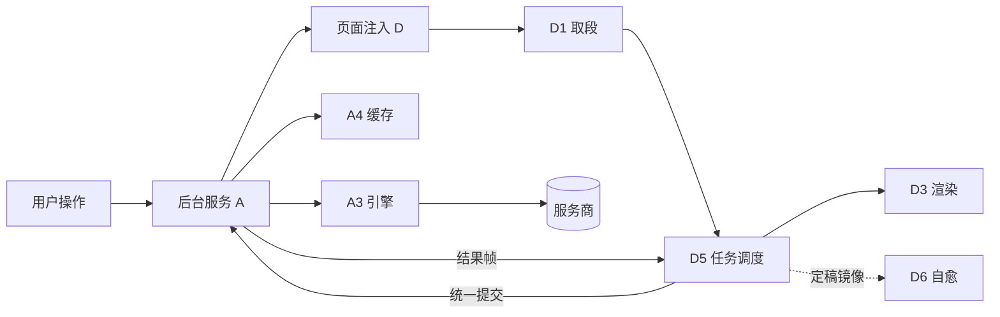

# SimpleTrans 项目架构

## 1. 文档说明与范围

本文是 SimpleTrans **结构设计的唯一来源**，只描述当前结构：项目由哪些模块组成、模块之间如何依赖与通信、配置与数据放在哪里、一次翻译怎么走、结构由哪些门禁守护、以及关键设计取舍。

本文只写结构与索引，**不复制代码事实**：

- 具体数值、默认值、枚举、报文、错误码、样式与边界情况，以源码和测试为准；模块文档只给代码位置与功能索引；
- 每个模块的代码位置与功能清单在 `docs/modules/` 的 A–E 文件中；
- 变更过程与旧方案由 Git 提交记录承担，本文不保留。

文档分工：

| 位置 | 是否入库 | 作用 |
| ---- | -------- | ---- |
| `docs/项目架构.md` | 入库 | 本文，结构设计唯一来源 |
| `docs/modules/` | 入库 | 模块级代码索引：A–E 五个文件，分别包含代码文件位置、模块描述与功能清单 |
| `docs/demand/`、`docs/bug/`、`docs/任务文档索引.md` | 不入库 | 本地过程文档，只在处理实现需求与缺陷时使用 |

使用约定：结构变更先改本文与模块文档，再改代码；本文与代码不一致时，以代码为当前事实，先修文档再继续改结构。协作流程与界面人工验收要求见 `AGENTS.md`。

## 2. 项目介绍

### 2.1 项目定位

SimpleTrans 是一个 Chrome 扩展（Manifest V3），把网页内容翻译成目标语言，并以**双语对照**方式显示：原文保留，译文内嵌在原文所属标签内部、原文之后。

它只提供两种翻译模式：

1. **整页翻译**：翻译当前页面里所有可翻译的文字宿主；首次提交当前视口附近的段落，滚动后增量提交新段落。
2. **悬停段落翻译**：鼠标停在某个文字宿主上按快捷键，只处理该宿主；按下时显示待翻译范围的虚线边框，按住期间可滚轮扩大到祖先文字宿主；已有标记或译文时再按一次隐藏。

两种模式共用同一套取段、提交与显示结构：提交后按段落 id 显示提交与翻译状态，结果全部来自后台帧——缓存命中直接回显，未命中由后台翻译队列按批返回（单段批可流式，多段批按段定稿）。

翻译引擎不限一家：既可以是传统机器翻译服务，也可以是 AI 大模型。用户可配置多个翻译实例并指定唯一的当前实例，整页与悬停使用同一套实例配置；弹窗快速翻译默认使用当前实例，也可临时改用其它实例，临时选择不写设置。不提供备用实例或自动切换，当前实例失败时只重试同一实例。

技术上：弹窗、设置页与翻译测试页用 Vite 构建；弹窗与设置页用 React + Tailwind + HyperUI 复制式组件（Application 为默认视觉，Neobrutalism 只用于设置页「关于」；组件类直接复制进项目，不安装、无运行时依赖），界面图标统一用 `lucide-react`；主题由 `settings.theme` 控制，通过根节点 `data-theme` 与 Tailwind `dark` 变体实现。AI 引擎统一走 OpenAI 兼容 Chat Completions，SSE 分帧用 `eventsource-parser`；传统接口用 `fetch`，签名用浏览器自带的加密接口。单元测试用 Vitest，`chrome` 由自写 stub 代替。具体依赖版本以 `package.json` 为准。

### 2.2 功能范围

| 功能 | 说明 |
| ---- | ---- |
| 整页翻译 | 找出整页可翻译的段落，批量翻译，译文逐段插入原文后面；顶层文档与可注入的子 frame 各自扫描与提交，弹窗显示汇总段数 |
| 悬停段落翻译 | 鼠标停在段落上，按设置中的悬停快捷键只提交该段；按下时显示虚线范围并可滚轮扩大到祖先文字宿主，松开后提交最终范围；已有标记或译文时再按隐藏；提交与显示结构与整页一致，指针在 iframe 内时同样生效 |
| 重渲染自动恢复 | 已翻译段落因页面重渲染丢失译文容器时，按会话内镜像自动恢复同一译文；原文变化不恢复、不重新提交；不产生网络请求 |
| 快捷键 | 悬停快捷键在设置页修改、刷新页面生效；整页快捷键使用 Chrome 扩展 `commands`，设置页显示当前值并可跳转浏览器快捷键页面 |
| 多实例 | 配置多个翻译实例（OpenAI 兼容 / 百度翻译），启用、停用、复制与管理；指定唯一的当前实例，整页、悬停与设置页测试共用同一套选择；弹窗快速翻译另有临时实例选择，不写设置 |
| 快速翻译 | 弹窗内输入或读取当前网页选中文字，用临时选择的实例与目标语言翻译，结果显示为可复制的纯文本；不写页面、不缓存、非流式 |
| 快速提示词 | 大模型实例的快速翻译使用独立提示词：单词按词典式排版返回音标行、按词性分行的目标语言释义与例句；句子与段落只返回译文 |
| 批量与流式 | 一次请求翻译多段；OpenAI 兼容实例可以边生成边显示，百度翻译一次返回整批（快速翻译与设置页测试为一次性非流式请求） |
| 失败处理 | 网络与限流错误在同一实例内重试；百度按实例 QPS 滑动窗口限速；批量对齐失败二分拆批；失败段可单段刷新 |
| 取消与清理 | 显示原文取消在途提交；标签页关闭兜底清理；后台回收重连后只续传未完成段一次 |
| 多语言 | 源语言支持自动识别与英文，目标语言支持中文、英文、日文与韩文；语言进入缓存 key，切换后不串用旧缓存；语言码映射见 `src/shared/languages.js` |
| 译文缓存 | 翻译过的段落按段缓存，再次遇到相同条件直接使用 |
| 每实例凭据 | 每个实例独立保存凭据：OpenAI API Key（无认证实例无需），百度 APPID 与密钥；凭据可以放本机或跟随账号同步 |
| 设置页测试 | 在设置页直接测试指定实例是否可用，显示结果、耗时、用量或字符数 |
| 统一日志 | 后台、弹窗、设置页、页面注入共用一套日志；浏览器四级加关闭，设置页可调；只输出控制台，不持久化 |
| 翻译测试页 | 扩展内固定英文内容页，从弹窗打开；页面自加载页面注入运行时，提供整页提交、滚动增量、悬停单段提交、清除与重渲染夹具，用于稳定的人工翻译测试 |

### 2.3 使用入口

| 入口 | 清单声明 | 作用 |
| ---- | -------- | ---- |
| 工具栏图标 | `action.default_popup` → `popup/index.html` | 打开弹窗：「默认」页查看翻译方式与密钥状态、快捷切换翻译方式，并可打开设置页或翻译测试页；「快速翻译」页输入或读取选区后用临时实例与目标语言翻译；打开时先显示哪一页由 `settings.popupDefaultTab` 决定 |
| 设置页 | `options_page` → `options/index.html` | 概览当前状态，管理翻译实例与当前实例、每实例凭据、两套提示词、语言与缓存开关、弹窗初始页、日志级别，测试翻译，清理缓存，查看版本与权限 |
| 翻译测试页 | 无清单声明；由弹窗打开 `testpage/index.html` | 固定英文内容的翻译夹具；页内操作条直接驱动页面任务 |
| 快捷键 | `commands` + 页面注入 | 悬停翻译由页面注入监听设置中的修饰键；整页翻译走清单命令 `translate-page`，用户可在 Chrome 扩展快捷键页面修改 |
| 页面内译文 | 由页面注入脚本插入 | 以双语对照方式显示译文 |

悬停快捷键由页面注入监听所选修饰键实现，设置项为 `settings.hoverShortcut`，页面刷新后读取生效；整页命令由 Chrome 的扩展快捷键页面管理，扩展只声明建议键、读取并显示当前值。Chrome 的 commands API 不支持裸修饰键，也不能用代码修改扩展快捷键，因此悬停只能在页面侧实现，整页只能提供跳转入口。

### 2.4 名词说明

| 名词 | 含义 |
| ---- | ---- |
| 段（段落） | 页面上一个可以独立翻译的文本块，例如一个 `<p>`、一个列表项、一个表格单元格 |
| 批 | 一次请求里发给引擎的多段文本 |
| 引擎 | 翻译服务的具体实现，例如 OpenAI 兼容接口、百度翻译 |
| 引擎实例 | 用户配置好的一个具体引擎；同一类型可以配多个实例（例如两个 DeepSeek 实例用不同模型） |
| 服务商 | 提供翻译接口的厂商，例如百度、DeepSeek |
| 翻译模式 | 只有两种：整页翻译、悬停段落翻译 |
| 状态容器 | 插入页面的 `<font>`，里面放提交状态与译文 |
| 页面注入 | 注入到网页里运行的扩展脚本，负责页面上的工作 |
| 源语言 / 目标语言 | 原文的语言 / 译文要翻译成的语言 |

## 3. 目录结构

### 3.1 源码目录

目录树是代码结构的唯一清单：**代码里有的文件必须在树里，树里的文件必须能指到模块**。

```text
.github/
  workflows/
    build-release.yml        CI：tag 自动发布与手动测试构建
  dependabot.yml             GitHub Actions 版本每周检查
public/
  manifest.json              扩展清单：入口、注入、权限
  icons/                     扩展图标：icon16.png / icon32.png / icon48.png / icon128.png；NOTICE.txt 随产物分发
src/
  background/                后台服务（A）
    index.js                 入口：监听器注册
    router.js                A1 消息路由
    commands.js              A1 快捷键入口
    context-menu.js          A1 右键菜单入口
    gateway.js               A2 请求网关
    quick.js                 A5 快速翻译：实例解析、提示词选择、调用 A3
  popup/                     工具栏弹窗（B）
    index.html
    main.jsx
    Popup.jsx                B1/B2 弹窗壳与默认页：标签栏、初始页、配置信息、单按钮整页操作与快捷键
    quick-translate.jsx      B3 快速翻译页：选区读取、临时实例与目标语言、结果与复制
    instance-option.js        B 实例选项：可用判断与下拉选项文案
    popup.css
    open-test-page.js        B2 打开 C6 测试页
  options/                   插件独立页面（C）/ 设置页
    index.html
    main.jsx
    Options.jsx              C1–C5 设置页壳：导航、哈希路由、全局状态、toast 与弹窗挂载
    lib.js                   设置页共享工具：消息、格式化、实例文案、测试页打开与浏览器快捷键跳转
    sections/
      overview.jsx           C1 概览：状态摘要、状态卡片、警告与快捷操作
      instances.jsx          C2/C3 翻译实例：列表、筛选与实例操作入口
      general.jsx            C1 通用设置：启用、语言、快捷键、密钥存储、缓存开关、弹窗初始页与日志
      test-translation.jsx   C4 测试翻译：实例选择、输入、结果与错误建议
      data-management.jsx    C5 数据管理：缓存占用、刷新、清空与存储说明
      about.jsx              C5 关于：版本、权限、隐私与诊断信息；Neobrutalism 组件
    components/
      instance-card.jsx      C2 实例卡片：类型/预设、状态徽标与操作
      instance-editor.jsx    C2 实例编辑弹窗：连接、认证、模型、参数、两套提示词与凭据
      create-instance.jsx    C2 新增实例对话框：类型/预设与名称
      confirm-dialog.jsx     通用对话框：确认、表单容器、焦点陷阱与 Esc 关闭
      empty-state.jsx       空状态：图标、说明与主操作
      toast.jsx             顶部提示：成功/失败与 aria-live
  testpage/                  插件独立页面（C）/ 翻译测试页
    index.html               固定英文内容与页内操作条
    main.js                  C6 测试页入口：加载 D 运行时、绑定操作条
    frame.html               内嵌 frame 夹具：独立文档，结构对照公告列表
    frame.js                 内嵌 frame 夹具入口：加载 D 运行时、绑定本 frame 操作条
    testpage.css             C6 测试页样式
  content/                   页面注入（D）
    index.js                 入口
    bridge.js                D4 与后台通信
    heal.js                  D6 译文自愈
    hover.js                 D2 悬停检测
    range.js                 D2 悬停范围预览
    task.js                  D5 任务调度
    dom/
      scanner.js             D1 段落提取
      renderer.js            D3 译文渲染
    content.css              译文样式
  shared/                    公共模块（E）
    protocol.js              E1 消息协议
    constants.js             公共数值（见 5.3）
    storage.js               E2 存储读写
    settings.js              E2 设置 schema、默认值、hoverShortcut 与 keyStorage
    shortcut.js              E6 快捷键：悬停修饰键归一/显示/平台映射与整页命令快捷键读取
    languages.js             语言目录：源/目标语言、显示名与百度语言码
    config/
      registry.js            E3 引擎类型目录（openai / baidu）、百度上限与实例校验
      openai.js              E3 OpenAI 兼容配置、DeepSeek 预设、校验与旧实例映射
      host-permission.js     E3 endpoint 主机匹配模式与权限检查
      instances.js           E3 实例模型 v2：CRUD、凭据、提示词、当前实例与迁移
    translate/
      adapter.js             A3 适配器契约（按类型分发 OpenAI / 百度）
      adapters/
        openai.js            A3 OpenAI 兼容适配器（请求、流式/非流式、错误与日志）
        baidu.js             A3 百度翻译适配器（签名、语言码、批量、错误映射与超时）
      openai-request.js      A3 OpenAI 请求构造（URL/认证/参数/messages）
      openai-stream.js       A3 OpenAI SSE 分帧与事件映射
      openai-response.js     A3 OpenAI 非流式响应、错误体与输出归一
      openai-errors.js       A3 OpenAI HTTP/流内错误映射与 TranslateError
      openai-profile.js      A3 OpenAI 缓存 profile 与主机权限契约
      prompt.js              A3 提示词模板、占位符展开与哈希
      batch.js               A3 批量编码与解析
      queue.js               A3 翻译队列（FIFO、并发、取消）
    cache/
      key.js                 A4 缓存 key
      store.js               A4 缓存读写与淘汰
    log/
      levels.js              E4 日志等级、阈值与设置页选项
      record.js              E4 记录、脱敏与格式化
      logger.js              E4 日志入口、级别过滤与全局异常
    ui/                      E5 共享展示组件：只用 HyperUI 与 Tailwind 类，不携带自定义 CSS
      button.jsx             E5 按钮：主/次/幽灵/危险/警告、尺寸与加载态
      toggle.jsx             E5 开关：HyperUI 轨道 + 滑块 + sr-only checkbox
      select.jsx             E5 单选下拉：HyperUI 触发器 + 面板；键盘、焦点与 ARIA
      notice.jsx             E5 提示条：HyperUI callout + 图标 + aria-live
      field.jsx              E5 表单字段：标签、帮助、错误与 aria-describedby
      status-badge.jsx       E5 状态徽标：图标 + 文字，不只靠颜色
    global.css               全局样式：Tailwind、data-theme dark 变体与基础页面颜色
scripts/
  build.mjs                  三模式构建
  smoke.mjs                  构建产物检查
  gen-icons.js               读取 icon-source.svg 生成 16/32/48/128 PNG
  icon-source.svg            扩展图标源文件（Lucide languages，ISC）
tests/
  unit/                      源码级测试，文件名与被测模块同名
    structure.test.js        文件头、依赖边界与 console 使用约定
    architecture.test.js     3.1 目录树与仓库一致性
    icons.test.js            图标 PNG 尺寸、签名与清单登记
    manifest.test.js         清单契约：content_scripts 覆盖所有 frame
    ui-style.test.js         HyperUI 样式契约：无旧组件库类、dark 变体与 Neobrutalism 隔离
  helpers/                   chrome stub 与加载助手
    chrome.js                chrome API stub：storage 三区与 onChanged、getManifest/getURL、事件与 Port、commands（含 getAll）、tabs、scripting、permissions、openOptionsPage
    load.js                  安装 stub 与动态导入
  component/                 组件测试（jsdom + react-dom/client）
    popup.test.jsx           B1/B2 弹窗信息、降级与设置入口
    popup-quick.test.jsx     B3 快速翻译页：选区、临时实例/语言与结果
    options.test.jsx         C 设置页壳：导航、概览、数据与关于
    options-instances.test.jsx C 实例列表、卡片、筛选与实例操作
    options-editor.test.jsx  C 实例编辑弹窗：字段、校验、保存与域名授权
    options-general.test.jsx C 通用设置即时保存、回滚与密钥存储切换
    options-test.test.jsx    C 测试翻译结果、错误与字符上限
    select.test.jsx          E5 单选下拉：展开、选择、键盘、ARIA 与状态
    button-toggle.test.jsx   E5 按钮与开关：变体、加载/禁用与可访问名称
vitest.config.js             单元测试与组件测试配置
vite.config.js               构建配置
dist/                        构建产物，加载到 Chrome 的目录（不提交）
```

`src/` 下不再有其它文件；新增文件先改这棵树。组件测试按文件声明 jsdom 环境。

### 3.2 构建产物

页面注入脚本不能用 ES Module，弹窗、设置页与翻译测试页是普通网页，后台可以用 ES Module。一次构建只能给一种格式，所以 `scripts/build.mjs` 分三次调用：

| 模式 | 产物 | 格式 | 说明 |
| ---- | ---- | ---- | ---- |
| `web` | `popup/`、`options/`、`testpage/` 与 `assets/` | ESM + HTML | React 页面与静态测试页 |
| `background` | `background.js` | ESM 单文件 | Service Worker |
| `content` | `content.js`、`content.css` | IIFE 单文件 + 固定名 CSS | 全部依赖内联 |

`testpage/` 是静态 HTML；它的入口脚本静态导入 D 入口，构建时把 D 的运行时模块、其引用的公共纯模块（如 E1、E4）与 `content.css` 内联进 web 产物，以便扩展页面自行驱动页面任务。它不经过 `content.js` 的 IIFE 打包与清单注入。`testpage/frame.html` 是内嵌 frame 夹具，同样自行加载 D 入口，用来验证 iframe 文档内的取段、提交与渲染。

由此产生两条约束：

- 页面注入可以引用 `shared/` 里的纯模块，构建时会内联进单文件；不能使用动态 `import()`。E4 日志也属于这类纯模块，`shared/log/` 不得引用 `chrome.storage`，也不得包含密钥、鉴权头或服务商域名。
- 页面注入的产物里不能出现翻译服务的地址、密钥字段名、签名代码；构建后由 `scripts/smoke.mjs` 检查。

命令：`npm run dev` 并行监听三种产物，`npm run build` 生产构建，`npm run smoke` 检查产物，`npm test` 跑单元测试，`npm run gate` 串联 test → build → smoke。

发布产物由 `.github/workflows/build-release.yml` 在 `npm run gate` 通过后生成：

| 产物 | 内容 | 用途 |
| ---- | ---- | ---- |
| `SimpleTrans-vX.Y.Z.zip` | `dist/` 全部内容，`manifest.json` 位于 zip 根目录 | Release 附件；解压后供 Chrome「加载已解压的扩展程序」 |
| `SimpleTrans-vX.Y.Z.zip.sha256` | 上述 zip 的校验和 | 下载完整性校验 |

版本约束：tag 去掉前缀 `v` 后，必须与 `package.json` 和 `public/manifest.json` 的 `version` 一致；手动构建不校验 tag，只校验两处 `version` 一致。

### 3.3 文档目录

| 位置 | 类别 | 放什么 |
| ---- | ---- | ------ |
| `docs/项目架构.md` | 入库文档 | 本文，结构设计唯一来源 |
| `docs/modules/A-后台服务.md`、`B-工具栏弹窗.md`、`C-插件独立页面.md`、`D-页面注入.md`、`E-公共模块.md` | 入库文档 | 模块级代码索引：代码文件位置、模块描述、功能清单 |
| `docs/demand/` | 本地过程文档 | 实现需求文档，按 `YYYYMMDD-序号-文档名.md` 命名，不入库 |
| `docs/bug/` | 本地过程文档 | 缺陷文档，命名同上，不入库 |
| `docs/任务文档索引.md` | 本地过程文档 | 实现需求与缺陷的索引，不入库 |

入库文档随代码同步更新；本地过程文档只在本机维护、不提交，也不作为本文的引用目标。

### 3.4 源码文件约定

1. 每个源码文件以文件头注释开头，声明模块、职责与依赖；结构测试锁定「模块：」与「职责：」两行，并禁止出现「实现阶段」。
2. 依赖方向按 5.1 执行：`content/` 不得引用 `shared/config/`、`shared/translate/`、`shared/cache/`；弹窗与设置页不引用引擎、缓存与第三方 SDK；`src/` 不得引用 `tests/`。
3. 只有 E4 日志模块直接调用 `console.*`，其余源码经 E4 输出，由结构测试锁定。
4. `src/` 不保留空文件与占位文件；文件必须在 3.1 目录树中，否则 `tests/unit/architecture.test.js` 失败。新增行为时同批补 `tests/unit/` 下的同名测试，并在 `docs/modules/` 登记代码位置与功能。

## 4. 模块划分

### 4.1 分层与总览

模块分三层：上层是运行位置（浏览器功能模块），中层是业务模块，下层是具体功能（实际动作，例如发送请求、保存配置、处理 DOM）。

| 运行位置 | 承载模块 | 说明 |
| -------- | -------- | ---- |
| 后台服务（A） | A1–A5 | Service Worker，处理消息、请求、缓存与配置，不接触页面 DOM |
| 工具栏弹窗（B） | B1–B3 | 打开即读状态、下发命令；不持有任务 |
| 插件独立页面（C） | C1–C6 | 设置页负责全部配置与测试；翻译测试页只提供夹具与页内操作 |
| 页面注入（D） | D1–D6 | 在网页内运行，负责取段、悬停、调度、渲染、通信与自愈 |
| 公共模块（E） | E1–E6 | 被多处引用的纯模块与共享组件，不单独运行 |

编号规则：浏览器功能模块用 A、B、C、D，公共模块用 E；业务模块用「部分编号 + 序号」，例如 A2、D3。

归属约定：

- A3 翻译引擎与 A4 翻译缓存的源码放在 `src/shared/` 下，构建时被后台引用；它们只被后台使用，因此归在后台服务。
- E4 是四个运行部分共用的日志入口，只输出控制台，不写存储、不上报。
- E5 只被弹窗与设置页引用，只组合 HyperUI 与 Tailwind 类，不进入 content 产物。
- E6 的纯函数可进入 content 产物；读取浏览器命令快捷键的函数只在弹窗与设置页调用。
- 任务调度不是模块，它把取段、提交、渲染与清除串起来，属于流程机制，见第 6 章。

### 4.2 模块总表

| 编号 | 模块 | 职责（一句话） | 源码（目录/主文件） | 模块文档 |
| ---- | ---- | -------------- | ------------------- | -------- |
| A1 | 消息路由 | 把弹窗与设置页消息、快捷键和右键菜单入口送到目标标签页各 frame，接收页面提交并转交 A2，转发悬停手势与选区读取 | `background/router.js`、`commands.js`、`context-menu.js`、`index.js` | [A1](./modules/A-后台服务.md#a1-消息路由) |
| A2 | 请求网关 | 按实例完成缓存预取、唯一 key 分组、切批与结果回帧，并管理连接、取消、超时与清理 | `background/gateway.js`（提交入口在 `router.js`） | [A2](./modules/A-后台服务.md#a2-请求网关) |
| A3 | 翻译引擎 | 按实例类型构造请求、解析流式与非流式响应、编码批量与映射错误，并在队列中按并发执行 | `shared/translate/`（`adapter.js`、`adapters/`、`queue.js` 等） | [A3](./modules/A-后台服务.md#a3-翻译引擎) |
| A4 | 翻译缓存 | 以段落级 key 读写 IndexedDB 缓存，负责容量与条数淘汰、统计与清空 | `shared/cache/key.js`、`store.js` | [A4](./modules/A-后台服务.md#a4-翻译缓存) |
| A5 | 快速翻译 | 解析临时或当前实例与快速提示词，调用 A3 返回一次性纯文本结果 | `background/quick.js` | [A5](./modules/A-后台服务.md#a5-快速翻译) |
| B1 | 状态显示 | 弹窗壳、标签栏、初始页与翻译方式、实例、密钥状态展示 | `popup/Popup.jsx`、`popup.css` | [B1](./modules/B-工具栏弹窗.md#b1-状态显示) |
| B2 | 命令下发 | 把弹窗整页操作转成后台命令，并按页面会话状态切换按钮与提示 | `popup/Popup.jsx`、`open-test-page.js` | [B2](./modules/B-工具栏弹窗.md#b2-命令下发) |
| B3 | 快速翻译页 | 弹窗内读取选区或输入文本，用临时实例与目标语言翻译并展示可复制结果 | `popup/quick-translate.jsx`、`instance-option.js` | [B3](./modules/B-工具栏弹窗.md#b3-快速翻译页) |
| C1 | 概览与通用设置 | 设置页壳层与概览告警，以及与引擎无关的通用选项 | `options/Options.jsx`、`sections/overview.jsx`、`sections/general.jsx`、`lib.js` | [C1](./modules/C-插件独立页面.md#c1-概览与通用设置) |
| C2 | 引擎管理 | 翻译实例的新增、编辑、复制、启停、删除与筛选 | `options/sections/instances.jsx`、`components/instance-*.jsx`、`create-instance.jsx` | [C2](./modules/C-插件独立页面.md#c2-引擎管理) |
| C3 | 当前实例 | 从可用实例中指定唯一的当前实例，并在停用、删除或凭据变化时改选 | `options/sections/instances.jsx`、`shared/config/instances.js` | [C3](./modules/C-插件独立页面.md#c3-当前实例) |
| C4 | 测试翻译 | 用已保存实例试翻一段文本，展示译文、实例信息、耗时与用量或字符数 | `options/sections/test-translation.jsx` | [C4](./modules/C-插件独立页面.md#c4-测试翻译) |
| C5 | 数据管理与关于 | 缓存占用、刷新与清空，以及版本、权限、隐私与诊断信息 | `options/sections/data-management.jsx`、`about.jsx` | [C5](./modules/C-插件独立页面.md#c5-数据管理与关于) |
| C6 | 翻译测试页 | 固定英文夹具与页内操作，供人工验证整页、滚动、悬停、清除与重渲染恢复 | `testpage/index.html`、`main.js`、`frame.html`、`frame.js`、`testpage.css` | [C6](./modules/C-插件独立页面.md#c6-翻译测试页) |
| D1 | 段落提取 | 找出可翻译的文字宿主，分配段落 id，判定块级与行内并跳过不可译内容 | `content/dom/scanner.js` | [D1](./modules/D-页面注入.md#d1-段落提取) |
| D2 | 悬停检测 | 记录指针所在的文字宿主，在按住快捷键期间展示待翻译范围并支持滚轮扩大到祖先宿主，跨 frame 广播范围开始与取消 | `content/hover.js`、`content/range.js`、`content/index.js` | [D2](./modules/D-页面注入.md#d2-悬停检测) |
| D3 | 译文渲染 | 在原文末尾内嵌状态与译文容器，负责更新、隐藏、清除与失败刷新入口 | `content/dom/renderer.js`、`content/content.css` | [D3](./modules/D-页面注入.md#d3-译文渲染) |
| D4 | 与后台通信 | 维持与后台的长连接，接收配置帧与结果帧并交给 D5 | `content/bridge.js` | [D4](./modules/D-页面注入.md#d4-与后台通信) |
| D5 | 任务调度 | 把取段、统一提交、结果回显、滚动增量、重试与清除串成页面会话 | `content/task.js`、`content/index.js` | [D5](./modules/D-页面注入.md#d5-任务调度) |
| D6 | 译文自愈 | 页面重渲染后按会话内镜像恢复原文未变的定稿译文 | `content/heal.js`、`content/index.js` | [D6](./modules/D-页面注入.md#d6-译文自愈) |
| E1 | 消息协议 | 定义消息类型、端口、错误分类、载荷校验与域名归一 | `shared/protocol.js` | [E1](./modules/E-公共模块.md#e1-消息协议) |
| E2 | 设置与存储 | 设置 schema、默认值、归一规则与三个存储区的读写 | `shared/storage.js`、`settings.js`、`languages.js` | [E2](./modules/E-公共模块.md#e2-设置与存储) |
| E3 | 翻译配置与密钥 | 引擎类型目录、实例 CRUD、当前实例、凭据与提示词、配置校验与迁移 | `shared/config/registry.js`、`openai.js`、`instances.js`、`host-permission.js` | [E3](./modules/E-公共模块.md#e3-翻译配置与密钥) |
| E4 | 日志输出 | 统一日志入口、级别过滤、记录结构、截断与脱敏 | `shared/log/`（`levels.js`、`record.js`、`logger.js`） | [E4](./modules/E-公共模块.md#e4-日志输出) |
| E5 | 共享展示组件 | 弹窗与设置页共用的 HyperUI 展示组件 | `shared/ui/`（按钮、开关、下拉、提示、字段、徽标） | [E5](./modules/E-公共模块.md#e5-共享展示组件) |
| E6 | 快捷键 | 悬停快捷键的归一、显示与平台映射，以及整页命令快捷键读取 | `shared/shortcut.js` | [E6](./modules/E-公共模块.md#e6-快捷键) |

表中源码路径省略 `src/` 前缀；各模块的功能级代码定位见 `docs/modules/` 中对应 A–E 文件。

## 5. 协作机制

### 5.1 依赖规则

**方向**：四个运行部分只能依赖公共模块和自己的内部业务模块；公共模块不反向依赖它们。唯一例外是 C6 翻译测试页，它可以依赖 D 入口。

| 部分 | 可以依赖 |
| ---- | -------- |
| 后台服务（A） | A3、A4、A5、E1、E2、E3、E4、E6 |
| 工具栏弹窗（B） | E1、E2（公开设置）、E4、E5、E6、`constants.js` |
| 插件独立页面（C） | E1、E2、E3、E4、E5、E6、`constants.js`；设置页另用 `chrome.permissions`；C6 另可依赖 D 入口 |
| 页面注入（D） | E1、E4、E6、`constants.js` 与 D 内部模块 |
| 公共模块（E） | E3 依赖 E2 与 E1；E2 依赖 E1、`languages.js` 与 E6；E4 不依赖 E2 与存储；E5 只依赖 React、`lucide-react` 与 Tailwind 类；E6 无依赖；E 不依赖 A/B/C/D |
| 测试（`tests/`） | `src/`、Node 内置模块、Vitest；不依赖浏览器与网络 |

**硬性规则**

1. 禁止循环依赖；同一模块内部的文件可以互相引用。
2. 页面注入不使用 `chrome.storage`：设置与密钥不进入页面；页面任务只在内存，只通过 `chrome.runtime` 的消息与长连接同后台通信。
3. content 产物中不能出现翻译服务域名、密钥字段名与签名代码；构建后检查，出现即失败。
4. 新增模块或新增依赖关系，先改本文，再改代码。
5. `src/` 不得引用 `tests/`；测试文件不进构建产物，测试不加载真实扩展，`chrome` 一律由 stub 代替，冒烟脚本复用同一份 stub。
6. **C6 是唯一依赖 D 的独立页面**：只有 `src/testpage/` 可以静态导入 `content/index.js`；它不经过清单注入，也不改变普通网页的注入路径。
7. **日志只输出控制台**：`shared/log/` 不读写 `chrome.storage`、不经消息传输日志记录、不落盘、不上报；页面注入只通过连接建立时的配置帧取得级别与内容配置。
8. **日志不含敏感内容**：不记录密钥、请求头/体、页面正文与完整 URL，只记录来源域名、事件名、错误摘要、计数、必要标识符与耗时。
9. **流式解析与签名依赖只在后台**：`eventsource-parser` 与 MD5 库只被 A3 引用，随 background 产物打包，content 产物不得出现。
10. **共享展示层只给页面用**：`shared/ui/` 只允许弹窗与设置页引用，content 产物不得引用 E5，也不得引入 React 组件。

### 5.2 通信方式

| 方式 | 参与方 | 用途 | 边界 |
| ---- | ------ | ---- | ---- |
| 一次性消息 | 弹窗、设置页 ↔ 后台；后台 → 页面注入 | 命令、查询、一次性结果 | 没有流式；后台被回收时可能失败 |
| 一次性提交 | 页面注入 → 后台 | 整页与悬停单段统一提交，校验后按 `tabId + frameId` 转交 A2，提交创建即回执 | 回执不含译文，结果经该 frame 的长连接返回 |
| 长连接 `st-gateway` | 每个 frame 的页面注入 ↔ 后台 | 连接配置下发、页面提交的结果帧与数据面批次 | 每 frame 一条；同一 frame 重连才替换；需要心跳与重连 |
| 范围广播 | 页面注入 → 后台 → 全部 frame | 悬停范围预览的开始与取消 | 只含阶段，不含坐标、文本或宿主；滚轮调整在持有指针的 frame 内完成 |
| 连接配置下发 | 后台 → 页面注入 | 连接建立后同步日志级别与内容配置 | 页面只应用第一帧；刷新或重连后重新下发 |

选择规则：只需要一个结果用一次性消息；需要多次回包用长连接。悬停单段与整页走同一个提交消息（用范围字段区分），失败段刷新复用同一条提交而不新增消息。消息名、方向与载荷校验见 `src/shared/protocol.js`。

设置页的实例新增、编辑、删除、凭据写入、当前实例切换与密钥存放位置迁移直接调用 E3 的 CRUD 函数（设置页本身是这些数据的写入方），不走消息；只有引擎列表、测试翻译、缓存占用与清空走一次性消息。实例写入后重新拉取公开字段，不在页面本地合并。弹窗快速翻译的实例与目标语言随请求载荷一次性传入，不经过设置页，也不写设置。

### 5.3 配置索引

本文与模块文档只给配置所在位置，不复制值：

| 配置类别 | 代码位置 |
| -------- | -------- |
| 数值类：超时、上限、节流、重试退避、视口范围 | `src/shared/constants.js` |
| 消息名、端口名、错误码、失败原因、载荷校验、域名归一 | `src/shared/protocol.js` |
| 设置 schema、默认值、归一（主题、弹窗初始页、密钥存放、悬停快捷键） | `src/shared/settings.js` |
| 存储区读写 | `src/shared/storage.js` |
| 语言目录与各服务商语言码 | `src/shared/languages.js` |
| 引擎类型、预设、字段默认值与实例校验 | `src/shared/config/registry.js`、`openai.js` |
| 实例模型、当前实例、凭据、提示词与配置迁移 | `src/shared/config/instances.js` |
| endpoint 主机匹配与权限检查 | `src/shared/config/host-permission.js` |
| 缓存 key 与缓存 profile | `src/shared/cache/key.js` |
| 缓存读写、淘汰、统计与清空 | `src/shared/cache/store.js` |
| 日志级别、记录结构、截断与脱敏 | `src/shared/log/` |
| 悬停快捷键枚举与整页命令名 | `src/shared/shortcut.js` |
| 提示词模板、占位符与输出格式 | `src/shared/translate/prompt.js` |
| 清单：入口、注入、权限、图标 | `public/manifest.json` |
| 译文样式 | `src/content/content.css`；全局样式与主题变量 `src/shared/global.css` |
| 构建模式与产物路径 | `scripts/build.mjs` |
| 版本号 | `package.json` 与 `public/manifest.json` |

规则：改行为改上述文件；新增可调数值先加到 `constants.js` 或对应模块常量，再在模块文档登记功能位置；本文不出现具体数值，避免文档与代码各说一套。

### 5.4 数据归属

| 数据 | 位置 | 写入方 | 读取方 |
| ---- | ---- | ------ | ------ |
| 普通设置（启用、语言、快捷键、密钥存放、缓存开关、日志级别、当前实例、弹窗初始页、主题） | `storage.sync` | 设置页；弹窗只写当前实例的快捷切换 | 弹窗、后台、设置页；页面注入经连接配置 |
| 引擎实例公共字段与类型配置 | `storage.sync` 的实例集合 | 设置页经 E3 | 后台、设置页；弹窗只经公开字段消息 |
| 每实例凭据 | `storage.local` 或 `storage.sync`（按密钥存放设置） | 设置页经 E3 | 仅后台读明文；设置页只读字段级布尔 |
| 每实例提示词 | `storage.local` | 设置页经 E3 | 后台、设置页 |
| 译文缓存 | 扩展自己的 IndexedDB | 后台 | 后台；设置页经消息查看与清空 |
| 自定义端点主机授权 | Chrome 扩展权限 | 设置页在用户手势中申请 | 后台发送前检查 |
| 页面标记与译文 | 页面 DOM | D3 | D3 |
| 页面会话数据（提交记录、段落注册表、段落 id 集合） | 页面注入内存 | D5 | D5 |
| 页面译文镜像（原文 → 译文、隐藏集合、抖动计数） | 页面注入内存 | D6 | D6 |
| 快速翻译会话（实例、目标语言、输入、结果） | 弹窗内存 | 弹窗 | 弹窗 |
| 网页选中文字 | 页面选区，只读 | — | 弹窗经后台读取 |
| 限流门控状态（每实例滑动窗口与等待链） | 后台内存 | A2 | A2 |

规则：

- 同一份数据只有一个写入方，其他模块通过消息请求；唯一例外是「当前实例」：弹窗快捷切换、设置页与 E3 改选写同一个字段。
- 密钥只有后台读；弹窗与设置页只知道是否已配置（无认证实例显示无需密钥）。
- 页面注入不缓存译文，缓存只有一份且在后台；缓存只存译文与来源域名，不存原文、密钥与完整页面 URL。
- 页面任务不写状态镜像；弹窗只显示翻译方式与实例公开信息，不展示任务进度。
- 日志不持久化，页面刷新或关闭即丢失；问题反馈直接复制对应控制台输出。

### 5.5 安全边界

1. **只接受扩展内部消息**：后台校验发送方是扩展自身，不接收外部消息，长连接端口名固定。
2. **后台不接受地址与请求头**：批次只能给引擎实例，不能给 URL、Header 或请求体模板；自定义接口地址只能来自用户设置。
3. **密钥不出后台**：content 产物里没有密钥字段、服务商地址、签名代码与提示词键前缀；设置页只显示是否已配置；日志与错误信息不出现密钥、请求头/体、页面正文与完整 URL。
4. **页面文本当作数据**：系统提示声明片段是数据不是指令；译文只按文本写入 DOM；不给模型工具调用能力。
5. **上限防滥用**：段长、批长与连接在途批次都有上限，超限直接拒绝。
6. **同步密钥要提醒**：密钥跟随账号同步时设置页必须说明会经过云端。
7. **自定义端点受限**：只允许 HTTPS 或本地回环 HTTP，拒绝 URL 账号密码、查询串与片段，不跟随重定向，发送前检查主机权限，未授权时按配置错误失败。
8. **密钥只走认证字段**：认证方式限定在预设的几种之内；静态 query 与 header 不允许放密钥，且不能覆盖认证与内容相关请求头。
9. **主机权限只由设置页在用户手势中逐个申请**：申请前显示域名，拒绝后实例可保存但标记未授权；权限状态不写入实例配置，只实时查询。
10. **百度签名只在本机后台计算**：盐值每次随机；上游原始错误报文不透传页面。
11. **选区只读**：后台只读当前活动标签页的选区，不写 DOM、不持久化，日志只记长度与来源域名。
12. **快速翻译不写页面、不进缓存**：只返回译文本，不向页面写标记、不注册提交；提示词正文只进入设置页与弹窗内存。
13. **译文镜像只在页面内存**：不写存储、不上报、不导出，日志只记计数与原因。

## 6. 业务流程

### 6.1 流程总览



| 流程 | 触发 | 边界与主要模块 |
| ---- | ---- | -------------- |
| 整页翻译 | 弹窗「翻译整页」或整页快捷键 | A1 定位标签页并按 frame 下发；D1 取段；D5 提交；A2 缓存与切批；A3/A4 执行；D3 渲染 |
| 悬停单段 | 悬停快捷键 | D2 定段并展示范围，滚轮可扩大到祖先宿主；D5 走同一条提交（单段范围）；结果回显同整页 |
| 快速翻译 | 弹窗快速页提交 | B3 采集；A1 校验；A5 解析实例与提示词；A3 执行；不写页面与缓存 |
| 译文自愈 | 页面重渲染删除容器 | D6 命中镜像后调 D5 重挂；不产生网络请求 |
| 显示原文 | 弹窗「显示原文」 | A1 广播清除；D5 先取消在途提交再清 DOM 与会话 |
| 实例改选 | 新建、停用、删除、清凭据 | C3 与 E3 一次写入；A2 在下一次提交时读取 |
| 缓存与失败恢复 | 每次提交与错误回包 | A2 预取、分组、拆批与重试；D5 单段刷新或重连续传 |
| 配置保存与迁移 | 设置页保存、扩展升级 | C 表单校验；E3 写入与迁移；失败回滚 |

### 6.2 整页翻译与滚动增量

1. **触发**：B2 发命令消息，A1 确定活动标签页，按该标签页已连接的 frame 逐个下发开始命令；没有连接时先补注入再按返回的 frame 重发。开始、清除与状态查询的逐 frame 响应由 A1 汇总成一份（段数相加、清除数相加、任一 frame 开启即视为会话开启）。
2. **取段**：每个 frame 内 D1 按文档顺序枚举当前视口附近的可译宿主，分配页面内唯一段落 id。
3. **提交**：D5 组装一次统一提交（整页范围），A1 做形状校验后按 `tabId + frameId` 转交 A2；提交创建即回执，不等译文。
4. **分发**：A2 读取实例与凭据，计算缓存 key 并一次批量预取；命中项立即回显，未命中项按唯一 key 分组、按实例参数切批后交给 A3 队列。
5. **回传**：A3 按批执行，每段结果交回 A2；A2 按段写缓存并回发结果帧，整批结束再发终态帧。
6. **回显与增量**：D5 按提交与段落 id 把结果帧交给 D3 渲染；首次提交成功后监听滚动，只补交尚未提交过的新段落。

边界：页面不分批、不去重、不排队；任务状态只在页面内存；弹窗只读取「整页会话是否开启」这一个布尔值，不展示进度。

### 6.3 悬停单段

- **触发**：D2 已记录指针所在宿主，E6 解析设置中的悬停修饰键；按下时显示待翻译范围的虚线边框，按住期间滚轮按祖先链扩大或缩小，松开后由 D5 走同一条提交（单段范围）。
- **范围**：范围始终是一个文字宿主，候选按 D1 现有段落规则向上取父元素；祖先含块级子元素时停止，不合并多段。
- **跨 frame**：手势 frame 没有指针宿主时，A1 向来源标签页全部 frame 广播范围开始，由持有指针的 frame 显示边框；滚轮事件天然落在该 frame 并本地调整；松开时复用悬停触发广播，只有持有范围会话的 frame 使用最终宿主。
- **回显**：与整页共用结果帧与渲染；已定稿或失败的段落再按一次只移除该段标记，翻译中与流式中忽略重复触发。
- **边界**：不启动滚动监听，不进入页面会话状态机；不占页面会话名额。

### 6.4 快速翻译

- **触发**：B3 读取选区或接收输入，选择临时实例与目标语言后提交；首次进入快速页时自动读取一次选区，之后可用按钮重新读取。
- **校验与分发**：A1 校验参数与禁止字段后交给 A5；A5 解析实例（未指定时回退当前实例），OpenAI 兼容实例取该实例的快速提示词，百度实例不使用提示词。
- **执行**：A5 复用 A2 的上游并发名额与实例并发上限调用 A3，一次性返回译文、耗时、用量与字符数。
- **边界**：不读缓存、不注册提交、不写页面 DOM、不流式、不写设置；关闭弹窗即丢失。
- **选区**：后台只读当前活动标签页的选区，页面不可注入或没有选中文字时返回空文本，弹窗不报错且仍可手动输入。

### 6.5 缓存、失败与清理

- **缓存预取**：提交进入 A2 后先按实例与引擎类型计算 key，一次批量读取；命中直接回显，不占上游名额、不写缓存。
- **key 维度**：引擎类型、endpoint 指纹、模型、语言、提示词版本与哈希、生成参数哈希、批量编码版本与原文；批次与并发参数不进入 key，来源域名只作缓存元数据。
- **失败处理**：网络与限流错误在同一实例内重试；批量结果与输入对不上时按二分拆批直到单段，已解析段保留；失败段只影响该段，页面提供「刷新」单段重发。
- **取消与清理**：显示原文先取消未结束的提交，再清 DOM 与会话；标签页关闭由后台按 `tabId` 兜底清理连接、提交与在途订阅。
- **后台回收**：页面会话状态仍在页面内存；长连接重连后只续传未完成段一次，不循环自动续传。
- **缓存维护**：容量超限按最近访问时间分批淘汰，设置页可查看占用并清空；清空后旧批次尚未完成的写入被跳过。

### 6.6 译文显示与自愈

- **显示**：D3 在宿主末尾内嵌状态容器，状态依次为正在提交、已提交、翻译中、流式、定稿与失败；块级宿主另起一行，行内宿主以空格分隔，颜色与字体随宿主。
- **结果来源**：页面不生成译文；缓存命中直接定稿，单段批可流式，多段批按段解析完成即定稿。
- **失败入口**：失败态在同一容器内追加可用键盘操作的「刷新」，只重发当前段，不触发宿主的按钮或链接。
- **自愈**：D5 把定稿写入 D6 的会话内镜像；页面重渲染导致容器丢失时，D6 观察 DOM 变更、按归一化原文命中镜像后重挂定稿，不出现中间态，也不发请求。
- **边界**：原文变化的段落只移除旧容器并注销，不恢复、不重新提交；用户隐藏的、翻译中、流式与失败的段落不参与恢复；清空或隐藏只移除标记，原文不动。

## 7. 测试与门禁

### 7.1 分层与边界

| 层 | 位置 | 工具 | 覆盖对象 | 是否阻断交付 |
| -- | ---- | ---- | -------- | ------------ |
| L1 产物契约 | `scripts/smoke.mjs` | Node 脚本 + 构建产物 | 产物格式、注入兜底、页面产物不含密钥与服务商地址 | 是 |
| L2 单元与组件 | `tests/` | Vitest | 源码模块、消息协议、已注册的监听器、组件行为 | 是 |
| L3 真浏览器 | 未引入 | Playwright（未接入） | 扩展加载、注入时机、页面渲染 | 否，由人工验收覆盖 |

1. 单元测试不接触真实 `chrome`、不联网、不读写真实存储；`chrome` 一律由 stub 代替。
2. 测试通过不是验收结论：任何可见界面变化仍按 `AGENTS.md` 的人工审核规范执行，测试只说明代码没有退步。

### 7.2 技术选型

| 项 | 选择 | 原因 |
| -- | ---- | ---- |
| 测试框架 | Vitest | 与 Vite 同源，复用同一套 ESM/JSX 解析与配置 |
| 默认环境 | Node | 纯逻辑测试不需要 DOM，启动最快 |
| DOM 环境 | jsdom | 按文件单独声明，默认仍是 Node |
| 组件测试 | `react-dom/client` + React `act` | 按用户可见行为断言，不引入额外渲染库 |
| `chrome` API | 自写 stub（`tests/helpers/chrome.js`） | 只实现本项目用到的语义，可控且不随 Chrome 版本漂移 |
| IndexedDB | `fake-indexeddb`（开发依赖） | Node 没有 IndexedDB，需要事务、索引与游标语义，不进构建产物 |
| 覆盖率 | 只报告，不设阈值 | 阈值会诱导写脆弱测试；高风险面由行为测试锁定 |

### 7.3 目录与依赖规则

```text
tests/
  unit/           源码级测试，文件名与被测模块同名
  component/      组件测试（jsdom + react-dom/client）
  helpers/        chrome stub、动态导入助手与测试夹具
vitest.config.js
```

1. 一个测试文件对应一个被测模块，文件名与被测文件同名，失败时可直接定位到模块。
2. `tests/` 只依赖 `src/`、Node 内置模块与 Vitest；`src/` 不得引用 `tests/`；冒烟脚本与单测共用同一份 chrome stub，避免两份 stub 各自漂移。
3. 测试不进构建产物：三个构建模式的入口都不含 `tests/`。
4. 新增模块或修改模块行为时同批补测试；没有测试的新模块不进入人工验收。

### 7.4 chrome stub 的语义要求

stub 必须按真实语义实现，否则测试只会给出错误的信心：

| API | 必须实现的语义 |
| --- | -------------- |
| `runtime.onMessage` / `runtime.connect` + Port | 监听器增删与触发；返回 `true` 表示异步回包；`connect` 触发 `onConnect`，Port 含 `id`、`name`、`onMessage`、`onDisconnect`，断开时清理在途请求 |
| `storage.<area>.get` / `set` / `remove` / `clear` | 支持单键、键数组与带默认值的对象三种入参；三个区域互不共享数据 |
| `storage.onChanged` | 增删监听与触发，变更后按区域发出含 `oldValue` / `newValue` 的 `changes` |
| `runtime.getManifest` / `runtime.getURL` | 返回含版本号的清单对象与扩展页 URL，供日志横幅与异常来源过滤 |
| `tabs.query` / `tabs.sendMessage` / `tabs.onRemoved` | 返回可配置的活动标签页；目标页没有监听器时抛错；触发标签页关闭清理 |
| `scripting.insertCSS` / `executeScript` | 记录调用顺序，用于断言先样式后脚本；`executeScript` 可配置返回结果，供读取选区用例 |
| `commands.onCommand` / `commands.getAll` | 命令事件触发；返回可配置的命令数组，可注入读取失败 |
| `permissions.contains` / `request` / `remove` | 可配置已授权 origin 集合、申请结果与异常，记录调用顺序，供实例资格与 endpoint 权限测试 |

### 7.5 编写约定

1. 入口模块（注册监听器的后台与页面注入入口）先安装 stub，再 `vi.resetModules()` 后动态 `import`。
2. 存储用内存实现，断言最终状态，不 mock 读写行为。
3. 涉及轮询与节流的用例用假定时器推进，不真等。
4. 页面注入入口的 CSS 导入按空模块处理，不开启真实样式加载。
5. 测试之间不共享全局状态，不依赖执行顺序；日志测试用 spy 替换 `console` 方法，断言等级与内容，不依赖颜色、时间戳精度或多行格式。

### 7.6 门禁

```text
npm test        # 单元与组件测试，先跑
npm run build   # 三模式构建
npm run smoke   # 产物契约
npm run gate    # 依次串联以上三步
```

顺序固定：单元测试 → 构建 → 冒烟；任一步失败即阻断，不进入人工验收。CI 在 tag 发布与手动测试构建时执行同一条门禁，通过后额外校验版本、打包并生成校验和；tag 运行再创建 Release。

### 7.7 结构测试与架构测试

| 测试 | 锁定内容 |
| ---- | -------- |
| `tests/unit/structure.test.js` | 每个源码文件头含「模块：」与「职责：」，且不含「实现阶段」；`src/` 不引用 `tests/`；页面注入不引用配置、引擎与缓存模块；弹窗与设置页不引用引擎、缓存与第三方 SDK；除 E4 外不直接使用 `console`；`shared/log/` 不依赖存储与设置 |
| `tests/unit/architecture.test.js` | 解析 3.1 的目录树，与 `src/` 文件集合逐项比对（缺失与多余都失败） |

1. 结构测试只读文件系统，不加载 `chrome`、不联网、不需要浏览器。
2. 新增或删除 `src/` 文件必须同批更新 3.1 目录树，否则 `npm test` 失败。
3. 行为测试与结构测试并存，结构测试是架构一致性的常驻门禁。

### 7.8 不测什么

- 真实 `chrome.*` 行为、Service Worker 回收与注入时机 → 人工验收；
- 译文样式与布局、弹窗与设置页的视觉效果 → 人工验收；
- 上游翻译服务 → 用注入的 `fetch` 与内存流隔离，测试不发网络请求。

## 8. 设计决策

| 决策 | 原因与边界 |
| ---- | ---------- |
| 所有翻译请求都在后台发出 | 页面注入受同源限制，密钥不能进页面；content 产物不得出现服务商地址、密钥字段与签名代码 |
| 取段、调度、渲染都在页面注入里 | 段落与译文都在页面里，不必来回传 DOM；后台拿不到 DOM，只处理文本与结果帧 |
| 状态与译文容器内嵌原文末尾 | 直接继承宿主的颜色、字体、字号与对齐；边界是宿主文本会包含标记，取段时必须排除译文子树 |
| 整页与悬停共用一条提交消息 | 两者只在范围、段落集合与是否监听滚动上不同；载荷、校验、回执与日志只有一套 |
| 页面不分批、不去重、不排队 | 批处理归后台，页面只做取段与提交，提交内容与所见范围一致，便于核对 |
| 提交即回执，结果走长连接 | 回执只表示接受，翻译耗时与流式结果由长连接帧推送，页面不阻塞在提交上 |
| 缓存放在后台、按段缓存 | 缓存靠近请求出口，写入的一定是成功结果，且跨标签页共享；段级复用率高，页面改版仍能命中 |
| 缓存 key 含端点、模型、参数与提示词，不含批次参数 | 这些维度会改变单段译文；批次与并发只影响调度，进入 key 会显著降低命中率 |
| 缓存用 IndexedDB，且只存译文与来源域名 | 需要按主键精确查询、按索引淘汰与事务更新；原文只以哈希参与 key，避免页面正文落盘 |
| 批量结果按段落编号对齐，对不上就二分拆批 | 模型会漏段与合并段，按位置猜会错配；单段仍对不上才报对齐失败 |
| 指定唯一当前实例，不自动切换 | 用户显式选择引擎与额度；失败只在同一实例内重试，避免静默换用其它模型或账号 |
| 只有百度做应用层限流 | 百度按版本给出明确 QPS；OpenAI 兼容端点配额不可枚举，只用并发上限与限流重试 |
| 悬停用页面手势，整页用浏览器命令 | Chrome commands 不支持裸修饰键，也不能用代码修改扩展快捷键；整页交给浏览器统一管理并显示当前绑定 |
| 弹窗整页操作只有一个主按钮 | 同一时刻只需要一个动作（翻译或显示原文）；状态取自一个布尔值，避免并排按钮里总有一个不可用 |
| 快速翻译不缓存、不写设置 | 与页面翻译的提示词、输出格式与调用方式不同，缓存 key 语义难对齐；临时选择不污染当前实例与全局语言 |
| 快速提示词按实例独立存储 | 单词需要音标与多词性分行，段落只要译文；共用模板会互相破坏输出结构 |
| 提示词模板可编辑，输出格式由程序展开 | 用户需要调整风格与语言要求，而批量解析依赖固定格式；占位符由程序替换，避免解析被改坏 |
| 译文自愈按原文镜像恢复、只存页面内存 | 宿主与段落 id 会随重渲染消失，文本是唯一稳定标识；内存副本让恢复同步、零请求，也不把正文落盘 |
| 界面只用 HyperUI 复制式组件与 Tailwind 类 | 不引入第二套 UI 运行时；Application 为默认视觉，Neobrutalism 只用于关于分区；深色用 `dark:` 变体 |
| 主题由 `settings.theme` 统一控制 | 系统、亮、暗三态在弹窗与设置页共用一套解析，根节点 `data-theme` 与 `color-scheme` 同步 |
| 自定义端点只允许 HTTPS 或回环，并逐个授权 | 防止扩展变成任意请求代理；权限按 endpoint 在用户手势中申请，拒绝后实例仍可保存但标记未授权 |
| 日志只输出控制台、分级过滤 | 避免存储配额、清理、脱敏与导出 UI；页面注入在连接建立时取一次级别，刷新或重连后生效 |
| 翻译测试页自加载 D 入口 | 扩展页不能运行 content script；直接导入 D 入口可复用同一套取段、渲染与任务逻辑，且不改变普通网页的注入路径 |
| 单元测试自写 `chrome` stub，不做真浏览器端到端 | 只实现用到的少数接口，语义可控且不随 Chrome 版本漂移；可见界面由人工验收覆盖 |

## 9. 参考资料

| 资料 | 用在哪 |
| ---- | ------ |
| [Chrome 扩展网络请求与 CORS](https://developer.chrome.com/docs/extensions/develop/concepts/network-requests) | 5.1、8：翻译请求为什么放在后台 |
| [Service Worker 生命周期](https://developer.chrome.com/docs/extensions/develop/concepts/service-workers/lifecycle) | 5.2、6.5：后台回收与续传 |
| [长连接消息](https://developer.chrome.com/docs/extensions/develop/concepts/messaging#connect) | 5.2 长连接、6.5 重连 |
| [Commands API](https://developer.chrome.com/docs/extensions/reference/api/commands) | 2.3 快捷键声明、8 悬停与整页的取舍 |
| [`chrome.storage`](https://developer.chrome.com/docs/extensions/reference/api/storage) | 5.4 数据归属 |
| [DevTools Console 参考](https://developer.chrome.com/docs/devtools/console/reference) | 5.3、E4：日志级别与过滤 |
| [Console API 参考](https://developer.chrome.com/docs/devtools/console/api) | E4：控制台方法映射 |
| [GitHub Actions 工作流语法](https://docs.github.com/en/actions/reference/workflows-and-actions/workflow-syntax) | 3.2 发布与 7.6 门禁 |
| [Artifact attestations](https://docs.github.com/en/actions/security-guides/using-artifact-attestations-to-establish-provenance-for-builds) | 3.2 构建来源证明 |
| [eventsource-parser](https://github.com/rexxars/eventsource-parser) | A3 的 SSE 分帧 |
| [百度翻译开放平台](https://fanyi-api.baidu.com/doc/21) | A3 百度适配器 |
| [HyperUI](https://www.hyperui.dev/) | 2.1、E5：Application 与 Neobrutalism 组件来源 |
| [Tailwind CSS](https://tailwindcss.com/docs) | 2.1、E5：样式与 `dark` 变体 |
| [Vitest](https://vitest.dev/) | 7.2 测试框架与配置 |
| [Playwright: Chrome 扩展](https://playwright.dev/docs/chrome-extensions) | 7.1 L3 预留方案 |

各服务商的批量开关、字符上限、调用频率、语言码与签名方式会随官方调整：实现以适配器里的常量与官方文档为准，真实错误显示在设置页的测试结果里。
