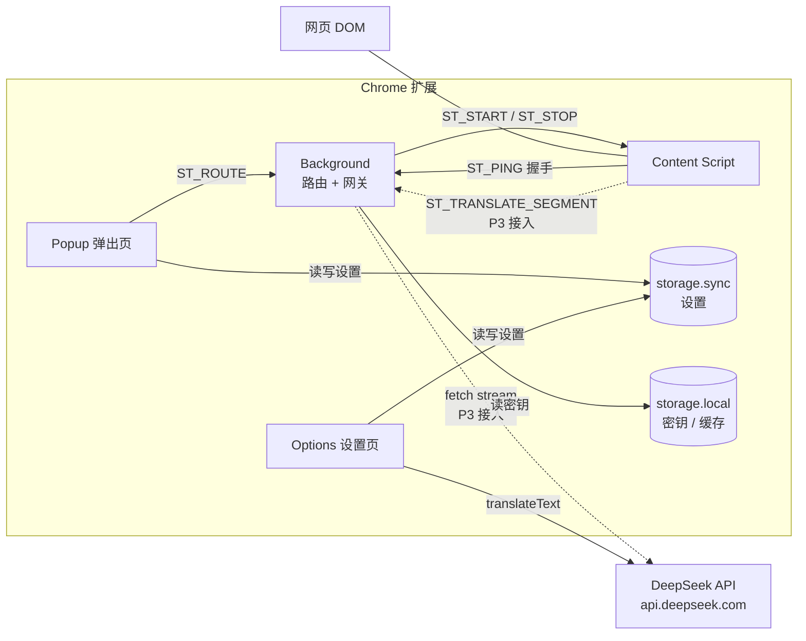
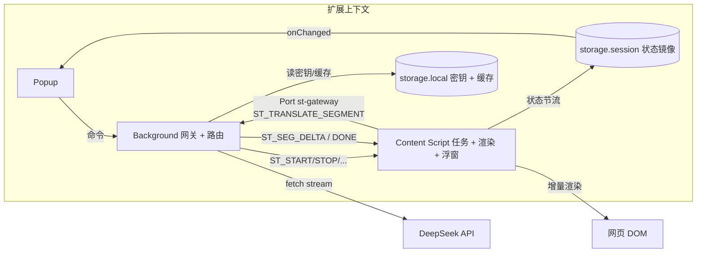

# SimpleTrans 项目架构

> 本文档描述项目当前的整体架构，需求完成后若产生架构变更，需同步更新（规则见 [AGENTS.md](../AGENTS.md)）。

## 1. 项目概述

SimpleTrans 是一个基于 **React + Vite** 构建的 **Chrome 扩展（Manifest V3）**，目前用于划词翻译，翻译引擎为 **DeepSeek**（通过 `@ai-sdk/deepseek` + `ai` SDK 调用）。

## 2. 技术栈

| 类别 | 技术 |
| ---- | ---- |
| UI 框架 | React 19 |
| 构建工具 | Vite 7（多入口构建，`vite build --watch` 用于开发） |
| 样式 | Tailwind CSS 4 + daisyUI 5 |
| AI 调用 | `ai` 7.x + `@ai-sdk/deepseek` 3.x |
| 扩展平台 | Chrome Extension Manifest V3 |

## 3. 目录结构

```
public/
  manifest.json          扩展清单（权限、入口、commands、content script + CSS）
  icons/                 扩展图标
src/
  popup/                 工具栏弹出页（React）：index.html / main.jsx / Popup.jsx / popup.css
  options/               设置页（React）：index.html / main.jsx / Options.jsx
  background/            Service Worker
    index.js             事件注册（onMessage / onConnect / commands / contextMenus / onInstalled）
    router.js            控制面路由、activeTab 解析、content 注入兜底
    gateway.js           数据面流式网关（当前仅 PING/PONG 与端口生命周期）
    commands.js          快捷键
    context-menu.js      右键菜单「翻译此段」
  content/               Content Script（P0：握手 + 兼容 GET_SELECTION）
    index.js             入口
    content.css          译文样式（manifest 静态注入，也是 insertCSS 兜底资源）
  shared/
    protocol.js          消息类型、载荷上限、错误码（唯一协议源）
    constants.js         超时、并发、心跳、语言表
    storage.js           chrome.storage 分区读写
    settings.js          设置 + 密钥存放位置（local / sync 可选）
    translate/           provider.js（提示词契约）+ deepseek.js（仅 background/options 引用）
    global.css           全局样式
scripts/
  build.mjs              三模式构建编排（web / background / content）
  smoke.mjs              无浏览器冒烟测试（直接跑 dist 产物）
  gen-icons.js           生成占位图标脚本
vite.config.js           构建配置（按模式切换产物格式）
dist/                    构建产物（加载到 Chrome 的目录，已在 .gitignore 中忽略）
```

## 4. 运行时组件

扩展由四类运行时组件构成：

| 组件 | 源码 | 运行环境 | 职责 |
| ---- | ---- | -------- | ---- |
| Popup | `src/popup/` | 弹出页 | 显示启用开关、目标语言、当前页面选中文本；提供“打开设置”入口 |
| Options | `src/options/` | 设置页 | 配置启用状态、目标语言、密钥与保存位置；提供翻译测试 |
| Background | `src/background/` | Service Worker | 安装时写入默认设置；控制面路由（`ST_ROUTE`/`ST_*`、注入兜底、快捷键、右键菜单）；数据面网关（当前仅 PING/PONG） |
| Content Script | `src/content/` | 网页上下文 | 响应 `ST_PING` / `ST_GET_STATUS` / `GET_SELECTION`；任务与渲染尚未接入 |

共享模块 `src/shared/` 被 Popup、Options、Background 引用；Content Script **可以**引用其中的纯模块（`protocol.js`、`constants.js`），但绝不能引用 `translate/deepseek.js`——构建时会把依赖内联进 IIFE 单文件（见 §8）。

## 5. 架构图



## 6. 核心数据流

### 6.1 设置数据

- 默认值定义在 `src/shared/settings.js` 的 `DEFAULT_SETTINGS`：
  - `enabled`：是否启用插件（默认 `true`）
  - `targetLang`：目标语言（默认 `zh-CN`）
  - `keyStorage`：密钥存放位置，`local`（默认）或 `sync`
  - `concurrency`：并发数（默认 `3`）
  - `cacheEnabled`：是否启用翻译缓存（默认 `true`）
- 非敏感设置存 `chrome.storage.sync`；密钥按 `keyStorage` 存 `chrome.storage.local` 或 `chrome.storage.sync`，切换时迁移并清除旧位置（`setKeyStorage`）。
- 读取：`getPublicSettings()`（不含密钥，Popup 使用）/ `getSettings()`（含密钥，仅设置页）/ `getApiKey()`（仅 Background）。
- 旧版本存在 `sync` 里的 `deepseekApiKey` 会在首次读取时惰性迁移到所选区域。

### 6.2 消息通信

| 消息类型 | 发送方 | 接收方 | 说明 |
| -------- | ------ | ------ | ---- |
| `ST_PING` | 任意上下文 | Content / Background | 连通性握手；`ensureContent` 用它判断是否已注入 |
| `ST_ROUTE` | Popup → Background | 活动标签页 Content | 弹窗启动翻译；由 Background 解析 tabId 并注入兜底 |
| `ST_START` / `ST_STOP` / `ST_RETRY` / `ST_CLEAR` / `ST_TOGGLE` / `ST_GET_STATUS` | Background → Content | Content | 控制面命令（P0 仅握手与状态查询有实现） |
| `ST_TRANSLATE_SEGMENT` → `ST_SEG_DELTA` / `ST_SEG_DONE` / `ST_SEG_ERROR` | Content ↔ Background（Port `st-gateway`） | — | 数据面流式协议；P3 接入 |
| `GET_SELECTION` | Popup → Content | Content | 兼容既有能力：读取当前选中文本 |
| `ST_STATE` | Content → `storage.session` | Popup（`onChanged`） | 状态镜像，P5 接入 |

### 6.3 翻译流程

**当前（设置页测试翻译）**

1. 设置页输入文本，点击“测试翻译”。
2. `translateText({ text, targetLang, apiKey })`（`src/shared/translate/deepseek.js`）校验 API Key 与文本。
3. 使用 `createDeepSeek({ apiKey })` 创建模型，调用 `deepseek-chat` 的 `generateText`，系统提示词来自 `provider.js`，要求仅返回译文。
4. 返回 `normalizeOutput()` 处理后的译文。

**目标（整页/段落，P3 起）**

Content 段级队列 → Port `st-gateway` → Background `translateSegmentStream`（`streamText`）→
`ST_SEG_DELTA` 增量 → Content 节流渲染 → `ST_SEG_DONE` 定稿。详见
[需求文档 §5.7](./demand/20261111-02-插件架构设计与选型.md)。

## 7. 扩展清单与权限

定义于 `public/manifest.json`：

- **入口**：`action.default_popup` → `popup/index.html`；`options_page` → `options/index.html`；`background.service_worker` → `background.js`（ES Module）。
- **Content Script**：匹配 `<all_urls>`，`document_idle` 注入 `content.js`，并由 `content_scripts.css` 静态注入 `content.css`；`all_frames: false`。
- **快捷键**：`commands` 声明 `translate-page`（`Ctrl+Shift+A`）与 `translate-paragraph`（`Ctrl+Shift+S`），mac 上为 `Command+Shift+*`。
- **权限**：`storage`、`activeTab`、`scripting`（注入兜底）、`contextMenus`（右键菜单）。
- **主机权限**：`https://api.deepseek.com/*`（调用 DeepSeek API）。
- **最低版本**：`minimum_chrome_version: "116"`（长连接消息保活依赖 Chrome 114+，116 起行为稳定）。

## 8. 构建与产物

- `scripts/build.mjs` 以三种模式依次调用 Vite（`ST_BUILD_MODE` 环境变量），因为 Vite 无法在一次构建里按入口指定 `format`：

  | 模式 | 产物 | 格式 |
  | --- | --- | --- |
  | `web` | `popup/`、`options/` + `assets/*` | ESM + HTML（React + Tailwind） |
  | `background` | `background.js` | ESM 单文件 |
  | `content` | `content.js`、`content.css` | IIFE 单文件 + 固定名 CSS |

- `vite.config.js` 保持 `root: 'src'`、`publicDir: public/`，输出到 `dist/`；`emptyOutDir` 关闭，由脚本统一清理（当前环境禁止删除文件时会退化为覆盖）。
- Content 必须自包含：它可以 `import` `shared/` 下的纯模块，构建时会被内联；**不得依赖动态 `import()`** 懒加载。
- 开发：`npm run dev`（三路并行 watch）；生产：`npm run build`；冒烟：`npm run smoke`。
- 在 Chrome 中加载 `dist/` 目录（开发者模式 → 加载已解压的扩展程序）。

## 9. 当前已知现状与待演进点

以下为基于现有代码的分析（P0 已落地后的状态）：

1. **Content 只有握手**：`ST_START` 返回 `BAD_RESPONSE`（“任务模块尚未接入”）；分段、队列、渲染、浮窗均未实现（P2–P6）。
2. **网关只有连通性**：`gateway.js` 处理 `PING/PONG`、`CLOSE`、`CANCEL_SEGMENT`，`ST_TRANSLATE_SEGMENT` 仍是 TODO（P3）。
3. **Popup 尚未接入翻译命令**：仍是“选中文本 + 开关 + 打开设置”（P5）。
4. **`enabled` 开关未生效**：Content/Background 尚未读取该设置（P4 起接入）。
5. **`ai` SDK 在 Service Worker 的验证**：尚未在真实 SW 中跑通 `streamText`，P3 需要实测（打包已确认可按 ESM 单文件产出）。
6. **`--watch` 三路并行构建未经实测**：`npm run build` 已验证，`npm run dev` 依赖同样的三模式路径。
7. **构建产物清理受限**：当前环境禁止删除文件，`dist/` 可能残留旧哈希资源（不影响加载）。

---

## 10. 目标架构（已选型，P0 已落地）

> 本节来自需求文档 [20261111-02 插件架构设计与选型](./demand/20261111-02-插件架构设计与选型.md)，描述网页双语对照翻译的**目标架构**。
> 状态：**选型已确认；P0（构建拆分、协议、目录重构、密钥位置可选）已完成，P1–P7 待实现**。全部落地后本节转为正式的「当前架构」。
> 已确认：方案 A（Content 编排 + Background 流式网关）；「翻译一段」= 鼠标/光标所在段落；三类触发统一经 Background；逐段流式；浮窗仅任务期间出现、原生 Shadow DOM；开放调用方 `data-st-status`；首版含右键菜单、不做暂停。

### 10.1 三端职责

| 组件 | 定位 | 职责 | 不负责 |
| --- | --- | --- | --- |
| Content Script（页面内注入） | 页面内的任务宿主 | 分段、段级队列调度、进度、重试编排、增量渲染（按 [译文 DOM 格式](./demand/20261111-01-译文DOM格式.md)）、浮窗 UI、锚点解析 | 任何网络请求、密钥、模型参数 |
| Popup（弹窗页面） | 控制面板 | 展示当前标签页任务状态、下发开始/停止/重试/清除命令、跳转设置 | 持有任务生命周期、直接调用翻译 |
| Background（后台服务） | 控制面路由 + 数据面流式网关 | 命令路由与 content 注入兜底、模型调用（唯一出口）、流式增量转发、鉴权、缓存、全局并发闸门、错误归一、端口级取消 | 任务队列、页面状态、渲染 |

核心原则：**DOM 在谁手里，编排就在谁手里；网络在谁的扩展源里，请求就在谁手里。** 因此编排在 Content，请求在 Background，长连接只承载"流"。

### 10.2 平台硬约束（架构前提）

1. MV3 中 content script 的 `fetch` 受页面同源策略约束，`host_permissions` 不豁免跨域 → 翻译请求**不能**放在 content script。
2. Service Worker 空闲 30 秒被终止、单个事件处理超过 5 分钟被终止、`fetch` 响应超过 30 秒未到达也会终止 → Background 只做「单段请求即流式返回」的网关，不持有跨段任务状态。
3. Chrome 114+ 只有长连接上的**消息往来**能保活，"打开端口"本身不保活 → 流式任务必须有心跳（20 s）与断线重连。
4. Content Script 不支持 ES Module，产物必须是自包含单文件 → content 引用 `shared/` 后，构建由 `scripts/build.mjs` 拆成 web / background / content 三模式（已落地）。
5. `chrome.commands` 最多 4 个带默认快捷键的命令；`activeTab` 在快捷键/点击图标等手势后授予，可配合 `scripting` 做按需注入。
6. 建议 `minimum_chrome_version: "116"`。

### 10.3 目标拓扑



- **数据面**（翻译请求）：`Content --Port--> Background --fetch(stream)--> api.deepseek.com`，请求只发生在 Background。
- **控制面**（触发）：快捷键 / 弹窗 / 浮窗 → 统一经 Background 路由 → Content 的同一个任务管理器。
- **状态面**：Content 节流写 `chrome.storage.session`，Popup 订阅 `storage.onChanged`，零轮询。
- **通道分工**：控制面用一次性 `runtime.sendMessage` / `tabs.sendMessage`；数据面用长连接 Port（流式增量）；状态用 storage 镜像。

### 10.4 目标目录与模块

```
src/
  background/       index.js  router.js  gateway.js  commands.js  keepalive.js
  content/          index.js  bridge.js
    task/           manager.js  queue.js  scheduler.js
    dom/            scanner.js  anchor.js  renderer.js  stream.js
    ui/             widget.js  widget.css
  popup/            Popup.jsx  components/StatusPanel.jsx  components/Actions.jsx
  options/          Options.jsx
  shared/           protocol.js  settings.js  storage.js  constants.js  cache.js
    translate/      provider.js  deepseek.js
```

依赖方向单向：`content/popup/options → shared`，`background → shared`；`shared/translate/deepseek.js` 只允许 background 引用，content 产物中不得出现密钥相关代码。

### 10.5 与现状的差异清单

| 项 | 现状 | 目标 |
| --- | --- | --- |
| content 依赖 | 单文件，不引用 shared | 可引用 `shared/protocol`、renderer；打包为 IIFE 单文件 |
| 构建 | 单 build，全 entry 一种 format | 按 mode 拆分：content=IIFE、background=ESM、web=HTML bundle |
| Background | 仅 `PING` | 控制面路由 + 翻译网关（鉴权、缓存、并发、重试） |
| 翻译调用位置 | Options 页（`shared/translate.js`） | Background（`shared/translate/*` 只被 background 引用） |
| 消息协议 | `GET_SELECTION`、`PING` | `ST_*` 命名空间协议（控制面一次性 + 数据面 Port 流式），集中在 `shared/protocol.js` |
| 数据面 | 无 | Port `st-gateway`：`ST_TRANSLATE_SEGMENT` → `ST_SEG_DELTA` → `ST_SEG_DONE` |
| 权限 | `storage`、`activeTab` + DeepSeek host | 增加 `scripting`、`commands`、`contextMenus`；`minimum_chrome_version: 116` |
| 密钥存储 | `chrome.storage.sync` 明文 | 位置由用户选择：`storage.local`（默认）或 `storage.sync`；只在 Background 读取，切换时迁移并清除旧位置 |
| Popup | 只读选中文本 | 状态面板（`storage.session` 镜像）+ 翻译/停止/重试/清除命令 |
| 浮窗 | 无 | Content 内原生 Shadow DOM，仅任务期间出现 |
| 快捷键 | 无 | `commands`：整页 / 当前段落（2 个默认值） |

### 10.6 遗留待确认

iframe 内文本是否翻译、跨页缓存默认开关、"批量流式"成本优化、整页进行中再按段落快捷键的交互，见需求文档 §8.2。**已确认项**：`data-st-status` 放开、密钥存储可选、首版含右键菜单、不做暂停/继续。

> 已确认项对应的文档已同步：上游 DOM 文档增加「调用方状态属性」说明；本节与需求文档保持一致。代码实现按需求文档 §6 的 P0–P7 推进。

