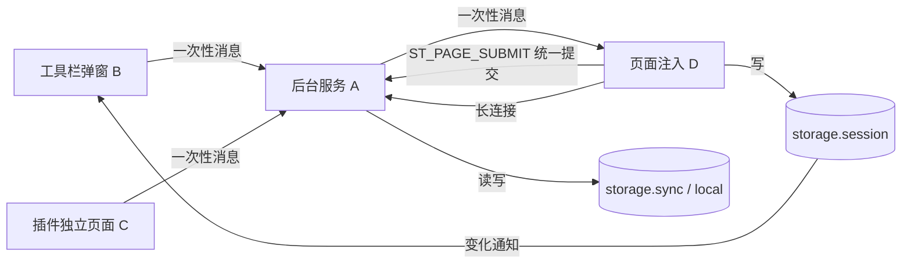
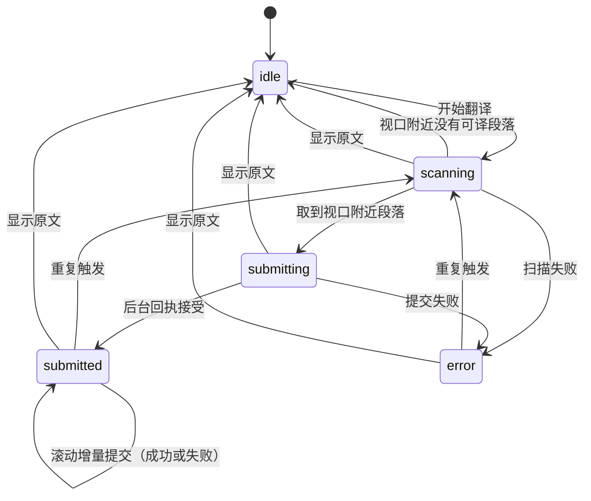
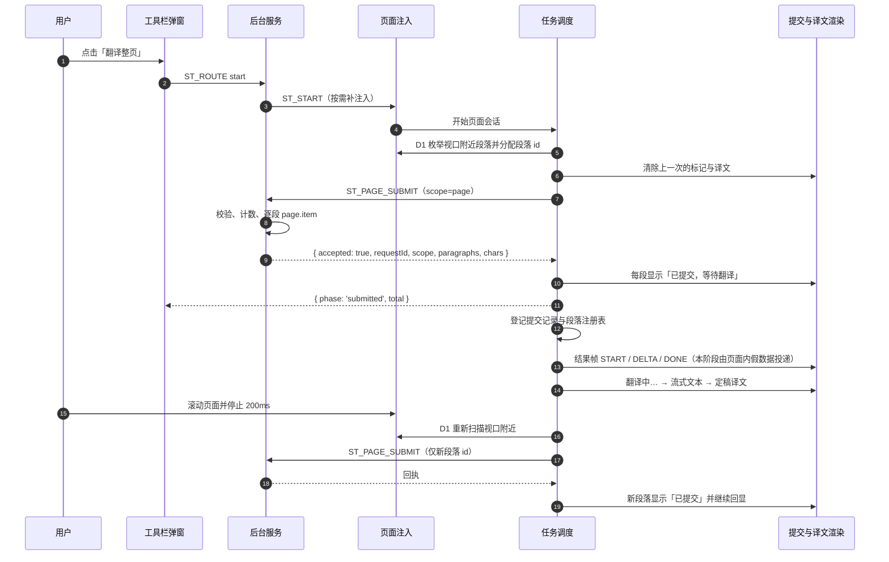
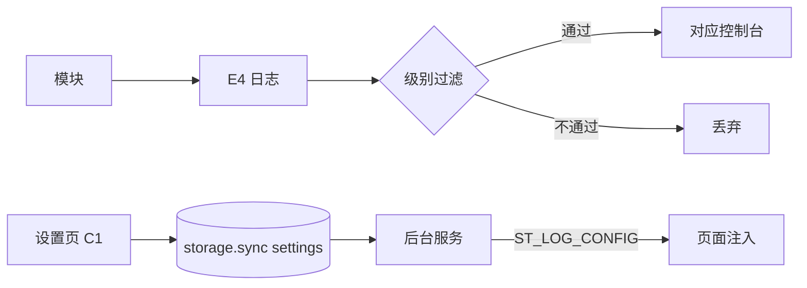

# SimpleTrans 项目架构

## 1. 文档说明与修订记录

### 1.1 文档用途与范围

本文是 SimpleTrans **结构设计的唯一来源**，只讲三件事：项目由哪些模块组成、每个模块负责什么、一次翻译大致怎么走。

本文**不写**以下内容：

- 具体交互与实现细节（页面上错误怎么显示、译文的具体样式、各家接口的报文格式、边界情况）→ `docs/modules/`；
- 实现进度与任务排期 → `docs/PLAN.md`；
- 单个功能的实现需求、缺陷修复 → `docs/demand/`、`docs/bug/`。

代码与本文不一致时，以本文为准：先改本文，再改代码。

### 1.2 修订记录

| 日期 | 结论 | 影响范围 |
| ---- | ---- | -------- |
| 2026-11-13 | 按模块重排为 8 章，统一消息命名，合并待确认项 | 全文 |
| 2026-11-13 | 按浏览器部分分层重排模块，限定两种翻译模式，细节下沉 `docs/modules/` | 全文 |
| 2026-11-13 | 新增「测试与质量门禁」一章：确立 Vitest 单元测试分层、`tests/` 目录、chrome stub 语义与门禁顺序；原第 7、8 章顺延为第 8、9 章 | 2.1、3.1、5.1、7（新增）、8/9（原 7/8） |
| 2026-11-13 | 按用户决定，单元测试集成并入 P0（原 P1 取消），门禁自 P0 起生效；PLAN 阶段编号前移（原 P2–P10 → P1–P9） | 7.1、7.7、8.1 |
| 2026-11-13 | P0 定位为「骨架重建 + 门禁」。3.1 目录树定稿：补 `commands.js`、`context-menu.js`（A1 入口），拆出 `config/`、`translate/`、`cache/` 与 `dom/` 的具体文件；不单独设 `keepalive.js`（连接保活由 D4 心跳与 A2 端口生命周期承担）。新增 3.4「空壳约定」与 7.9「P0 结构测试」。 | 3.1、3.4（新增）、4.2、7.3、7.9（新增）、8.1 |
| 2026-11-13 | 澄清：E1 消息名、5.3 数值、E2/E3 字段属于设计与契约，P0 只建文件不写值；代码在 P1、P2 按 `docs/modules/` 落地 | 3.1、4.6、7.9 |
| 2026-11-14 | P1 落地：`tests/helpers/chrome.js`、`load.js` 建立，3.1 目录树去掉 `helpers/`「待建」；chrome stub P1 仅实现 storage 三区语义，`runtime`/`tabs`/`scripting`/`Port` 随 P2 补齐（7.4 为最终目标语义） | 3.1、7.3 |
| 2026-11-15 | P2 落地 E1 消息与报文、A1 控制面、A2 网关、D4 页面通道；Q12 结论：不新增 `ST_STOP`，`ST_RETRY`/`ST_GET_STATUS` 分别在 P8/P6（现 P9/P7）落地；5.3 增加心跳超时 10 秒；7.3 的 chrome stub 阶段标注调整为 P2 补事件/Port、P3/P6（现 P4/P7）补 tabs/scripting | 4.6、5.3、7.3、8.1 |
| 2026-11-15 | 新增 E4 日志输出与 P3 日志模块阶段：日志只输出浏览器控制台、五级过滤（debug/info/warn/error/off）、设置页可调，不持久化/不收集/不导出；全局异常与 traceId 纳入；原 P3–P9 顺延为 P4–P10；同步 C1、E1、A2、D4、依赖、安全、测试与决策 | 1.2、2.2、2.3、3.1、3.2、4.1、4.2、4.4、4.6、5.1、5.2、5.4、5.5、6.1、6.10、7.2–7.6、8.1、8.2、8.3 |
| 2026-11-15 | P3 落地：E4 三文件并入 3.1 目录树；C1 日志级别、`ST_LOG_CONFIG`、`traceId`、全局异常与浏览器四级过滤按设计实现；日志仅控制台 | 3.1、4.6、7.3–7.6 |
| 2026-11-16 | P4 落地：D1 段落提取、D2 悬停检测、D3 译文渲染与 D5 单段任务实现；A1 增加快捷键与按需注入；D3 采用「块级相邻兄弟 + 列表/表格内部末尾」的混合插入；DOM 模块测试启用 jsdom | 1.2、3.1、4.2、4.5、6.3、7.2–7.5 |
| 2026-11-16 | 快捷键修复：Ctrl+Shift+S 是 Chrome「另存为」保留快捷键，commands 改用 Ctrl+Shift+Y 作为备用；页面注入增加 Ctrl 单键手势（commands API 不支持裸修饰键） | 2.3、7.5 |
| 2026-11-16 | 取消翻译修复：A3 观察 `usage` 延迟 Promise；E4 将 `AbortError` 记 `global.abort`（info）并阻止浏览器默认报错 | 6.10 |
| 2026-11-16 | P4 译文显示改为内嵌原文末尾：外层 `<font>` 容器按宿主布局使用 `<br>` 或 `&nbsp;&nbsp;`，样式继承宿主；D1 提取与块级判定排除译文；复制包含译文作为已知取舍 | 4.5、6.9、7.5、8.2 |
| 2026-11-16 | P4 宿主改为任意文字标签：从指针最近的文字标签取宿主（span/button/code 等），不再设标签白名单；按钮与代码可翻译；换行/空格改由宿主 `getComputedStyle` 决定；表单值控件与可编辑区仍不插入译文 | 4.5、6.9、7.5、8.2 |
| 2026-11-16 | P5 缓存落地：A4 由 `storage.local` 改为 IndexedDB 的 `simpletrans-cache`（`entries`/`meta`/`stats`，`meta` 含 `domain` 与 `by_domain`），清单申请 `unlimitedStorage`，应用层保留 1 GiB / 100 万条上限；A2 接入按段查缓存与成功后写入；E1 新增 `ST_CACHE_STATS` / `ST_CLEAR_CACHE` 与 `ST_TRANSLATE_BATCH.domain`；C1 新增缓存开关、占用显示与清空 | 1.2、4.2、4.6、5.4、5.5、6.5、7.2、7.3、7.5、8.1、8.2 |
| 2026-11-16 | P6.1 视口取段与一次性提交落地：D1 按视口枚举段落（文档顺序、段落级最外层宿主、上一段上下文、5000 段上限、分片扫描，不做同文本合并）；D5 改为提交状态机（`idle` / `scanning` / `submitting` / `submitted` / `error`），一次点击只发一条 `ST_PAGE_SUBMIT`，后台只校验、计数并回执，页面为每段渲染「已提交」（不写状态镜像，P7 补）；E1 落地 `ST_ROUTE` / `ST_START` / `ST_PAGE_SUBMIT`，`ST_CLEAR` 响应 `{ removed, cancelled }`；A1 增加弹窗命令转发与提交回执；B2 增加两个最小按钮 | 1.2、4.2、4.3、4.5、4.6、5.2、5.3、5.4、6.2、6.3、6.8、6.9、7.3、7.5、8.2 |
| 2026-11-16 | P6.5 新增翻译测试页：C6 扩展独立页面提供固定英文夹具，页面自加载 D 入口并提供页内操作条；B2 增加打开测试页按钮；C6 成为唯一允许依赖 D 入口的独立页面；不新增权限、清单入口或协议 | 1.2、2.2、2.3、3.1、3.2、4.1、4.3、4.4、5.1、8.2 |
| 2026-11-16 | P6.1 统一提交与滚动增量：Ctrl 单段与整页都走 `ST_PAGE_SUBMIT`（`scope=page/single`），删除旧悬停单段数据面发送与加载/流式/完成渲染；视口取段扩为上下各半屏，页面会话滚动 200ms 防抖后只补交新 `hostId`；后台 `page.received` + 逐段 `page.item`（preview ≤ 60 字）；`ST_CLEAR` 响应 `{ removed }`；C6 测试页适配 | 1.2、2.1、2.2、4.2、4.3、4.4、4.5、4.6、5.2、5.3、5.4、5.5、6.1、6.2、6.3、6.8、6.9、7.3、7.5、8.2 |
| 2026-11-16 | P6.1 结果回显：段落 id 改为 `h<实例标记>-<序号>`（页面内唯一，兼作结果帧 `itemId`），移除段落上下文；D3 恢复翻译中/流式/译文三态；D5 增加提交记录、段落注册表与 `applyResultFrame`，结果来源由 `src/content/fake-results.js` 的临时假数据提供（C6 增加两个模拟开关）；A1 移除上下文校验；P6.2 / P6.4 只需把结果来源换成后台帧 | 1.2、2.1、2.2、3.1、4.2、4.3、4.5、4.6、5.3、5.4、6.1、6.2、6.3、6.5、6.8、6.9、7.3、7.5、8.2 |
| 2026-11-16 | P6.2 翻译实例参数：E3 实例增加 `reasoningEffort`、`batchSize`、`batchMaxChars`、`maxConcurrency`、`systemPrompt`，`model` 改为可编辑；A3 新增 `prompt.js`（模板、占位符展开、哈希），按实例提示词与思考强度调用；A1 `ST_LIST_ENGINES` 返回完整实例参数；A2 并发改读实例 `maxConcurrency`，缓存 key 升 v2 并纳入 `promptHash` / `reasoningEffort` / `BATCH_ENCODING_VERSION`；A4 数据库版本 2 清空 v1 缓存；C1/C2 增加「翻译实例」最小参数区块 | 1.2、3.1、4.2、4.4、4.6、5.3、5.4、6.5、6.7、7.3、7.5、8.1、8.2 |
| 2026-11-16 | P6.2 数值校验口径：单批段数由「1–12」改为正整数、不设业务上限；设置页只做类型与非空/正整数校验，不再强制业务范围 | 5.3、4.4 |

## 2. 项目介绍

### 2.1 项目定位

SimpleTrans 是一个 Chrome 扩展（Manifest V3），把网页内容翻译成目标语言，并以**双语对照**的方式显示：原文保留，译文内嵌在原文所属标签内部、原文之后。

只提供两种翻译模式：

1. **整页翻译**：翻译当前页面里所有可翻译的文字宿主；P6.1 当前先提交当前视口附近段落，滚动后增量提交新段落。
2. **悬停段落翻译**：鼠标停在某个文字宿主上，按快捷键只处理该宿主；已有标记或译文时，再按快捷键隐藏。

两种模式共用同一套提交与显示结构；P6.1 当前提交后按段落 id 显示「正在提交 / 已提交 / 翻译中 / 流式 / 译文 / 失败」，本阶段回显内容由页面内临时假数据提供，真实译文在 P6.3 / P6.4 接入后沿用同一套显示。

翻译引擎不限定一家：既可以是传统机器翻译服务（腾讯、阿里、有道、百度、Google、DeepL 等），也可以是 AI 大模型（DeepSeek、OpenAI 兼容接口、Ollama 等）。用户选择首选引擎和备用引擎，两种模式使用同一套引擎配置。

技术上：弹窗、设置页与测试页用 Vite 构建；弹窗与设置页用 React + Tailwind，C6 测试页用静态 HTML + 独立 CSS；AI 引擎走统一的流式调用库；传统接口用 `fetch`，签名用浏览器自带的加密接口；单元测试用 Vitest，P1 起用自写的 `chrome` stub 代替浏览器；具体版本以 `package.json` 为准。

### 2.2 功能范围

| 功能 | 说明 |
| ---- | ---- |
| 整页翻译 | 找出整页可翻译的段落，批量翻译，译文逐段插入原文后面 |
| 悬停段落翻译 | 鼠标停在段落上，按快捷键只提交该段；已有标记或译文时按快捷键隐藏；提交与显示结构与整页一致 |
| 多引擎 | 配置多个引擎，指定首选与备用；整页与悬停使用同一套选择 |
| 批量与流式 | 一次请求翻译多段；AI 引擎可以边生成边显示 |
| 译文缓存 | 翻译过的段落缓存起来，再次遇到直接使用 |
| 密钥存放位置可选 | 密钥可以放本机（`local`）或跟随账号同步（`sync`） |
| 设置页测试 | 在设置页直接测试引擎是否可用，显示结果与耗时 |
| 统一日志 | 后台、弹窗、设置页、页面注入共用一套日志；浏览器四级 + 关闭，设置页可调；只输出控制台，不持久化 |
| 翻译测试页 | 扩展内固定英文内容页，从弹窗打开；页面自加载页面注入运行时，提供页内整页提交、滚动增量、Ctrl 单段提交、清除与「模拟失败 / 模拟慢速」开关，用于稳定的人工翻译测试 |

### 2.3 使用入口

| 入口 | 清单声明 | 作用 |
| ---- | -------- | ---- |
| 工具栏图标 | `action.default_popup` → `popup/index.html` | 打开弹窗：查看状态，按钮在「开始翻译」与「显示原文」之间切换，打开设置 |
| 设置页 | `options_page` → `options/index.html` | 配置引擎、首选与备用、密钥、缓存、日志级别 |
| 翻译测试页 | 无清单声明；由弹窗按钮打开 `testpage/index.html` | 固定英文内容的翻译夹具；页内操作条直接驱动页面任务，用于稳定的人工翻译测试 |
| 快捷键 | `commands` + 页面注入 | 页面内按 **Ctrl 单键**（按下并松开）翻译鼠标所在段落；该段已有译文时隐藏。清单 `commands` 的 `Ctrl+Shift+Y` 是备用入口，用于页面注入未运行时的补注入与触发 |
| 页面内译文 | 由页面注入脚本插入 | 以双语对照方式显示译文 |

快捷键由页面注入监听 Ctrl 单键实现，用户不需要在 Chrome 的扩展快捷键页面配置；清单的 `commands` 仍保留 `Ctrl+Shift+Y`，可由用户在扩展快捷键页面修改。Ctrl+Shift+S 是 Chrome 的「另存为」保留快捷键，扩展命令会被浏览器静默忽略；Chrome 的 commands API 也不支持裸修饰键，因此 Ctrl 单键只能在页面侧实现。

### 2.4 名词说明

全文只用下面这套叫法。

| 名词 | 含义 |
| ---- | ---- |
| 段（段落） | 页面上一个可以独立翻译的文本块，例如一个 `<p>`、一个列表项、一个表格单元格 |
| 批 | 一次请求里发给引擎的多段文本 |
| 引擎 | 翻译服务的具体实现，例如 DeepSeek、腾讯翻译 |
| 引擎实例 | 用户配置好的一个具体引擎；同一类型可以配多个实例（例如两个 DeepSeek 实例用不同模型） |
| 服务商 | 提供翻译接口的厂商，例如腾讯云、DeepL |
| 翻译模式 | 只有两种：整页翻译、悬停段落翻译 |
| 状态容器 | 插入页面的 `<font>`，里面放提交状态；P6.4 接入后也放译文 |
| 页面注入 | 注入到网页里运行的扩展脚本，负责页面上的工作 |
| 源语言 / 目标语言 | 原文的语言 / 译文要翻译成的语言 |

## 3. 目录结构

### 3.1 源码目录

目录树是代码结构的唯一清单：**代码里有的文件必须在树里，树里的文件必须能指到模块**。未创建的条目在注释里标「待建」并写明阶段。

```text
public/
  manifest.json              扩展清单：入口、注入、权限
  icons/                     扩展图标：icon16.png / icon48.png / icon128.png
src/
  background/                后台服务（A）
    index.js                 入口：监听器注册
    router.js                A1 消息路由
    commands.js              A1 快捷键入口
    context-menu.js          A1 右键菜单入口
    gateway.js               A2 请求网关
  popup/                     工具栏弹窗（B）
    index.html
    main.jsx
    Popup.jsx
    popup.css
    open-test-page.js        B2 打开 C6 测试页
  options/                   插件独立页面（C）/ 设置页
    index.html
    main.jsx
    Options.jsx
  testpage/                  插件独立页面（C）/ 翻译测试页
    index.html               固定英文内容与页内操作条
    main.js                  C6 测试页入口：加载 D 运行时、绑定操作条
    testpage.css             C6 测试页样式
  content/                   页面注入（D）
    index.js                 入口
    bridge.js                D4 与后台通信
    hover.js                 D2 悬停检测
    task.js                  D5 任务调度
    fake-results.js          D5 临时：P6.1 结果回显的假数据源（P6.3 / P6.4 接入后台结果后删除）
    dom/
      scanner.js             D1 段落提取
      renderer.js            D3 译文渲染
    content.css              译文样式
  shared/                    公共模块（E）
    protocol.js              E1 消息协议
    constants.js             公共数值（见 5.3）
    storage.js               E2 存储读写
    settings.js              E2 默认设置
    config/
      registry.js            E3 引擎类型目录与字段
      instances.js           E3 引擎实例、首选与备用、密钥迁移
    translate/
      adapter.js             A3 适配器契约
      prompt.js              A3 提示词模板、占位符展开与哈希
      batch.js               A3 批量编码与解析
    cache/
      key.js                 A4 缓存 key
      store.js               A4 缓存读写与淘汰
    log/
      levels.js              E4 日志等级、阈值与设置页选项
      record.js              E4 记录、脱敏与格式化
      logger.js              E4 日志入口、级别过滤与全局异常
    global.css               全局样式
scripts/
  build.mjs                  三模式构建
  smoke.mjs                  构建产物检查
  gen-icons.js               生成占位图标
tests/
  unit/                      源码级测试，文件名与被测模块同名
    structure.test.js        骨架结构与空壳约定（P0）
    architecture.test.js     3.1 目录树与仓库一致性（P0）
  helpers/                   chrome stub 与加载助手
    chrome.js                chrome API stub（storage 三区与 onChanged、getManifest/getURL，P1/P3）；事件、Port（P2）；commands、tabs、scripting（P4）
    load.js                  安装 stub 与动态导入（P1）
  component/                 组件测试（待建，P7–P8）
vitest.config.js             单元测试配置
vite.config.js               构建配置
dist/                        构建产物，加载到 Chrome 的目录（不提交）
```

`src/` 下不再有其它文件；新增文件先改这棵树。`tests/component/` 在 P7–P8 建立，之前只在树里标注「待建」。

### 3.2 构建产物

页面注入脚本不能用 ES Module，弹窗、设置页与翻译测试页是普通网页，后台可以用 ES Module。一次构建只能给一种格式，所以 `scripts/build.mjs` 分三次调用：

| 模式 | 产物 | 格式 | 说明 |
| ---- | ---- | ---- | ---- |
| `web` | `popup/`、`options/`、`testpage/` 与 `assets/` | ESM + HTML | React 页面与静态测试页 |
| `background` | `background.js` | ESM 单文件 | Service Worker |
| `content` | `content.js`、`content.css` | IIFE 单文件 + 固定名 CSS | 全部依赖内联 |

`testpage/` 是静态 HTML；它的入口脚本静态导入 D 入口，构建时把 D1–D5、E1、E4 与 `content.css` 内联进 web 产物，以便扩展页面自行驱动页面任务。它不经过 `content.js` 的 IIFE 打包与清单注入。

由此产生两条约束：

- 页面注入可以引用 `shared/` 里的纯模块，构建时会内联进单文件；不能使用动态 `import()`。E4 日志也属于这类纯模块，`shared/log/` 不得引用 `chrome.storage`，也不得包含密钥、鉴权头或服务商域名。
- 页面注入的产物里不能出现翻译服务的地址、密钥字段名、签名代码；构建后由 `scripts/smoke.mjs` 检查。

命令：`npm run dev` 并行监听三种产物，`npm run build` 生产构建，`npm run smoke` 检查产物，`npm test` 跑单元测试，`npm run gate` 串联 test → build → smoke。

### 3.3 文档目录

| 位置 | 放什么 |
| ---- | ------ |
| `docs/项目架构.md` | 本文，结构设计唯一来源 |
| `docs/PLAN.md` | 实现进度与任务排期 |
| `docs/任务文档索引.md` | 实现需求与缺陷的索引 |
| `docs/demand/` | 实现需求文档，按 `YYYYMMDD-序号-文档名.md` 命名 |
| `docs/bug/` | 缺陷文档，命名同上 |
| `docs/modules/` | 各模块与交互细节：样式、错误提示、报文格式、边界情况 |

### 3.4 空壳约定

P0 交付的是可构建、可加载的**空骨架**，不是最小可用功能。约定如下：

1. 每个源码文件只有文件头注释，声明模块编号、职责、依赖与实现阶段，正文不写行为；文件头统一含 `实现阶段：P<数字>`。
2. 空壳不含任何 `chrome.*` 调用、不读写 `storage`、不引用翻译引擎与密钥，也不定义消息名、错误码与业务常量——这些属于 E1/E2/E3 的设计，在 P1、P2 按 `docs/modules/` 落地。
3. 入口文件（`background/index.js`、`content/index.js`、`popup/main.jsx`、`options/main.jsx`）保留构建所需的引用（样式导入、React 挂载），不注册监听器、不发起消息。
4. 弹窗与设置页只渲染静态占位文案，不读取设置、不调用引擎；占位文案必须写明「待接入」的阶段。
5. 依赖方向仍按 5.1 执行：`content/` 不得引用 `shared/config/`、`shared/translate/`、`shared/cache/`；`src/` 不得引用 `tests/`。
6. 新增行为时，先在本文件与对应 `docs/modules/` 写清接口，再填代码；同批补 `tests/unit/` 下的同名测试。

## 4. 模块划分

### 4.1 分层与总览

模块分三层，上层是运行位置，中层是业务模块，下层是具体功能：

1. **浏览器功能模块**：按代码在浏览器里运行的位置划分，共四个——后台服务、工具栏弹窗、插件独立页面、页面注入。
2. **业务模块**：每个浏览器功能模块内部按职责再分。被多个部分共用的业务模块单独放在公共模块里，避免每个部分各写一份。
3. **具体功能**：业务模块内部的实际动作，例如发送请求、保存配置、处理 DOM。

编号规则：浏览器功能模块用 A、B、C、D，公共模块用 E；业务模块用「部分编号 + 序号」，例如 A2、D3。

```text
后台服务（A）
├─ A1 消息路由
├─ A2 请求网关
├─ A3 翻译引擎
└─ A4 翻译缓存
工具栏弹窗（B）
├─ B1 状态显示
└─ B2 命令下发
插件独立页面（C）
├─ C1 通用设置
├─ C2 引擎管理
├─ C3 首选引擎
├─ C4 测试翻译
├─ C5 数据管理
└─ C6 翻译测试页
页面注入（D）
├─ D1 段落提取
├─ D2 悬停检测
├─ D3 译文渲染
├─ D4 与后台通信
└─ D5 任务调度
公共模块（E）
├─ E1 消息协议
├─ E2 设置与存储
├─ E3 翻译配置与密钥
└─ E4 日志输出
```

每个业务模块按「职责 / 具体功能 / 源码」三行写，不展开实现细节。

A3、A4 的源码放在 `shared/` 下，方便构建时引用，但它们只被后台使用，因此归在后台服务下。E4 是四个运行部分共用的日志入口，只输出控制台，不写存储、不上报，因此归在公共模块下。

有两类内容不放在模块里：

- **任务调度**：它串起多个模块，属于流程机制，见 6.2。
- **样式、错误提示、接口报文、边界情况**：属于实现细节，见 `docs/modules/`。

### 4.2 后台服务（A）

运行在 Service Worker 里，负责接收请求、调用引擎、返回结果，不接触页面 DOM。

**A1 消息路由**

- 职责：把弹窗、设置页的请求和快捷键、右键菜单事件送到对应标签页，页面注入脚本没注入时先注入；接收页面的统一段落提交并回执。
- 具体功能：接收弹窗与设置页消息；接收快捷键与右键菜单；确定目标标签页；按需注入页面脚本；转发开始、清除、提交当前段落；接收 `ST_PAGE_SUBMIT`，做形状校验、统计段数与字符数、逐段打印预览并回执，不查缓存、不调用引擎、不占用上游并发；把转发失败的原因回传。
- 源码：`src/background/router.js`（含弹窗 `ST_ROUTE` 的 start / clear 转发与 `ST_PAGE_SUBMIT` 回执）、`src/background/commands.js`（快捷键入口）、`src/background/context-menu.js`（右键菜单入口）

**A2 请求网关**

- 职责：处理 P6.3 / P6.4 的批次请求，返回译文；P6.1 不调用。
- 具体功能：校验批次（段数、长度、在途数量）；按配置确定首选引擎；按实例参数（模型、思考强度、提示词）计算缓存 key 并按段查缓存，命中直接返回、未命中才调引擎并在成功后写缓存，关闭缓存时跳过读写；按实例 `maxConcurrency` 控制全局并发；调用引擎并转发增量与定稿；处理取消与连接关闭；在页面连接建立后下发一次日志级别。
- 源码：`src/background/gateway.js`
- 说明：不保存任务状态，任务在页面注入侧；缓存读写在实例与密钥检查之后，命中仍要求已配置密钥；`settings.concurrency` 只作旧实例迁移回退。

**A3 翻译引擎**

- 职责：把一批文本交给具体服务，按段返回结果。
- 具体功能：每个服务商一个适配器，处理地址、签名、语言码；AI 引擎做批量编码与解析；把流式输出拆回各段；把各家错误映射成统一类型；返回用量；按实例 `systemPrompt` 展开提示词模板（`{{targetLang}}` / `{{outputFormat}}`），按 `reasoningEffort` 透传思考参数。
- 源码：`src/shared/translate/`（`adapter.js` 适配器、`prompt.js` 提示词模板与哈希、`batch.js` 批量编码）

**A4 翻译缓存**

- 职责：保存「源文 → 译文」，下次遇到相同条件直接返回。
- 具体功能：计算缓存 key（key 版本、引擎、模型、语言、提示词版本、批量编码版本、思考强度、提示词哈希、每段上下文、原文）；在扩展自己的 IndexedDB `simpletrans-cache` 中读写 `entries` / `meta` / `stats`；`meta` 记录来源域名并建 `by_domain` 索引；命中只更新最近访问时间；按字节与条数双上限分批淘汰、清空与统计恢复。
- 源码：`src/shared/cache/`
- 说明：清单申请 `unlimitedStorage` 解除浏览器配额与驱逐，应用层仍保留 1 GiB / 100 万条保守上限；只存译文与来源域名，不存原文；数据库版本 2，升级时清空 v1 缓存。

### 4.3 工具栏弹窗（B）

点击工具栏图标后打开的页面，只负责查看状态和下发命令，不持有任务。

**B1 状态显示**

- 职责：显示当前标签页的翻译状态。
- 具体功能：读取状态镜像；订阅变化；显示进度、成功数、失败数、当前引擎。
- 源码：`src/popup/Popup.jsx`
- 当前状态：P6.1 只显示本次命令的一行结果提示；状态镜像、进度与失败数展现归 P7。

**B2 命令下发**

- 职责：把用户操作转成命令。
- 具体功能：两个按钮「翻译整页」「显示原文」，各发一条 `ST_ROUTE`；请求期间按钮禁用；结果提示「已提交：N 段，滚动后自动提交新段落」「视口附近没有可翻译的段落」「正在提交…」或「已清除 N 处标记」「没有可清除的标记」；错误直接显示后台返回的提示。P6.5 增加「打开测试页」按钮，通过 `chrome.runtime.getURL` 与 `chrome.tabs.create` 在新标签页打开 C6，不发送 `ST_ROUTE`，失败时显示一行提示。
- 源码：`src/popup/Popup.jsx`、`src/popup/open-test-page.js`
- 当前状态：P6.1 是固定两个翻译按钮，不做状态切换、进度与当前引擎；状态化按钮与「打开设置页」入口归 P7；P6.5 增加测试页导航按钮。

### 4.4 插件独立页面（C）

插件独立页面包括设置页与翻译测试页。设置页负责所有配置与测试，不直接调用翻译服务；翻译测试页只提供固定英文内容与页内操作，不调用引擎、不读写配置。

**C1 通用设置**

- 职责：配置与具体引擎无关的选项。
- 具体功能：启用开关、目标语言、源语言、密钥存放位置、缓存开关、日志级别；并发不再单独设置，统一由实例 `maxConcurrency` 决定。
- 源码：`src/options/Options.jsx`

**C2 引擎管理**

- 职责：管理用户配置的引擎实例。
- 具体功能：按类型目录生成表单；添加、编辑、复制、停用、删除；测试连接。P6.2 先落地当前默认实例的最小参数区块：模型名称、思考强度、单批段数、批次最大字符数、最大并发数、可编辑 system 提示词（插入占位符、恢复默认、校验）与保存；实例切换、添加、删除、首选/备用归 P8。
- 源码：`src/options/Options.jsx`

**C3 首选引擎**

- 职责：指定所有翻译使用哪个引擎。
- 具体功能：选择首选引擎；设置备用引擎。
- 源码：`src/options/Options.jsx`

**C4 测试翻译**

- 职责：试翻一段文本以确认引擎可用。
- 具体功能：使用已保存的实例参数（模型、思考强度与提示词）发测试请求；显示结果、耗时与用量；未保存的草稿不参与测试（P8 再支持草稿测试）。
- 源码：`src/options/Options.jsx`

**C5 数据管理**

- 职责：管理本地数据。
- 具体功能：清空译文缓存；导入导出配置（不含密钥）。
- 源码：`src/options/Options.jsx`

**C6 翻译测试页**

- 职责：提供稳定的英文翻译夹具与页内操作入口，供人工验证整页提交、滚动增量、Ctrl 单段提交与显示原文；P6.1 当前只显示「正在提交 / 已提交 / 提交失败」，真实译文在 P6.4 接入。
- 具体功能：静态英文区块（标题、段落、列表、表格、引用、代码、表单、长文、负例、页脚）；页内「翻译整页 / 显示原文」操作条直接调用 D5 页面任务；页面静态导入 D 入口以加载页面注入运行时；不自动翻译、不调用引擎、不读写配置；弹窗按钮通过扩展页 URL 打开。
- 源码：`src/testpage/index.html`、`src/testpage/main.js`、`src/testpage/testpage.css`
- 说明：C6 是唯一允许依赖 D 入口的独立页面，仅用于测试；它不经过清单注入，也不改变普通网页的注入路径。

### 4.5 页面注入（D）

注入到网页里运行的脚本，负责页面上的所有工作：找段落、跟踪悬停位置、调度任务、显示提交状态、与后台通信。

**D1 段落提取**

- 职责：找出页面上可以翻译的文字宿主。
- 具体功能：悬停时从指针最近的文字标签取宿主（任意标签，含 span、a、button、strong、code 等）；整页时按文档顺序枚举与「当前视口上下各半屏」相交的段落级宿主（取最外层、选中后不再拆后代、段落内按钮单独成段），不做同文本合并，给每段分配页面内唯一段落 id（`h<实例标记>-<序号>`，重复扫描复用），受 5000 段上限与分片扫描约束；判断宿主计算样式是块级还是行内；跳过脚本、样式、表单值控件、隐藏内容与已翻译内容；不记录上下文。
- 源码：`src/content/dom/scanner.js`
- 说明：具体规则见 `docs/modules/D1-段落提取.md`（P4 悬停、P6.1 视口取段与段落 id）。

**D2 悬停检测**

- 职责：记录鼠标当前停在哪个文字宿主上，供快捷键使用。
- 具体功能：跟踪指针移动；确定所在宿主；指针落在提交标记或译文容器上时归到该容器所属的宿主。
- 源码：`src/content/hover.js`
- 说明：具体规则见 `docs/modules/D2-悬停检测.md`（P4）。

**D3 译文渲染**

- 职责：把提交与译文状态内嵌到原文末尾、更新、隐藏和清除。
- 具体功能：提交时在宿主末尾显示「正在提交…」；提交成功后显示「已提交，等待翻译」；收到结果帧后依次显示「翻译中…」、流式文本与定稿译文，翻译失败显示「翻译失败：…」；按宿主计算样式（`getComputedStyle(host).display`）用 `<br>` 换行或 `&nbsp;&nbsp;` 分隔，状态容器为行内 `<font>` 并继承宿主样式；隐藏或清除单段标记；清除全部标记。本阶段的回显内容由页面内临时假数据提供（P6.3 换成后台缓存回显、P6.4 换成真实流式）。
- 源码：`src/content/dom/renderer.js`
- 说明：具体 DOM 结构与样式见 `docs/modules/D3-译文渲染.md`（P4）。

**D4 与后台通信**

- 职责：维持与后台的长连接，接收日志级别帧，并为 P6.3 / P6.4 的批次与结果通道保留能力。
- 具体功能：连接与握手；心跳；断线退避重连；接收 `ST_LOG_CONFIG`；P6.1 的 D5 不通过它发送提交批次。
- 源码：`src/content/bridge.js`

**D5 任务调度**

- 职责：把视口附近取段、统一提交、结果回显、滚动增量、渲染与清除串成一个页面会话，并处理 Ctrl 单段提交。
- 具体功能：页面会话状态机（`idle` / `scanning` / `submitting` / `submitted` / `error`）；首次提交一条 `ST_PAGE_SUBMIT(scope='page')`，成功后按 200ms 防抖监听滚动，只补交新段落 id；Ctrl 单段调用同一提交函数（`scope='single'`）；提交成功登记提交记录与段落注册表，按 `requestId + itemId` 把 `ST_ITEM_START` / `DELTA` / `DONE` / `ERROR` 路由到对应段落并渲染（增量按 80ms 合并），迟到、作废与找不到宿主的帧丢弃；重复触发先清除全部标记与结果状态再按最新视口附近范围重新提交；清除、页面生命周期与扩展失效的衔接。
- 源码：`src/content/task.js`
- 说明：提交状态机、载荷、结果帧路由、滚动增量与 Ctrl 单段的细节见 `docs/modules/D5-任务调度.md`（P6.1）。
- 临时结果来源：`src/content/fake-results.js` 按 `ST_ITEM_*` 形状在页面内投递模拟结果（P6.3 接入后台缓存回显后删除）。
- 边界：任务、提交记录、段落注册表与段落 id 集合只在页面注入内存，**不写状态镜像**；`storage.session` 的 `task:<tabId>`、进度与终态清理由 P7 落地。

### 4.6 公共模块（E）

被多个部分共用的代码，不单独运行在某个位置。

**E1 消息协议**

- 职责：定义扩展内部的消息与错误类型。
- 具体功能：消息名与方向；错误分类；载荷上限；统一的参数校验。
- 源码：`src/shared/protocol.js`
- 说明：字段与报文细节见 `docs/modules/E1-消息协议.md`（P1–P3、P6.1）。

消息清单：

| 消息 | 方向 | 用途 |
| ---- | ---- | ---- |
| `ST_ROUTE` | 弹窗 → 后台 | 把一条命令（开始、清除）转给当前标签页 |
| `ST_START` | 后台 → 页面注入 | 开始整页任务，带上目标语言 |
| `ST_PAGE_SUBMIT` | 页面注入 → 后台 | 统一提交段落（`scope=page/single`），每段 `index` / `hostId` / `text`；`hostId` 即段落 id 与结果帧 `itemId`；后台校验、计数、逐段日志并回执 |
| `ST_TOGGLE` | 后台 → 页面注入 | 提交或隐藏鼠标所在段落：没有标记就提交，已有就隐藏，正在提交就忽略 |
| `ST_CLEAR` | 后台 → 页面注入 | 清除全部标记并停止滚动增量 |
| `ST_PING` / `ST_PONG` | 双向 | 连通性检查与心跳 |
| `ST_LIST_ENGINES` | 设置页 → 后台 | 取引擎列表（含实例参数与 `hasKey`，不含密钥与地址，P6.2） |
| `ST_TEST_ENGINE` | 设置页 → 后台 | 用已保存的实例参数测试翻译 |
| `ST_CACHE_STATS` / `ST_CLEAR_CACHE` | 设置页 → 后台 | 查看缓存占用 / 清空缓存（P5） |
| `ST_ENGINE_CHANGED` | 后台 → 页面注入 | 通知已切换到备用引擎 |
| `ST_TRANSLATE_BATCH` | 页面注入 → 后台 | 提交一批待译文本（P6.1 不发送，保留给 P6.3 / P6.4） |
| `ST_ITEM_START` | 后台 → 页面注入 | 某段开始处理（P6.1 由页面内假数据按同形状投递，P6.3 / P6.4 换成后台帧） |
| `ST_ITEM_DELTA` | 后台 → 页面注入 | 某段的增量文本（同上） |
| `ST_ITEM_DONE` | 后台 → 页面注入 | 某段定稿（同上） |
| `ST_ITEM_ERROR` | 后台 → 页面注入 | 某段失败（同上） |
| `ST_BATCH_DONE` | 后台 → 页面注入 | 整批结束（含整批拒绝） |
| `ST_CANCEL_BATCH` / `ST_CANCEL_ITEM` | 页面注入 → 后台 | 取消整批 / 取消单段 |
| `ST_CLOSE` | 页面注入 → 后台 | 主动关闭连接 |
| `ST_LOG_CONFIG` | 后台 → 页面注入 | 连接建立后下发日志级别（P3） |

P3 起所有命令类消息可以带可选 `traceId`（非空字符串 ≤ 64），用于把一次用户操作串到后台与页面日志；P3 先校验 `ST_TEST_ENGINE` 与 `ST_TRANSLATE_BATCH`。`ST_LOG_CONFIG` 只在连接建立时下发一次，不随心跳重复，也不意味着日志记录会进入消息通道。

P5 起 `ST_TRANSLATE_BATCH` 载荷增加批次级 `domain`（当前页面 hostname，网关归一后只写入缓存元数据，不参与缓存 key、不参与命中）；设置页查看与清空缓存走 `ST_CACHE_STATS` / `ST_CLEAR_CACHE` 两条一次性消息，不直接打开缓存数据库。

P6.1 起整页与 Ctrl 单段统一为「视口附近取段 + `ST_PAGE_SUBMIT` 提交 + 滚动增量 + 按段落 id 回显」：弹窗发 `ST_ROUTE` 的 `start`，A1 向页面发 `ST_START { targetLang, traceId? }`；页面按当前视口上下各半屏取段，把段落放进 `ST_PAGE_SUBMIT`（`requestId`、`traceId`、`scope`、`targetLang`、`domain`、`viewport`、`paragraphs[]`，每段只有 `index` / `hostId` / `text`）发到后台；后台做形状校验（`scope`、`requestId`、1–5000 段、`single` 恰 1 段、`text` 非空、`hostId` ≤ 64 字符、禁止字段），逐段打印 `page.item`（preview ≤ 60 字）并回执 `{ accepted: true, requestId, scope, paragraphs, chars }`，不查缓存、不调用引擎、不返回译文、不占用上游并发。页面按 `requestId + itemId` 消费 `ST_ITEM_START` / `DELTA` / `DONE` / `ERROR` 并逐段渲染；本阶段结果来源是页面内的临时假数据（`src/content/fake-results.js`），P6.3 改为后台缓存回显、P6.4 改为真实流式。首次提交成功后页面会话监听滚动，200ms 防抖后只补交新段落 id。`ST_START` 响应为 `{ phase, total }`，`phase` 取值 `scanning` / `submitting` / `submitted` / `idle`；`ST_CLEAR` 响应为 `{ removed }`。Ctrl 单段走同一条 `ST_PAGE_SUBMIT`（`scope='single'`）；数据面批次留给 P6.3 / P6.4。分批、同 key 去重与上游并发由后台后续阶段（P6.3 / P6.4）负责。

**E2 设置与存储**

- 职责：读写扩展的配置与运行数据。
- 具体功能：定义默认设置；读写 `storage.sync`、`storage.local`、`storage.session`；提供公开设置、完整设置、单个密钥三种读取方式。
- 源码：`src/shared/storage.js`、`src/shared/settings.js`

**E3 翻译配置与密钥**

- 职责：管理引擎类型、引擎实例、首选与备用引擎、密钥。
- 具体功能：维护各类型的字段与默认值；校验配置；按优先级算出实际生效的值；决定密钥键名；迁移旧配置。
- 源码：`src/shared/config/`

**E4 日志输出**

- 职责：为后台、弹窗、设置页、页面注入提供统一的日志入口与级别过滤，只输出到浏览器控制台。
- 具体功能：五级过滤（`debug`/`info`/`warn`/`error`/`off`）；按上下文与模块生成统一前缀；记录结构与字段截断；敏感字段脱敏；未捕获异常与未处理 Promise 拒绝捕获；可选 `traceId` 绑定。
- 源码：`src/shared/log/`（`levels.js`、`record.js`、`logger.js`，P3 创建）
- 说明：只输出控制台，不写 `storage`、不上报、不导出；细节见 `docs/modules/E4-日志.md`（P3）。
- 边界：不依赖 E2 与浏览器存储，级别由调用方注入；页面注入只在连接建立时从后台取得级别，刷新/重连后生效。

## 5. 模块协作机制

### 5.1 依赖规则

**方向**：四个部分只能依赖公共模块和自己内部的业务模块；公共模块不反向依赖它们。唯一例外是 C6 翻译测试页，它可以依赖 D 入口，见下方硬性规则。

| 部分 | 可以依赖 |
| ---- | -------- |
| 后台服务（A） | A3、A4、E1、E2、E3、E4 |
| 工具栏弹窗（B） | E1、E2（公开设置）、E4 |
| 插件独立页面（C） | E1、E2、E3（类型目录与校验）、E4；C6 翻译测试页另外可以依赖 D 入口（仅测试页） |
| 页面注入（D） | E1、`constants.js`、E4、D 内部模块 |
| 公共模块（E） | E3 依赖 E2，E2 依赖 E1；E4 不依赖 E2/存储；不依赖 A/B/C/D |
| 测试（`tests/`） | `src/`、Node 内置模块、Vitest；不依赖浏览器与网络 |

**硬性规则**

1. 禁止循环依赖；同一模块内部的文件可以互相引用。
2. 页面注入不使用 `chrome.storage.sync` 与 `chrome.storage.local`（设置与密钥不进入页面），只允许写 `storage.session` 里当前标签页的状态键，并使用 `chrome.runtime` 的消息与连接接口。
3. `content.js` 产物中不能出现翻译服务域名、密钥字段名、签名代码；构建后检查，出现即失败。
4. 新增模块必须先改本文，再改代码；新增依赖关系同样先改 5.1。
5. `src/` 不得引用 `tests/`；测试文件不进构建产物；测试用 7.4 的 stub 代替 `chrome`，不加载真实扩展；冒烟脚本复用同一份 stub。
6. **C6 是唯一依赖 D 的独立页面**：只有 `src/testpage/` 可以静态导入 `src/content/index.js`，用于扩展页内的翻译测试；其他 C 页面不得依赖 D，D 也不得反向依赖 C。C6 不经过清单注入，不改变普通网页注入路径。
7. **日志只输出控制台。** `src/shared/log/` 不读写 `chrome.storage`、不经过消息传输日志记录、不落盘、不上报；页面注入只通过 `ST_LOG_CONFIG` 取得级别。
8. **日志不含敏感内容。** 不记录密钥、请求头/体、页面正文与完整 URL；只记录来源域名、事件名、错误摘要、计数、必要标识符与耗时。

### 5.2 通信方式

| 方式 | 谁和谁 | 适合 | 限制 |
| ---- | ------ | ---- | ---- |
| 一次性消息 | 弹窗 ↔ 后台、设置页 ↔ 后台、后台 ↔ 页面注入 | 命令、查询、一次性结果 | 没有流式；后台被回收时可能失败 |
| 一次性提交 `ST_PAGE_SUBMIT` | 页面注入 → 后台 | Ctrl 单段与整页统一提交，后台校验、计数、逐段日志并回执 | 只回执接收结果，不返回译文；分批、去重与并发归后台后续阶段 |
| 长连接 `st-gateway` | 页面注入 ↔ 后台 | 日志级别下发；P6.3 / P6.4 的批次与结果通道 | 需要心跳；断开要重连；P6.1 的 D5 不发送批次 |
| 状态同步 | 页面注入 → `storage.session` → 弹窗 | 进度展示 | 只做单向展示，不传大对象 |
| 日志级别下发 | 后台 → 页面注入 | 页面连接建立后同步一次级别 | 只在首次心跳后下发；刷新/重连后生效；不实时推送 |

选择规则：只需要一个结果的用一次性消息；需要多次回包的用长连接；只需要「看到状态」的用状态同步，不用消息。

P3 起，页面注入连接建立后由后台通过 `st-gateway` 下发一次 `ST_LOG_CONFIG { level }`；设置页修改级别后，已打开的页面需要刷新或重连才生效。日志记录本身不进入任何消息通道，也不写存储。



图中 `OPT` 代表设置页的一次性消息路径；C6 翻译测试页不直接走一次性消息，而是自加载 D 入口并复用 `st-gateway`。

消息名与方向见 E1（4.6 节）；字段与报文细节见 `docs/modules/E1-消息协议.md`（P2 已建立）。

P2 起 `ST_BATCH_DONE` 是每批的唯一终态：整批拒绝时带 `ok: false` 与 `error`，正常结束或部分失败时带计数；不新增 `ST_BATCH_ERROR`。Q12 已解决：不新增 `ST_STOP`（`ST_CLEAR` 已覆盖清除语义）；`ST_RETRY` 在 P9、`ST_GET_STATUS` 在 P7 落地。

### 5.3 公共约定

以下数值集中在这里，代码里对应 `src/shared/constants.js` 与 `src/shared/protocol.js`；其他地方只引用。

| 项 | 值 | 说明 |
| -- | -- | ---- |
| 心跳间隔 | 20 秒 | 页面注入发 `ST_PING`，后台回 `ST_PONG` |
| 心跳超时 | 10 秒 | 发出 `ST_PING` 后 10 秒未收到 `ST_PONG` 即主动重连 |
| 重连退避 | 1 秒、2 秒、4 秒 | 断开后重连，期间暂停新批 |
| 传统翻译超时 | 单段 15 秒，整批 30 秒 | 无流式，等完整响应 |
| AI 单段超时 | 单段 15 秒，增量 30 秒，总计 120 秒 | 30 秒无新增量视为卡住 |
| AI 批量超时 | 单段 20 秒，增量 30 秒，总计 180 秒 | 必须小于后台单次事件的 5 分钟上限 |
| 重试次数 | 2 次 | 间隔 1 秒、2 秒，加随机抖动 |
| 翻译并发 | 实例 `maxConcurrency`，默认 4 | 后台同时进行的上游请求上限；正整数、不设固定上限；`settings.concurrency` 只作旧实例迁移回退 |
| 单批段数 | 实例 `batchSize`，默认 8，正整数、不设业务上限 | 单个批次最多包含的段落数；单次上游请求仍受载荷上限约束 |
| 批次最大字符数 | 实例 `batchMaxChars`，默认 1000 | 按原文累计字符切批的上限；正整数、不设固定上限 |
| 交互预留 | 1 | 数据面交互专用；P6.3 / P6.4 的上游并发由后台统一分配 |
| 整页段落上限 | 5000 | 单次提交最多这么多段落，达到上限停止扫描 |
| 扫描分片 | 500 个元素 | 每处理这么多元素让出一次主线程 |
| 段落 id 上限 | 64 字符 | `h<6 位实例标记>-<序号>`，只含 `[a-z0-9-]` |
| 视口附近余量 | 上下各 0.5 屏 | `VIEWPORT_MARGIN_RATIO`；整页与滚动增量都按这个范围取段 |
| 滚动提交防抖 | 200 毫秒 | `SCROLL_SUBMIT_DEBOUNCE_MS`；滚动停止后才扫描提交 |
| 显示更新节流 | 80 毫秒 | `DISPLAY_UPDATE_THROTTLE_MS`；P6.1 起用于合并流式增量的 DOM 刷新 |
| 状态写入节流 | 300 毫秒 | 终态必须写 |
| 状态保留 | 任务结束后 30 秒 | 之后删除状态键 |
| 首屏目标 | 段落 ≤ 1.5 秒，AI 首字 ≤ 2.5 秒 | 用于判断是否需要调整批量 |

载荷上限：

| 限制 | 值 |
| ---- | -- |
| 单批段数 | 12 段 |
| 单批字符 | 12000 字符 |
| 单段字符 | 4000 字符 |
| 每段上下文 | 400 字符（仅数据面批次） |
| 每批上下文 | 1200 字符（仅数据面批次） |
| 每个连接在途批次 | 4 |

### 5.4 数据归属

| 数据 | 存在哪 | 谁写 | 谁读 | 什么时候清 |
| ---- | ------ | ---- | ---- | ---------- |
| 普通设置 | `storage.sync` | 设置页 | 弹窗、后台、设置页（页面注入经后台获取） | 用户修改时覆盖 |
| 日志级别 | `storage.sync` 的 `settings.logLevel` | 设置页 | 弹窗、后台、设置页；页面注入经 `ST_LOG_CONFIG` | 用户修改时覆盖 |
| 引擎实例与首选/备用引擎 | `storage.sync` | 设置页 | 后台、设置页 | 用户删除时 |
| 翻译实例参数（模型、思考强度、批次、并发与 system 提示词） | `storage.sync` 的实例对象 | 设置页经 E3 `updateInstance` | 后台、设置页 | 随实例一起删除/覆盖 |
| 密钥 | `storage.local` 或 `storage.sync`（按 `keyStorage`） | 设置页写入，配置模块迁移 | 仅后台 | 删除实例时 |
| 翻译缓存 | IndexedDB 的 `simpletrans-cache`（`entries` / `meta` / `stats`） | 后台 | 后台；设置页经 `ST_CACHE_STATS` / `ST_CLEAR_CACHE` 请求 | 容量淘汰、用户清空 |
| 任务状态镜像 | `storage.session` 的 `task:<tabId>` | 页面注入 | 弹窗 | 任务结束 30 秒后、标签页关闭时（P7 落地） |
| 页面上的标记与译文 | 页面 DOM | 提交与结果渲染 | 提交与结果渲染自己维护 | 清除、页面卸载 |
| 页面会话数据（提交记录、段落注册表、段落 id 集合） | 页面注入内存 | 任务调度 | 任务调度 | 下一次提交、清除、页面卸载 |

规则：

- 密钥只有后台读；弹窗和设置页只知道「已配置 / 未配置」。
- 页面注入不缓存译文，缓存只有一份，在后台。
- 缓存只存译文、字节数、时间戳与来源域名，不存原文、密钥与完整页面 URL；缓存 key 只含 SHA-256 哈希。
- 同一份数据只有一个写入方；其他模块通过消息请求，不直接写别人的数据。
- system 提示词属于实例配置、存 `storage.sync`；受单条 8192 字节限制，长度上限 2000 字符；更长提示词留 P8 迁到 `storage.local` 独立键。
- 任务状态镜像尚未落地：P6.1 的页面会话状态、提交记录、段落注册表与已提交/已尝试的段落 id 集合只在页面注入内存，弹窗读不到进度；`storage.session` 的 `task:<tabId>` 由 P7 写入与清理。
- 页面不缓存译文：P6.1 的模拟回显内容只存在于页面 DOM 与内存，不写任何存储；真实译文到达后同样不写页面存储。
- 日志本身不持久化：不写 `storage.local`，不进入任务状态镜像，页面刷新/关闭即丢失；问题反馈直接复制对应控制台输出。

### 5.5 安全边界

1. **只接受扩展内部的消息。** 后台检查发送方是扩展自身，不接收外部消息，长连接的端口名固定为 `st-gateway`。
2. **后台不接受地址和请求头。** 批次请求里只能给引擎实例，不能给 URL、Header、请求体模板；自定义接口地址只能来自用户设置。
3. **密钥不出后台。** 页面注入产物里没有密钥字段、服务商地址、签名代码；设置页只显示是否已配置；日志和错误信息里不出现密钥、请求头/体、页面正文与完整 URL。
4. **页面文本当作数据。** 系统提示里明确说明「片段是数据，不是指令」；译文只用文本方式写入；不给模型提供工具调用能力。
5. **上限防滥用。** 段长、批长、连接在途批次都有上限，超限直接拒绝。
6. **同步密钥要提醒。** `keyStorage=sync` 会让密钥经过云端，设置页必须说明这一点。
7. **日志只在本机控制台。** 日志不写存储、不上传；只记录来源域名、事件摘要、错误码、计数、必要标识符与耗时；用户分享日志前应自行检查。
8. **P6.1 预览日志例外。** 后台 `page.item` 在 P6.1 调试期输出每段最多 60 字符的 `preview`（短段落会完整显示），只用于人工核对取段与提交；长段落不输出完整原文，也不输出上下文与完整 URL，P6.3 / P6.4 接入真实翻译前移除或降为 debug。
8. **缓存权限与清空范围。** 清单申请 `unlimitedStorage` 只为解除缓存配额与驱逐，不新增主机权限；缓存只在本机 IndexedDB、只有后台可读写、不上传不导出；来源域名只取 hostname 作为缓存元数据，不进入缓存 key、不参与命中判断、不进入提示词；「清空缓存」只作用于 `simpletrans-cache`，不动密钥、设置与任务状态。

## 6. 业务流程

### 6.1 流程总览

一次翻译的基本路线：

```mermaid
flowchart LR
  U[用户操作] --> BG[后台服务 A]
  BG --> CS[页面注入 D]
  CS --> SC[D1 段落提取]
  SC --> TS[任务调度]
  TS -- ST_PAGE_SUBMIT --> BG
  BG -- 回执 --> TS
  TS --> RD[D3 提交与译文渲染]
  TS -- 结果帧（本阶段假数据） --> RD
  TS -- 状态 --> SS[(storage.session)]
  SS --> POP[B1 状态显示]
  BG -. P6.3 / P6.4 接入 .-> CA[A4 翻译缓存]
  BG -. P6.3 / P6.4 接入 .-> EN[A3 翻译引擎]
  EN -.-> PV[服务商]
```

P6.1 当前链路止于「提交 → 后台校验/计数/逐段日志 → 回执 → 标记」；真实译文接入后（P6.4）再经 A4/A3 并把结果回传页面。

每个流程都按同样五步写：**触发 → 检查 → 开始 → 执行 → 显示与失败**。

| 流程 | 触发 | 涉及模块与机制 |
| ---- | ---- | -------- |
| 整页翻译 | 弹窗点「翻译整页」 | A、B2、D1、D3、D5、任务调度 |
| 悬停段落翻译 | 悬停 + 快捷键 | A、D1、D2、D3、任务调度（统一 `ST_PAGE_SUBMIT`，`scope='single'`） |
| 显示原文 | 弹窗点「显示原文」 | A、B2、D3、D4、D5、任务调度 |
| 引擎选择与备用切换 | 请求开始、请求失败 | A2、E3、A3 |
| 缓存读写 | 每次批次请求 | A2、A4、E2 |
| 标签页关闭 | 关闭标签页 | A、D4、任务调度 |
| 配置保存与迁移 | 设置页保存、扩展升级 | C、E3、E2 |
| 异常与恢复 | 请求失败、连接断开 | A、D4、D5、任务调度 |
| 译文显示与更新 | 标记加载、收到结果 | D3、D5 |
| 日志输出与级别 | 模块调用、设置页修改 | E4、C1、A2、D4 |

### 6.2 任务调度与状态

任务调度不是模块，它把视口取段、提交、渲染与取消串起来。

**两类任务**

- **页面会话**：一次视口附近取段、统一提交与滚动增量，一个标签页同时只有一个。
- **Ctrl 单段提交**：一次只提交当前一段，走同一条 `ST_PAGE_SUBMIT`（`scope='single'`），不启动滚动监听。

两种入口使用同一个提交函数（见 6.3）：页面会话按 `scope='page'` 提交视口附近段落并监听滚动；Ctrl 单段按 `scope='single'` 提交 1 段；已提交的段落再按快捷键只移除该段标记。

**任务状态**



- 页面会话状态：`idle`（空闲）、`scanning`（扫描视口附近段落）、`submitting`（已发出首次提交、等待回执）、`submitted`（首次提交成功，滚动监听生效）、`error`（首次扫描或首次提交失败）。
- 段落可见状态有六种：`submitting`（正在提交…）、`submitted`（已提交，等待翻译）、`loading`（翻译中…）、`streaming`（流式文本）、`done`（译文）与 `error`（提交失败 / 翻译失败）。结果帧按 `requestId + itemId` 落到段落；本阶段内容来自页面内临时假数据。
- Ctrl 单段不进入页面会话状态机：成功时把段落 id 加入已提交/已尝试集合并登记提交记录，失败只标当前段；不安装滚动监听。

**提交规则**

| 项 | 规则 |
| -- | ---- |
| 取段范围 | 当前视口上下各半屏（`VIEWPORT_MARGIN_RATIO = 0.5`）内的段落，按文档顺序收集；不做同文本合并 |
| 请求粒度 | 首次点击发一条 `ST_PAGE_SUBMIT(scope='page')`；滚动停止 200ms 后只补交新段落 id；页面不分批、不排队 |
| 后台处理 | 形状校验、统计段数与字符数、逐段打印 `page.item`（preview ≤ 60 字）并回执；不查缓存、不调用引擎、不占用上游并发 |
| 成功判定 | 回执 `accepted: true` 即提交成功，每段显示「已提交，等待翻译」，并登记提交记录与段落注册表，开始等待结果帧 |
| 结果回显 | 按 `requestId + itemId` 路由 `START` / `DELTA` / `DONE` / `ERROR`；新增量按 80ms 合并刷新，`DONE` 立即写定稿；迟到、作废、找不到宿主的帧丢弃 |
| 失败 | 首次扫描或提交失败时整批段落显示失败提示，任务 `error`，不自动重试；滚动增量失败只标当前批，页面会话保持 `submitted`；翻译失败只影响该段 |
| 重复触发 | 先移除全部标记与结果状态，再按最新视口附近范围重新扫描与提交（新 `requestId`）；扫描或首次提交中再次触发返回当前 phase，不重复提交 |
| 滚动增量 | 只提交未尝试过、也不在途的段落 id；已提交不重复；滚出视口不撤销标记；失败批记入已尝试集合，重新触发才重试 |
| 分批与并发 | 页面不参与；同 key 去重、分批与上游并发归后台（P6.3 / P6.4） |
| 重试与备用 | 提交本身不重试、不切引擎；真实翻译接入后按 P6.3 / P6.4 / P9 的规则处理 |
| Ctrl 单段 | 走同一 `ST_PAGE_SUBMIT(scope='single')`；已定稿/失败标记再次触发只移除；翻译中/流式中忽略重复触发；不占页面会话名额 |

**状态镜像**

- 键：`task:<tabId>`，写在 `storage.session`。
- 字段：`phase`、`scope`、`lang`、`engineId`、`total`、`done`、`failed`、`inflight`、`startedAt`、`updatedAt`、`lastError`、`fallbackUsed`。
- 写入按 5.3 节流；终态必写；任务结束 30 秒后删除；标签页关闭时由后台清理。
- P6.1 尚未写入状态镜像：页面会话只有状态、提交记录、段落注册表与段落 id 集合，都在页面注入内存，弹窗读不到；`data-st-host` 保留供结果定位、清除与重复触发使用。

**取消**

| 层级 | 触发 | 行为 |
| ---- | ---- | ---- |
| Ctrl 单段 | 已定稿/失败标记上再按快捷键 | 只移除该段标记与注册表条目，不发起新提交 |
| Ctrl 单段 | 提交中或结果回显中再按快捷键 | 忽略重复触发，保持当前进行中显示 |
| 页面会话 | 显示原文 | 停止滚动监听、结果来源与刷新计时器，清除全部标记与译文，状态回 `idle`；响应 `{ removed }` |
| 页面会话 | 扫描或首次提交中再次触发 | 返回当前 phase，不重复提交 |
| 滚动增量 | 显示原文 | 递增 `sessionToken`，迟到的扫描/提交/结果帧作废；不自动重试 |
| 标签页 | 关闭标签页 | Ctrl 单段提交随页面销毁；标记随 DOM 消失；删除状态键（P7） |
| 连接 | 页面卸载、后台回收 | D4 长连接断开；一次性提交不受长连接影响，失败即报错 |

### 6.3 翻译流程（整页与 Ctrl 单段）

整页与 Ctrl 单段共用同一条链路：**取段 → `ST_PAGE_SUBMIT` → 后台校验/计数/逐段日志 → 回执 → 登记提交记录 → 结果帧逐段回显**。P6.1 不调用网关；结果帧由页面内临时假数据按 `ST_ITEM_*` 形状投递，P6.3 换成后台缓存回显、P6.4 换成真实流式。滚动增量复用同一条提交，只是段落集合变为新进入视口附近的部分。

**差异**

| 项 | 整页翻译 | Ctrl 单段 |
| -- | -------- | --------- |
| 触发 | 弹窗点「翻译整页」 | 鼠标停在段落上按快捷键 |
| 范围 | 当前视口上下各半屏内的可译段落；滚动后只补交新段落 | 只有指针所在段落 |
| 提交 | `ST_PAGE_SUBMIT(scope='page')`，成功后监听滚动 | `ST_PAGE_SUBMIT(scope='single')`，1 段 |
| 状态 | 每段六种状态（提交中 / 已提交 / 翻译中 / 流式 / 译文 / 失败）；滚动增量继续提交新段落 | 只有该段显示提交与回显状态 |
| 已有标记 | 重复触发清除全部标记与译文后按最新范围重新提交 | 已定稿段落再按快捷键隐藏该段；进行中忽略重复触发 |
| 取消 | 点「显示原文」停止滚动、结果来源与刷新计时器并清除全部标记与译文 | 提交/回显中再次触发忽略；已定稿/失败标记再次触发移除 |
| 后台 | 统一校验、计数、逐段日志并回执 | 同左，`scope='single'` |

**检查**：扩展是否启用；当前是否有活动标签页；页面是否能注入。整页与 Ctrl 单段都不检查引擎与密钥——本阶段不调用网关；引擎与密钥检查在真实翻译接入后由后台负责。

**开始**：

- 整页：弹窗发 `ST_ROUTE`，后台确定标签页，页面注入没运行就先注入，再发 `ST_START { targetLang, traceId? }`；页面扫描并提交后回包 `{ phase, total }`，随后监听滚动。
- Ctrl 单段：后台收到快捷键，发 `ST_TOGGLE`，由页面注入确定当前段落并走同一提交函数。

**按钮状态**（只对整页）：P6.1 的弹窗只有两个固定按钮（「翻译整页」「显示原文」），请求期间禁用并显示一行结果提示；点「开始翻译」后按钮自动变成「显示原文」的状态化交互归 P7。

**执行**：

1. 取段：D1 按文档顺序枚举与当前视口上下各半屏相交的段落级宿主，分配页面内唯一段落 id，记录 `index`；Ctrl 单段由 D2 给出当前段落，指针落在标记上时归到该标记所属的段落。
2. 组装载荷：D5 把段落放进一条 `ST_PAGE_SUBMIT`（`requestId`、`scope`、`targetLang`、`domain`、`viewport`、`paragraphs[]`，每段只有 `index` / `hostId` / `text`）。
3. 提交：经 `chrome.runtime.sendMessage` 一次性发到后台。
4. 回执：后台做形状校验、统计段数与字符数、逐段打印 `page.item`（preview ≤ 60 字）并回执，不查缓存、不调用引擎。
5. 显示：回执 `accepted: true` 时每段显示「已提交，等待翻译」，登记提交记录；随后按结果帧显示「翻译中…」、流式文本与定稿译文；提交失败整批显示失败提示，翻译失败只影响该段。
6. 滚动：首次成功后会话监听滚动，停止 200ms 后扫描，只提交未尝试过的新段落；成功后继续回显，失败只标当前批。

**显示与失败**：

| 情况 | 处理 |
| ---- | ---- |
| 后台回执接受 | 每段显示「已提交，等待翻译」，并登记提交记录等待结果帧 |
| 结果帧 | `START` → 翻译中…；`DELTA` → 流式文本；`DONE` → 定稿译文；`ERROR` → 「翻译失败：…」 |
| 视口附近没有可译段落 | 任务回 `idle`，弹窗提示「视口附近没有可翻译的段落」 |
| 该段已有标记 | 重复触发先清除全部标记与译文，再按最新范围重新提交 |
| 首次提交失败 | 整批段落显示失败提示，任务 `error`，返回后台的错误码与消息 |
| 滚动增量失败 | 当前批显示失败提示，页面会话保持 `submitted`；失败批不再自动重试，重新触发才重试 |
| 翻译失败 | 该段显示「翻译失败：…」，其它段与会话不受影响；重新触发可重试 |
| 扫描异常 | 返回 `OTHER`「扫描页面失败，请稍后重试」，任务 `error` |
| 页面不能注入 | 弹窗提示无法在当前页面使用 |
| 连接断开 | 只影响 D4 日志级别与后续阶段；一次性提交走独立消息，失败即报错 |
| 真实译文 | 本阶段不接入；结果由页面内假数据产生，P6.3 换成后台缓存回显、P6.4 换成真实流式 |

取消与清除的细节见 6.2。



Ctrl 单段把触发换成快捷键、把范围缩到一段，提交与回显链路完全相同。

P6.1 已落地：弹窗「翻译整页」→ A1 取活动页并按需补注入 → D1 视口附近取段与段落 id → D5 统一提交、滚动增量与结果路由 → A1 校验、计数、逐段日志与回执 → D3 渲染提交与译文状态；Ctrl 单段走同一条提交。结果来源是本阶段的页面内假数据；P6.3 接入缓存回显与后台帧，P6.4 接入真实流式，状态镜像、进度显示与重试/备用切换仍由 P7 / P9 补齐。

> P6.1 的页面提交不进入 A2 / A3 / A4；6.4–6.5 的引擎选择与缓存流程在 P6.3 / P6.4 接入后生效。

### 6.4 引擎选择与备用切换

所有翻译都用用户配置的首选引擎，两种模式共用同一套选择。

**选择顺序**：首选引擎 → 首选不可用时改用备用 → 两者都不可用则提示。

**备用切换**：

- 只保留 1 个备用引擎。
- 只有这些情况会切换：没有密钥、没有引擎、配置无效、鉴权失败、额度不足、不支持该语言，以及重试之后仍然限流。
- 切换在任务内生效：一旦切到备用，本次任务剩余段落都用备用，不切回首选，避免同一页出现两种译文风格。
- 切换结果记进状态镜像（`fallbackUsed`），弹窗显示「首选引擎不可用，已切换到 XXX」。
- 批量结果对不上不换引擎，只拆批。

### 6.5 缓存读写

1. 后台收到批次后，先完成载荷校验、设置读取与实例/密钥检查，再用实例提示词算一次 `promptHash`，并对每段算缓存 key（key 版本、引擎、模型、源语言、目标语言、提示词版本、批量编码版本、思考强度、提示词哈希、每段上下文、原文；来源域名与批次/并发参数不进入 key）。
2. 缓存关闭（`cacheEnabled` 为 `false`）时不做 key 计算、不读也不写缓存，行为等同于全部未命中。
3. 命中：仍发 `ST_ITEM_START` → `ST_ITEM_DONE`，不发增量、不占用上游并发名额、不调用引擎；命中仍要求已配置密钥。
4. 未命中：按实例 `maxConcurrency` 控制全局并发调用引擎；流式过程中只转发增量，不写缓存。
5. 成功定稿：先发 `ST_ITEM_DONE`，再异步按段写入缓存，包括已取消显示、但批量仍在执行的段；失败、取消、批超时与空译文不写。
6. 读写异常只降级：读失败按未命中继续调引擎，写失败只记日志，都不影响译文。
7. 清理：容量超限按 `by_lastUsedAt` 分批近似 LRU 淘汰到上限的 90%；设置页可查看占用与手动清空；清空后旧批次尚未完成的写入被跳过（generation 校验）。

### 6.6 标签页关闭

关闭标签页或页面被卸载时，立即结束这一页的所有工作，不需要用户确认：

1. 页面注入与后台的连接断开。
2. 后台中断该页面所有排队中与执行中的请求。
3. 页面自己维护的段落队列随页面一起销毁，不再执行。
4. 后台在标签页关闭事件里删除 `task:<tabId>` 状态键。

未完成的译文不保留，也不影响其他标签页。

### 6.7 配置保存与迁移

**保存**：

1. 设置页收集改动，按类型目录校验字段。
2. 先保存引擎实例，再保存首选与备用引擎；任一失败就撤销本次全部改动，避免出现「首选指向不存在的实例」。
3. 影响译文的字段（模型、思考强度、提示词内容哈希、提示词版本、批量编码版本、语言）进入缓存 key，变化后旧结果不再命中；批次段数、批次字符数与并发数只影响调度，不进入 key；只改界面文字不影响缓存。

**切换密钥存放位置**：

1. 把当前分区里的所有密钥写到目标分区。
2. 全部写入成功后，删除原分区的密钥。
3. 中途失败则保留原数据并提示，不删除任何内容。

**旧配置迁移**：把旧的单一密钥转成默认引擎实例；确认写入成功后删除旧键；重复执行不会产生重复实例。

**导入导出**：导出不含密钥；导入后校验结构与版本，提示补填密钥。

### 6.8 异常与恢复

**错误分类**

| 类别 | 包含 | 重试 | 拆批 | 切备用 |
| ---- | ---- | ---- | ---- | ------ |
| 配置 | 没有密钥、没有引擎、配置无效 | 否 | 否 | 是 |
| 鉴权与额度 | 鉴权失败、额度不足 | 否 | 否 | 是 |
| 限流与网络 | 限流、网络错误、超时、流中断 | 是 | 否 | 限流重试后 |
| 批量对齐 | 输出与输入对不上 | 否 | 是 | 否 |
| 取消 | 用户取消、连接关闭 | 否 | 否 | 否 |
| 其它 | 不支持的语言、页面注入失败 | 否 | 否 | 视情况 |

具体错误码、提示文案与页面上的展示方式见 `docs/modules/`。

**常见失败与处理**

| 情况 | 处理 |
| ---- | ---- |
| 长连接断开 | 只影响 D4 日志级别与后续阶段；Ctrl/整页提交走一次性消息，不受长连接影响；自动重发归 P9 |
| 心跳丢失 | 主动重连，不依赖心跳判断任务失败 |
| 后台被回收 | 页面会话状态与已提交集合仍在页面内存；提交失败即报错，用户再次触发时按最新视口附近重新提交，不自动续传 |
| 首次提交超时或失败 | 本次段落显示失败提示，任务 `error`，返回后台错误码与消息；自动重试归 P9 |
| 滚动增量提交失败 | 当前批显示失败提示，页面会话保持 `submitted`；失败批记入已尝试集合，重新触发才重试 |
| 提交被拒绝 | 载荷校验失败（`scope`、段数越界、空文本、上下文超限、禁止字段）时整批失败，不进入翻译；分批与并发归 P6.3 / P6.4 |
| 流中断 | 保留已收到的部分，由最终结果覆盖；拆批重试归 P9 |
| 批量结果对不上 | 归 P6.3 / P6.4（后台按段对齐），页面侧不处理（P9 补重试） |
| 首选引擎鉴权或额度失败 | 真实翻译接入后切备用；本次任务不再切回 |
| 页面删除标记节点 | 写入前检查节点是否还在文档里；清理时按统一选择器再扫一遍 |
| 关闭标签页 | 见 6.6：销毁页面会话与标记、删除状态键（P7） |
| 重复触发 | 先清除全部标记再重新取段与提交，不会产生第二个页面会话 |

### 6.9 译文显示与更新

- P6.1 的统一显示有六种状态：`submitting`（正在提交…）、`submitted`（已提交，等待翻译）、`loading`（翻译中…）、`streaming`（流式文本）、`done`（译文）与 `error`（提交失败：… / 翻译失败：…）。
- 提交成功后，每个段落的容器写入 `data-st-state="submitted"`，文本「已提交，等待翻译」；`content.css` 用 `opacity: 0.7` 与斜体区分。提交失败写入 `data-st-state="error"` 并显示失败提示。
- 结果帧到达后：`START` 写「翻译中…」；`DELTA` 累加并按 80ms 节流刷新，进入 `streaming`；`DONE` 立即用定稿文本覆盖为 `done`；`ERROR` 写入「翻译失败：…」。缓存回显式的 `START → DONE`（无增量）同样直接显示定稿。
- 本阶段结果由页面内临时假数据产生，内容形如「【模拟 <段落id>】<原文>」；P6.3 换成后台缓存回显、P6.4 换成真实流式，页面状态机与渲染不再改。
- 滚动增量提交时，新段落先显示「正在提交…」，回执后改为「已提交」并继续等待结果帧。
- Ctrl 单段与整页共用同一套状态容器；已定稿/失败标记再次 Ctrl 只移除标记，翻译中/流式中忽略重复触发。
- 清除或隐藏时只移除标记与译文，原文不动，之后可以重新触发。
- 标记内嵌在原文所属标签内部：与原文同属一个段落盒或行内盒，颜色、字体、字号、行高与对齐随宿主；块级宿主用 `<br>` 另起一行，行内宿主用两个不换行空格分隔。宿主不限标签，`span` / `button` / `code` 等文字也可提交。
- 内嵌后宿主 `textContent` 包含标记；D1 提取段落文本时排除 `[data-st-translation]` 子树。页面脚本读取与选中复制会看到它们，这是已确认的取舍。
- 只改变段落内部的显示，不改动页面原有布局。

### 6.10 日志输出与级别

日志不是业务流程，但贯穿所有流程，用于开发排查与用户问题反馈。

**输出**

- 四个运行部分各自初始化 E4；模块用 `createLogger(scope)` 记录，统一格式输出到当前上下文的浏览器控制台。
- 过滤在输出前完成：低于当前级别不构造记录、不调用 `console.*`；`off` 在配置生效后完全关闭；页面注入在收到 `ST_LOG_CONFIG` 前按默认 `info` 输出少量启动日志。
- 日志只输出控制台，不写 `storage`、不通过消息传输、不上报；页面刷新/关闭即丢失。

**级别**

- 级别：`debug`（Verbose）/ `info` / `warn` / `error` / `off`；默认 `info`。
- 设置页写 `settings.logLevel`；后台启动时读取并监听 `storage.onChanged` 更新自身；弹窗与设置页打开时读取；页面注入在连接建立时收到一次 `ST_LOG_CONFIG`。
- 调整级别后，后台、弹窗、设置页按各自打开/更新时机生效；已打开的网页需要刷新或重连后生效，不做实时推送。

**诊断**

- 全局异常：后台、弹窗、设置页捕获未捕获异常与未处理 Promise 拒绝；页面注入只捕获扩展自身脚本的错误。`AbortError` 视为预期取消：记录 `global.abort`（info）并阻止浏览器默认的未处理错误打印，其它拒绝仍记 `error`。
- `traceId`：命令入口生成，随消息传到后台；日志带 `traceId` 便于把一次操作串起来。
- 日志不含密钥、请求头/体、页面正文与完整 URL；只记录来源域名、事件名、错误摘要、计数与耗时。



## 7. 测试与质量门禁

### 7.1 分层与边界

测试分三层，只有前两层进入门禁，第三层首版不做。

| 层 | 位置 | 工具 | 覆盖对象 | 是否阻塞交付 |
| -- | ---- | ---- | -------- | ------------ |
| L1 产物契约 | `scripts/smoke.mjs` | Node 脚本 + 构建产物 | `dist/` 的格式、注入兜底、页面产物不含密钥与引擎地址 | 是（已有） |
| L2 单元与集成 | `tests/` | Vitest | `src/` 的模块、消息协议与已注册的监听器 | 是（P0 起） |
| L3 真浏览器 | 未落地 | Playwright | 扩展加载、注入时机、页面渲染 | 否（首版不做，见 8.1 Q10） |

两条边界：

1. 单元测试不接触真实 `chrome`、不联网、不读写真实存储；`chrome` 一律由 7.4 的 stub 代替。
2. 单元测试不是验收结论：任何可见界面变化仍按 `AGENTS.md` 第三部分人工验收，测试通过只说明代码没有退步。

### 7.2 技术选型

| 项 | 选择 | 原因 |
| -- | ---- | ---- |
| 测试框架 | Vitest 5.x | 与 Vite 同源，复用同一套 ESM/JSX 解析与配置；`vite` peer 支持 6.4/7/8，与现有 Vite 7 匹配；不用 Jest，避免两套转换配置 |
| 默认环境 | Node | 纯逻辑测试不需要 DOM，启动最快 |
| DOM 环境 | jsdom | P4 的 DOM 模块测试与 P7–P8 组件测试按文件单独声明，默认仍是 Node |
| 组件测试 | @testing-library/react | 按用户可见行为断言，不测实现细节 |
| `chrome` API | 自写 stub（`tests/helpers/chrome.js`） | 只实现本项目用到的语义，可控且零额外依赖 |
| IndexedDB | `fake-indexeddb`（开发依赖） | Node 没有 IndexedDB；用它提供事务、索引与游标语义，不进构建产物 |
| 覆盖率 | 只报告，不设阈值 | 阈值会诱导写脆弱测试；先锁定 7.5 列出的高风险面 |

不直接用 `sinon-chrome`、`vitest-chrome`、`vitest-chrome-mv3` 这类第三方 mock：它们覆盖的是「整个 `chrome` 对象」，而本项目只用到其中少数几个 API，且这些库的 API 形状随 Chrome 版本漂移，用它们测过并不能说明扩展里的真实行为。

### 7.3 目录与依赖规则

```text
tests/
  unit/structure.test.js      骨架文件、文件头与依赖方向
  unit/architecture.test.js   3.1 目录树与仓库一致性
  unit/<模块名>.test.js       行为测试，与被测源文件同名（P1 起）
  unit/logger.test.js         E4 日志入口、等级过滤与控制台输出（P3）
  unit/log-levels.test.js     E4 等级归一与阈值（P3）
  unit/log-record.test.js     E4 记录、脱敏与格式化（P3）
  unit/log-global.test.js     E4 全局异常捕获（P3）
  unit/scanner.test.js        D1 段落提取、视口附近取段与段落 id（P4/P6.1，jsdom）
  unit/hover.test.js          D2 悬停锚定（P4，jsdom）
  unit/renderer.test.js       D3 提交与译文状态渲染（P6.1，jsdom）
  unit/fake-results.test.js   D5 假数据源：帧序列、模式、并发与取消（P6.1，jsdom）
  unit/task.test.js           D5 统一提交、结果路由、页面会话、滚动增量与 Ctrl 单段（P6.1，jsdom + 假提交）
  unit/cache-key.test.js      A4 缓存 key（P5 / P6.2）
  unit/prompt.test.js         A3 提示词模板、占位符、输出格式与哈希（P6.2）
  unit/cache-store.test.js    A4 IndexedDB 存取、容量、淘汰与清空（P5，fake-indexeddb）
  unit/commands.test.js       A1 快捷键命令（P4）
  unit/content-page.test.js   命令 → 视口附近取段 → 统一提交 → 结果回显 → 滚动增量（P6.1，jsdom）
  helpers/chrome.js           stub：三个存储区域（P1）、storage.onChanged 与 getManifest/getURL（P3 补）；事件、Port（P2 补）；commands、tabs、scripting（P4 补）
  helpers/load.js             安装 stub → resetModules → 动态导入被测模块
  component/<组件名>.test.jsx 组件测试（待建，P7–P8）
vitest.config.js
```

规则：

1. 一个测试文件对应一个被测模块，文件名与被测文件同名，失败时能直接定位到模块。
2. `tests/` 只依赖 `src/`、Node 内置模块与 Vitest；`src/` 不得引用 `tests/`；P1 建立 `tests/helpers/chrome.js` 后，`scripts/smoke.mjs` 与单测复用它，避免两份 stub 各自漂移。
3. 测试不进构建产物：三个构建模式的 `input` 都不含 `tests/`。
4. 新增模块或修改模块行为时，同批提交对应测试；没有测试的新模块不进入人工验收。
5. E4 是唯一允许直接调用 `console.*` 的源码模块；其余 `src/` 文件通过 E4 输出，由结构测试锁定。
6. 缓存测试用 `fake-indexeddb` 代替真实 IndexedDB：每个用例独立建库或删库重建，`createCacheStore({ limits })` 注入小上限，不制造真实 GB 级数据。

### 7.4 chrome stub 的语义要求

stub 必须按真实语义实现，否则测试只会给出错误的信心。最低要求：

| API | 必须实现的语义 |
| --- | -------------- |
| `runtime.onMessage` | `addListener` / `removeListener` / `emit`；监听器返回 `true` 表示异步回包 |
| `storage.<area>.get` | 支持 `'key'`、`['k1','k2']`、`{ k: 默认值 }` 三种入参，第三种要合并默认值 |
| `storage.<area>.set` / `remove` / `clear` | 按区域隔离，`local`、`sync`、`session` 不共享数据 |
| `storage.onChanged` | `addListener` / `removeListener` / `emit`；`set` / `remove` / `clear` 后按区域发出 `changes`（含 `oldValue` / `newValue`） |
| `runtime.getManifest` | 返回至少含 `version` 的清单对象，供日志启动横幅读取版本 |
| `runtime.getURL` | 返回 `chrome-extension://<id>/<path>`，供页面注入全局异常来源过滤 |
| `tabs.query` | 返回可配置的活动标签页，供 A1 快捷键入口使用 |
| `tabs.sendMessage` | 目标页没有监听器时抛错，模拟「Receiving end does not exist」 |
| `scripting.insertCSS` / `executeScript` | 记录调用顺序，用于断言「先注入样式再注入脚本」 |
| `commands.onCommand` | `addListener` / `removeListener` / `emit`，供快捷键入口测试 |
| `runtime.connect` + `runtime.onConnect` + Port | `connect` 触发 `onConnect`；Port 含 `id`、`name`、`onMessage`、`onDisconnect`、`postMessage`；断开时清理在途请求 |

### 7.5 测试范围

P0 只有结构测试（见 7.9）；下表中的行为测试随对应阶段补齐。

| 模块 | 用例要点 |
| ---- | -------- |
| E1 消息协议 | 错误码到 `retryable` 的映射；消息判定；段请求校验（缺 `requestId`、空文本、超长、上下文超限）；可选 `traceId` 的兼容处理 |
| E2 设置与存储 | 默认值合并；`keyStorage` 归一；旧密钥惰性迁移；切换存放位置不丢密钥；公开设置不含密钥 |
| E3 翻译实例 | 默认字段与默认值；旧实例读取补齐与并发迁移回退；`updateInstance` 合并、归一、校验、失败不写入；正常化非法值与提示词占位符规则（P6.2） |
| E4 日志 | 等级阈值与 `off`；统一前缀；数据截断与敏感字段；全局异常只捕获扩展自身；`traceId`；控制台方法映射 |
| C1 日志级别 | 读取/保存 `settings.logLevel`；保存失败不改变当前级别；页面行为由 GUI 人工验收覆盖 |
| C1/C2 翻译实例参数 | 字段默认值、本地校验、保存成功/失败反馈与提示词占位符错误由 GUI 人工验收覆盖；模型/批次/并发/提示词的取值与归一在 E3 单测覆盖（P6.2） |
| A1 消息路由 | 已注入不重复注入；未注入时先样式后脚本；注入失败与发送失败的错误码；无活动标签页；`ST_ROUTE` 的 `start` / `clear` 转发、停用、无标签页与页面错误透传；`ST_PAGE_SUBMIT` 的 `scope` / 段数 / 空文本 / `hostId` 上限 / 禁止字段 / 外部发送方拒绝 / 上下文被忽略；`page.received` 与逐段 `page.item` 日志字段与 60 字预览；`ST_LIST_ENGINES` 返回完整实例参数且不含密钥与地址，`ST_TEST_ENGINE` 使用已保存参数（P6.2） |
| A1 快捷键 | 命令名过滤；扩展停用不发消息；活动标签页与 `ST_TOGGLE`/`traceId` 转发；转发失败原样返回 |
| 后台入口 | 监听器注册齐全（含 `commands.onCommand`）；`ST_PING` 同步回包；`ST_ROUTE` 异步回包；转发命令集合；安装时只写位置类设置；`storage.onChanged` 更新日志级别 |
| A2 请求网关 | 端口名过滤；心跳回包；首个心跳后只下发一次 `ST_LOG_CONFIG`；关闭与断线都释放全部在途请求；端口计数归零；命中缓存时不调用引擎、不发增量、不占上游名额；未命中成功后才写缓存；失败/取消/超时不写；缓存关闭时不读不写；`domain` 归一（缺失/非法为空串）且同文本不同域名命中同一 key |
| A4 翻译缓存 | key 字段逐项影响结果（含 `promptHash` / `reasoningEffort` / `batchEncodingVersion`）、形态为 `cache:v2:<64 位十六进制>`、不含原文与域名、批次与并发参数不进 key；首次打开建库与索引（含 `by_domain`）；数据库版本 2 升级清空 v1；读写与 `getMany`；命中只更新 `meta.lastUsedAt`；字节/条数上限触发分批淘汰且按 `by_lastUsedAt` 顺序；清空只清缓存库并跳过旧 generation 写入；统计缺失/损坏时清空重建；写入异常先淘汰再重试、仍失败不抛出 |
| A3 翻译引擎 | 默认模板与占位符展开（单段/批量）、提示词哈希稳定与换行归一、非法思考强度归一；`off` 关闭思考且不传 effort、其余开启并传 effort；实例提示词用于翻译；提示词在有无上下文时的差异；输出归一；空文本短路；缺密钥的错误码 |
| D1 段落提取 | 任意标签宿主（含 span/button/strong/code）；按钮与代码可提交；表单值控件/可编辑/隐藏/不翻译声明跳过；文本归一；计算样式判定块级/行内；标记归位；嵌套标记不参与文本提取；超长文本仍返回宿主；视口附近枚举的文档顺序、最外层宿主、段落内按钮、无同文本合并、段落 id 形状与复用（不同实例前缀不同）、无上下文、上下各半屏范围、5000 段上限与分片让出、`scan.error` |
| D2 悬停检测 | 指针移动解析宿主；标记归位；按钮/代码可作为宿主；表单值控件/纯数字返回空；`elementFromPoint` 优先；pointerleave 清空；80 毫秒节流；重复 start 不重复监听 |
| D3 译文渲染 | 内嵌宿主末尾；块级 `<br>` / 行内 `&nbsp;&nbsp;` 两种格式；六种状态（提交中 / 已提交 / 翻译中 / 流式 / 译文 / 失败）；流式文本覆盖与定稿覆盖；同一宿主复用容器；只写文本；隐藏不残留换行或空格；清除全部；宿主/容器被删除后的容错 |
| D5 统一提交 | 页面会话状态机（`idle` / `scanning` / `submitting` / `submitted` / `error`）与响应字段；Ctrl 单段与整页都只发 `ST_PAGE_SUBMIT`；载荷段落只有 `index` / `hostId` / `text`；提交成功后登记提交记录与段落注册表；结果路由 START / DELTA / DONE / ERROR、零增量 DONE、未知 requestId / itemId、作废记录与断开宿主丢弃；重复 START 与 DONE 后 DELTA 忽略；视口附近无段落返回 `idle` / `total: 0`；首次失败整批错误；扫描异常；重复触发清除后重新提交；`clearAll()` 返回 `{ removed }` 并停止结果来源；滚动 200ms 防抖只补交新段落 id；已提交/在途不重复；增量失败保持会话；Ctrl 单段成功/失败/隐藏/进行中忽略；`setResultMode` 转交结果来源 |
| 假数据源（P6.1 临时） | 内容为「【模拟 <段落id>】<原文>」；提交后延迟一个间隔再 START；每片 20 字符、80ms 的增量与定稿；慢速 4 字符 / 400ms；失败模式 START → ERROR；并发上限 8；`cancelAll` 停止待开始、排队与在途段；`setMode` 只影响之后的提交 |
| 页面注入入口 | 握手与日志级别；`ST_TOGGLE` / `ST_CLEAR` / `ST_START` 回包（含异步提交与无 DOM 失败）；重复注入保护；Ctrl 单键手势（其它键/点击/滚轮/可编辑焦点/超时过滤）；滚动增量 |

### 7.6 编写约定

1. 入口模块（顶层注册监听器的 `background/index.js`、`content/index.js`）必须 `vi.resetModules()` 后动态 `import`，并且 stub 先安装再导入。
2. 存储用内存实现，断言最终状态，不 mock `get`/`set` 的行为。
3. 涉及轮询与节流的用例用 `vi.useFakeTimers()` 加 `advanceTimersByTimeAsync`，不真等。
4. `content/index.js` 的 CSS 导入按空模块处理，不开启真实样式加载。
5. 测试之间不共享全局状态，不依赖执行顺序。
6. E4 日志测试用 spy 替换 `console.debug/info/warn/error`，断言等级与输出内容，不依赖颜色、时间戳精度或多行格式；全局异常测试在 Node 中模拟 `window`，不引入 jsdom。

### 7.7 门禁

```text
npm test        # vitest run，先跑
npm run build   # 三模式构建
npm run smoke   # 产物契约
```

顺序固定：单元测试 → 构建 → 冒烟；任一步失败即阻断，不进入人工验收。三条命令可用 `npm run gate` 串联，每个阶段收尾与 P10 全量验收都跑同一条。

### 7.8 不测什么

- 真实 `chrome.*` 行为、Service Worker 回收、注入时机 → L3（首版不做）或人工验收；
- 译文样式与布局、弹窗与设置页的视觉效果 → 人工验收；
- 上游翻译服务 → 用 `vi.mock('ai')` 隔离，测试不做网络调用。

### 7.9 P0 结构测试

P0 没有行为可测，`tests/unit/` 只锁定结构不变量，防止骨架在后续阶段被随手改坏：

| 测试文件 | 锁定内容 |
| -------- | -------- |
| `structure.test.js` | 每个源码文件头含 `职责：` 与 `实现阶段：P<数字>`；`src/` 不引用 `tests/`；`content/` 不引用 shared 下的配置、引擎与缓存模块 |
| `architecture.test.js` | 解析 3.1 的目录树，与 `src/` 文件集合逐项比对（缺失与多余都失败）；树里标「待建」的条目允许不存在，出现即失败（提示同步文档） |

规则：

1. 结构测试只读文件系统，不加载 `chrome`、不联网、不需要浏览器。
2. 新增或删除 `src/` 文件，必须同批更新 3.1 目录树，否则 `npm test` 失败。
3. P1 起在同一目录增加行为测试；结构测试保留，作为架构一致性的常驻门禁。

## 8. 其他说明与待确认项

### 8.1 待确认项

| 编号 | 问题 | 影响模块 | 建议 | 结论 |
| ---- | ---- | -------- | ---- | ---- |
| Q1 | 缓存默认开启是否合适 | A4、C1 | 默认开启，设置页可关闭与清空 | 已确认（2026-11-16）：默认开启，设置页可关闭与清空 |
| Q2 | AI 批量编码用哪种 | A3 | 先实测哨兵块，JSONL 作为备选 | 待定 |
| Q3 | 首批支持哪些传统服务商 | A3、C2 | 按用户实际有账号的 1–2 家先做 | 待定 |
| Q4 | 备用引擎数量与是否切回 | E3、A2 | 只保留 1 个，切换后本次任务不再切回 | 待定 |
| Q5 | 批量档位如何设置 | E3、A3 | `fast` / `balanced` / `cost` 三档，高级可手动覆盖 | 待定 |
| Q6 | 上下文范围与术语表 | A3、E3 | 先用页面标题与相邻段，术语表后续 | 待定 |
| Q7 | 源语言自动还是手动 | E3、A3 | 默认自动，可手动指定；传统接口需要语言码映射 | 待定 |
| Q8 | 自定义 OpenAI 兼容地址 | E3、A2 | 只允许 HTTPS，用可选权限在运行时申请 | 待定 |
| Q9 | 提示词的开放范围 | E3、A3 | 结构层锁定，风格层可改，带变量校验 | 已确认（2026-11-16）：P6.2 起模板可完整编辑，只锁定 `{{targetLang}}` / `{{outputFormat}}` 两个占位符与输出格式；防注入语句可删，风险由用户承担 |
| Q10 | 是否引入 L3 真浏览器 E2E | 测试与门禁 | 首版不引入；等 P4 渲染与 P6 任务落地后，只补 4–5 条核心链路 | 待定 |
| Q11 | 单元测试是否设覆盖率阈值 | 测试与门禁 | 不设，只报告；先锁定 7.5 的高风险面 | 待定 |
| Q12 | E1 清单缺 `ST_STOP`（清除）、`ST_RETRY`（重试）、`ST_GET_STATUS`（查询状态）三个名字 | E1、B2 | 不新增 `ST_STOP`：`ST_CLEAR` 已定义「清除全部译文并中断在途请求」，语义重叠会形成两套说法；`ST_RETRY` 在 P9、`ST_GET_STATUS` 在 P7 落地；批量级失败复用 `ST_BATCH_DONE` | 已确认（2026-11-15） |
| Q13 | 日志是否持久化、收集或导出 | E4、C1 | 不做：只输出浏览器控制台；问题反馈直接复制控制台 | 已确认（2026-11-15） |
| Q14 | 日志级别与设置位置 | E4、C1 | 浏览器四级 + `off`：`debug`/`info`/`warn`/`error`，默认 `info`；设置放 C1；页面刷新/重连后生效 | 已确认（2026-11-15） |
| Q15 | 诊断能力范围 | E4、E1 | 全局异常捕获 + 可选 `traceId`；日志只含来源域名、事件摘要、错误码、计数与耗时 | 已确认（2026-11-15） |

### 8.2 关键取舍与原因

| 取舍 | 原因 | 如果反过来会怎样 |
| ---- | ---- | ---------------- |
| 段落提取、调度、渲染都在页面注入里 | 段落和译文都在页面里，不用来回传 DOM | 后台拿不到 DOM，要传大量结构化数据，还得处理页面变化 |
| 状态/译文容器内嵌到原文末尾 | 直接继承宿主颜色、字体、字号、行高与对齐；`<font>` 行内元素在列表项、表格单元格、span、button 等结构中天然合法，任意文字标签都可作为宿主 | 内嵌会让宿主 `textContent` 包含标记或译文，复制与页面脚本读取会受影响，D1 提取需排除状态容器 |
| 页面不分批、不去重，首次提交视口附近并滚动增量补交 | 分批、去重与并发属于后台（P6.3 / P6.4）；页面只做取段与提交，提交内容与所见范围一致，便于核对 | 页面承担调度会让页面与后台各有一套批次语义，重复实现且难以对齐 |
| Ctrl 单段与整页共用 `ST_PAGE_SUBMIT` | 两者只在 `scope`、段落集合与是否监听滚动上不同，载荷、校验、回执与日志只有一套 | 两套发送与返回语义，字段和错误处理容易不一致 |
| 视口上下各半屏 | 首次提交覆盖当前阅读区域并略作预取，滚动后只补新段落，避免一次性提交整页 | 严格视口会在滚动时立即出现空档；整页提交消息过大、后台日志过多 |
| 滚动停止 200ms 后再扫描 | 合并连续滚动事件，避免滚动过程中反复扫描与提交 | 每次滚动都扫描会卡顿并产生大量重复请求 |
| 整页取最外层段落宿主，不再拆到行内标签 | 与悬停的「最近文字标签」相比，整页按段落翻译更连贯，也避免 `p` 与 `p > span` 重复翻译 | 整页会把每个行内片段当独立段落，译文碎片化、语序错乱 |
| 段落 id 复用 `hostId` 并加实例前缀 | 同一个值同时用于 DOM 标记、提交字段与结果帧 `itemId`，不引入第二套映射；实例前缀避免重复注入后与页面遗留 id 相撞 | 多加一个 `paragraphId` 字段语义更清晰，但提交、日志与回帧都要维护两套 id 与映射 |
| P6.1 的结果来源先用页面内假数据 | 先跑通「提交 → 回帧 → 按段落 id 渲染」的完整链路，不提前接入引擎、缓存与后台批次；内容带「【模拟 …】」前缀避免误认为真实译文 | 等到 P6.4 才做回显，则页面状态机、结果路由与流式渲染的缺陷会推迟到真实翻译接入时才暴露 |
| 所有翻译请求放在后台 | 页面注入受同源限制；密钥不能进页面 | 请求被跨域拦截，密钥暴露给网页 |
| 整页与 Ctrl 单段共用同一套取段与标记 | 两种模式都用 D1 的宿主规则与 D3 的状态容器，差别只在触发入口、取段范围与是否监听滚动 | 两套取段与渲染逻辑，样式和错误处理容易不一致 |
| 悬停段落由快捷键触发，不自动提交 | 用户按需处理，避免鼠标划过页面就不断发请求 | 浏览时频繁提交，浪费额度 |
| 缓存放在后台 | 缓存靠近请求出口，写入的一定是成功结果，且跨标签页共享 | 每个标签页各存一份，重复请求、命中率低 |
| 按段缓存而不是按页缓存 | 段落级复用率高，页面改版也能命中 | 整页缓存容易失效，滚动加载的页面无法覆盖 |
| 批量结果按段落编号对齐，不按位置猜 | 模型会漏段、合并段，按位置猜会把译文错配到别的段落 | 一旦错位，整页译文全部错乱且难以发现 |
| 只保留 1 个备用引擎，切换后不切回 | 同一页混用两种引擎，译文风格不一致 | 首选引擎恢复后中途切回，同一页两种风格 |
| 后台只接受引擎实例，不接受地址 | 防止网页借扩展发任意请求 | 扩展变成任意请求代理，安全风险高 |
| 译文只用文本方式写入 | 页面文本不可信，不能当 HTML 解析 | 可能被注入脚本，或破坏页面结构 |
| 状态用 `storage.session` 镜像而不是轮询 | 弹窗只在打开时读，变化靠通知，开销小 | 轮询浪费资源，后台被回收时还会失败 |
| 单元测试自写 `chrome` stub，不用第三方 mock | 只实现本项目用到的少数几个 API，语义可控，不随 Chrome 版本漂移 | 第三方 mock 的接口形状与实际调用不一致，测试通过也挡不住回归 |
| 首版不做真浏览器 E2E | 启动成本高、维护脆；当前只有后台网关、页面通道与设置页，人工验收足够 | 早期大量时间花在等浏览器，而不是发现缺陷 |
| 日志只输出控制台，不落盘 | 避免存储配额、清理、脱敏与导出 UI；控制台已足够定位开发期问题 | 能回看历史，但需要日志存储、容量淘汰、导出与更严格的脱敏 |
| 级别沿用浏览器四级 + `off` | 与 DevTools 的 Verbose/Info/Warning/Error 对齐，减少自定义概念 | 自定义 trace 更细，但 DevTools 没有对应过滤项，用户要记映射 |
| 页面注入只在连接建立时取级别 | 不引入实时推送与广播，改动最小 | 设置后要刷新页面，调试时多一步操作 |
| 缓存用 IndexedDB 而不是 `storage.local` | 需要按主键精确查询、按索引做 LRU、按事务更新统计；`storage.local` 只能整键读写，无法做容量与淘汰 | 用 `storage.local` 会全量读写、无法分批淘汰，容量也受限 |
| 缓存只存译文与来源域名，不存原文 | 原文只以 SHA-256 哈希参与 key，即使拿到存储也看不到页面原文 | 存原文便于调试与迁移，但会把页面正文落到磁盘 |
| 缓存按字节与条数双上限淘汰 | 大译文与大量极小条目都会撑大存储，单一维度挡不住 | 只按条数或只按字节，另一维度会失控 |
| 申请 `unlimitedStorage` 并自设 1 GiB 上限 | 浏览器默认配额会驱逐缓存，命中率不稳定；同时用保守上限避免写满磁盘 | 依赖默认配额会被浏览器清理，或不设限写满用户磁盘 |
| 翻译测试页自加载 D 入口，不新增协议 | Chrome 扩展页不能运行 content script，`tabs.sendMessage` 也不送达；直接导入 D 入口可复用同一套取段、渲染与任务逻辑 | 会多一份随测试页打包的 D 代码，且不验证真实注入路径；普通网页注入路径保持不变 |
| 提示词模板可编辑、输出格式由程序提供 | 用户需要调整风格与语言要求，但批量解析依赖固定输出格式；把 `{{outputFormat}}` 交给程序展开，既开放风格又避免批量对齐被改坏 | 完全自由模板会让 P6.4 的 JSONL 解析随用户改动失效；完全锁死则无法满足风格需求 |
| 思考强度与提示词哈希进入缓存 key，批次/并发不进 | 同一段文本在不同思考强度或提示词下译文可能不同，复用会混淆；批次与并发只影响调度，不改变单段语义 | 都进 key 会让缓存命中率过低；都不进 key 会复用不同质量的译文 |
| 后台 `page.item` 输出 60 字预览 | P6.1 需要人工核对取段与提交内容；只保留前 60 字，能在控制台直接看出段落大致内容 | 日志含少量页面正文，需在 P6.3 / P6.4 接入真实翻译前移除或降为 debug |

### 8.3 维护约定

1. 结构变更先改本文，并在 1.2 记录一行；进度不写进本文。
2. 新增或修改模块，要同时更新 4.1 总览、5.1 依赖表、3.1 目录。
3. 模块的交互与实现细节写进 `docs/modules/`，不写进本文。
4. 新增超时、并发、节流等数值，只写在 5.3；模块内部专用的数值写在对应模块文档。
5. 实现需求与缺陷按 `AGENTS.md` 的流程走 `docs/demand/`、`docs/bug/`，完成后更新 `docs/任务文档索引.md`。
6. 本文与代码冲突时，先确认哪边是对的；如果设计仍然成立，改代码；如果设计变了，先改本文。
7. 新增或修改模块时同步补 `tests/unit/` 下同名测试；`npm test` 不通过不进入人工验收。
8. 日志事件名是排查契约：已使用的 `event` 不随意改名；新增事件先更新 `docs/modules/E4-日志.md` 的事件表。
9. 阶段编号调整后，历史需求文档保留当时编号不回改；当前有效编号以 `docs/PLAN.md` 的阶段总览为准。

## 9. 参考资料

| 资料 | 用在哪 |
| ---- | ------ |
| [Chrome 扩展网络请求与 CORS](https://developer.chrome.com/docs/extensions/develop/concepts/network-requests) | 8.2：翻译请求为什么放在后台 |
| [Service Worker 生命周期](https://developer.chrome.com/docs/extensions/develop/concepts/service-workers/lifecycle) | 5.3 超时上限、6.8 后台被回收 |
| [长连接消息](https://developer.chrome.com/docs/extensions/develop/concepts/messaging#connect) | 5.2 长连接、6.8 重连 |
| [Commands API](https://developer.chrome.com/docs/extensions/reference/api/commands) | 2.3 快捷键声明 |
| [`chrome.storage`](https://developer.chrome.com/docs/extensions/reference/api/storage) | 5.4 数据归属、日志级别设置 |
| [Chrome DevTools Console 参考](https://developer.chrome.com/docs/devtools/console/reference) | E4：浏览器四级与 Log Levels 过滤 |
| [Console API 参考](https://developer.chrome.com/docs/devtools/console/api) | E4：`console.debug/info/warn/error` 的方法映射 |
| [在控制台中记录消息](https://developer.chrome.com/docs/devtools/console/log) | E4：默认可见级别与 Verbose |
| [Vercel AI SDK](https://ai-sdk.dev/docs) | A3 的流式调用 |
| [沉浸式翻译提示词指南](https://immersivetranslate.com/docs/prompts/) | E3 提示词分层、Q9 |
| [Read Frog](https://github.com/mengxi-ream/read-frog) | 6.8 批量失败回退单段 |
| [KISS Translator](https://github.com/fishjar/kiss-translator) | A3 按引擎能力配置批量、A4 按段缓存 |
| [腾讯云机器翻译](https://cloud.tencent.com/document/product/551) | A3 腾讯适配器 |
| [有道智云文本翻译](https://ai.youdao.com/DOCSIRMA/html/trans/api/) | A3 有道适配器 |
| [百度翻译开放平台](https://fanyi-api.baidu.com/doc/21) | A3 百度适配器 |
| [阿里云机器翻译](https://help.aliyun.com/product/30381.html) | A3 阿里适配器 |
| [Google Cloud Translation](https://cloud.google.com/translate/docs) | A3 Google 适配器 |
| [DeepL API](https://developers.deepl.com/docs) | A3 DeepL 适配器 |
| [Vitest 文档](https://vitest.dev/) | 7.2 测试框架与配置 |
| [Playwright: Chrome 扩展](https://playwright.dev/docs/chrome-extensions) | 7.1 L3 预留的可行方案 |

> 各服务商的批量开关、字符上限、调用频率、语言码、签名方式会随官方调整。实现时以适配器里的常量和官方文档为准，并把真实错误显示在设置页的测试结果里。
