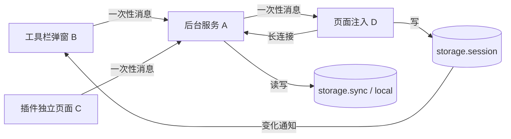
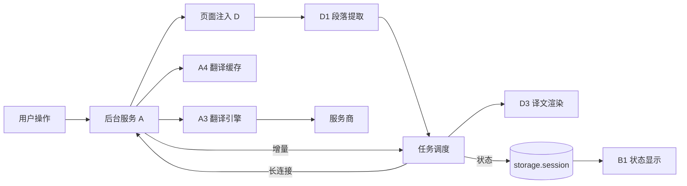
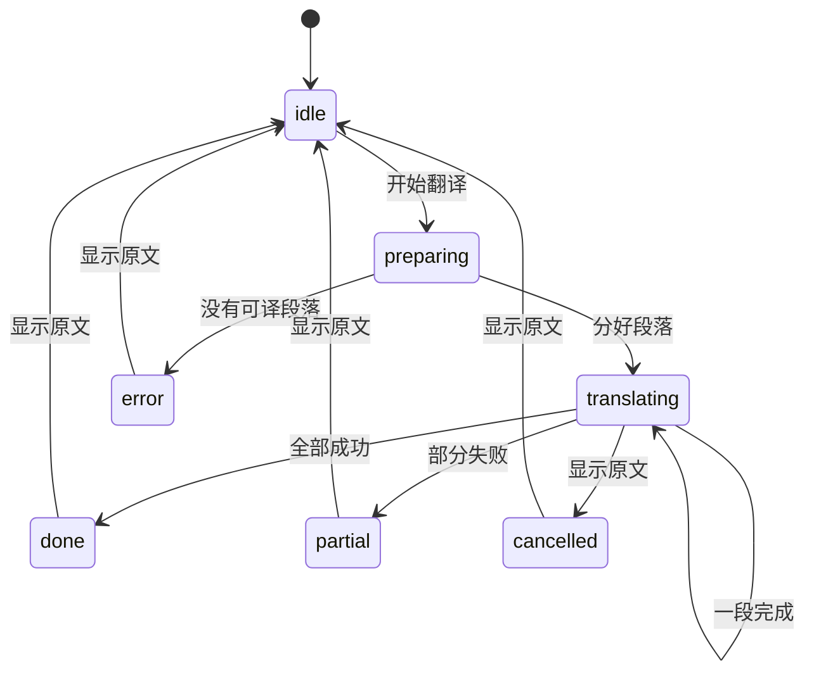
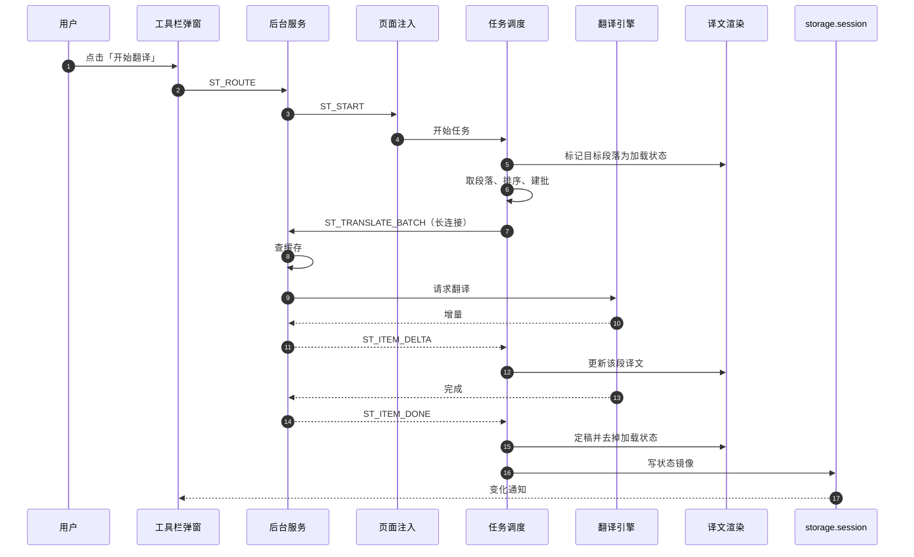

# SimpleTrans 项目架构

## 1. 文档说明与修订记录

### 1.1 文档用途与范围

本文是 SimpleTrans **结构设计的唯一来源**，只讲三件事：项目由哪些模块组成、每个模块负责什么、一次翻译大致怎么走。

本文**不写**以下内容：

- 具体交互与实现细节（页面上错误怎么显示、译文的具体样式、各家接口的报文格式、边界情况）→ `docs/modules/`；
- 实现进度与任务排期 → `docs/PLAN.md`；
- 单个功能的实现需求、缺陷修复 → `docs/demand/`、`docs/bug/`。

代码与本文不一致时，以本文为准：先改本文，再改代码。

### 1.2 修订记录

| 日期 | 结论 | 影响范围 |
| ---- | ---- | -------- |
| 2026-11-13 | 按模块重排为 8 章，统一消息命名，合并待确认项 | 全文 |
| 2026-11-13 | 按浏览器部分分层重排模块，限定两种翻译模式，细节下沉 `docs/modules/` | 全文 |
| 2026-11-13 | 新增「测试与质量门禁」一章：确立 Vitest 单元测试分层、`tests/` 目录、chrome stub 语义与门禁顺序；原第 7、8 章顺延为第 8、9 章 | 2.1、3.1、5.1、7（新增）、8/9（原 7/8） |
| 2026-11-13 | 按用户决定，单元测试集成并入 P0（原 P1 取消），门禁自 P0 起生效；PLAN 阶段编号前移（原 P2–P10 → P1–P9） | 7.1、7.7、8.1 |
| 2026-11-13 | P0 定位为「骨架重建 + 门禁」。3.1 目录树定稿：补 `commands.js`、`context-menu.js`（A1 入口），拆出 `config/`、`translate/`、`cache/` 与 `dom/` 的具体文件；不单独设 `keepalive.js`（连接保活由 D4 心跳与 A2 端口生命周期承担）。新增 3.4「空壳约定」与 7.9「P0 结构测试」。 | 3.1、3.4（新增）、4.2、7.3、7.9（新增）、8.1 |
| 2026-11-13 | 澄清：E1 消息名、5.3 数值、E2/E3 字段属于设计与契约，P0 只建文件不写值；代码在 P1、P2 按 `docs/modules/` 落地 | 3.1、4.6、7.9 |
| 2026-11-14 | P1 落地：`tests/helpers/chrome.js`、`load.js` 建立，3.1 目录树去掉 `helpers/`「待建」；chrome stub P1 仅实现 storage 三区语义，`runtime`/`tabs`/`scripting`/`Port` 随 P2 补齐（7.4 为最终目标语义） | 3.1、7.3 |
| 2026-11-15 | P2 落地 E1 消息与报文、A1 控制面、A2 网关、D4 页面通道；Q12 结论：不新增 `ST_STOP`，`ST_RETRY`/`ST_GET_STATUS` 分别在 P8/P6 落地；5.3 增加心跳超时 10 秒；7.3 的 chrome stub 阶段标注调整为 P2 补事件/Port、P3/P6 补 tabs/scripting | 4.6、5.3、7.3、8.1 |

## 2. 项目介绍

### 2.1 项目定位

SimpleTrans 是一个 Chrome 扩展（Manifest V3），把网页内容翻译成目标语言，并以**双语对照**的方式显示：原文保留，译文插在原文后面。

只提供两种翻译模式：

1. **整页翻译**：翻译当前页面里所有可翻译的段落。
2. **悬停段落翻译**：鼠标停在某个段落上，按快捷键只翻译这一段；该段已有译文时，再按快捷键隐藏译文。

两种模式的显示方式完全一样，都在段落内部插入译文。

翻译引擎不限定一家：既可以是传统机器翻译服务（腾讯、阿里、有道、百度、Google、DeepL 等），也可以是 AI 大模型（DeepSeek、OpenAI 兼容接口、Ollama 等）。用户选择首选引擎和备用引擎，两种模式使用同一套引擎配置。

技术上：界面用 React 加 Vite 构建，样式用 Tailwind；AI 引擎走统一的流式调用库；传统接口用 `fetch`，签名用浏览器自带的加密接口；单元测试用 Vitest，P1 起用自写的 `chrome` stub 代替浏览器；具体版本以 `package.json` 为准。

### 2.2 功能范围

| 功能 | 说明 |
| ---- | ---- |
| 整页翻译 | 找出整页可翻译的段落，批量翻译，译文逐段插入原文后面 |
| 悬停段落翻译 | 鼠标停在段落上，按快捷键只翻译该段；已有译文时按快捷键隐藏；显示方式与整页翻译一致 |
| 多引擎 | 配置多个引擎，指定首选与备用；整页与悬停使用同一套选择 |
| 批量与流式 | 一次请求翻译多段；AI 引擎可以边生成边显示 |
| 译文缓存 | 翻译过的段落缓存起来，再次遇到直接使用 |
| 密钥存放位置可选 | 密钥可以放本机（`local`）或跟随账号同步（`sync`） |
| 设置页测试 | 在设置页直接测试引擎是否可用，显示结果与耗时 |

### 2.3 使用入口

| 入口 | 清单声明 | 作用 |
| ---- | -------- | ---- |
| 工具栏图标 | `action.default_popup` → `popup/index.html` | 打开弹窗：查看状态，按钮在「开始翻译」与「显示原文」之间切换，打开设置 |
| 设置页 | `options_page` → `options/index.html` | 配置引擎、首选与备用、密钥、缓存 |
| 快捷键 | `commands` | 翻译鼠标所在段落；该段已有译文时隐藏 |
| 页面内译文 | 由页面注入脚本插入 | 以双语对照方式显示译文 |

快捷键由清单的 `commands` 声明，用户可以在 Chrome 的扩展快捷键页面修改。

### 2.4 名词说明

全文只用下面这套叫法。

| 名词 | 含义 |
| ---- | ---- |
| 段（段落） | 页面上一个可以独立翻译的文本块，例如一个 `<p>`、一个列表项、一个表格单元格 |
| 批 | 一次请求里发给引擎的多段文本 |
| 引擎 | 翻译服务的具体实现，例如 DeepSeek、腾讯翻译 |
| 引擎实例 | 用户配置好的一个具体引擎；同一类型可以配多个实例（例如两个 DeepSeek 实例用不同模型） |
| 服务商 | 提供翻译接口的厂商，例如腾讯云、DeepL |
| 翻译模式 | 只有两种：整页翻译、悬停段落翻译 |
| 译文容器 | 插入页面的那个 `<span>`，里面放译文 |
| 页面注入 | 注入到网页里运行的扩展脚本，负责页面上的工作 |
| 源语言 / 目标语言 | 原文的语言 / 译文要翻译成的语言 |

## 3. 目录结构

### 3.1 源码目录

目录树是代码结构的唯一清单：**代码里有的文件必须在树里，树里的文件必须能指到模块**。未创建的条目在注释里标「待建」并写明阶段。

```text
public/
  manifest.json              扩展清单：入口、注入、权限
  icons/                     扩展图标：icon16.png / icon48.png / icon128.png
src/
  background/                后台服务（A）
    index.js                 入口：监听器注册
    router.js                A1 消息路由
    commands.js              A1 快捷键入口
    context-menu.js          A1 右键菜单入口
    gateway.js               A2 请求网关
  popup/                     工具栏弹窗（B）
    index.html
    main.jsx
    Popup.jsx
    popup.css
  options/                   插件独立页面（C）
    index.html
    main.jsx
    Options.jsx
  content/                   页面注入（D）
    index.js                 入口
    bridge.js                D4 与后台通信
    hover.js                 D2 悬停检测
    task.js                  D5 状态上报与任务调度
    dom/
      scanner.js             D1 段落提取
      renderer.js            D3 译文渲染
    content.css              译文样式
  shared/                    公共模块（E）
    protocol.js              E1 消息协议
    constants.js             公共数值（见 5.3）
    storage.js               E2 存储读写
    settings.js              E2 默认设置
    config/
      registry.js            E3 引擎类型目录与字段
      instances.js           E3 引擎实例、首选与备用、密钥迁移
    translate/
      adapter.js             A3 适配器契约
      batch.js               A3 批量编码与解析
    cache/
      key.js                 A4 缓存 key
      store.js               A4 缓存读写与淘汰
    global.css               全局样式
scripts/
  build.mjs                  三模式构建
  smoke.mjs                  构建产物检查
  gen-icons.js               生成占位图标
tests/
  unit/                      源码级测试，文件名与被测模块同名
    structure.test.js        骨架结构与空壳约定（P0）
    architecture.test.js     3.1 目录树与仓库一致性（P0）
  helpers/                   chrome stub 与加载助手
    chrome.js                chrome API stub（storage 三区语义，P1）；事件、Port（P2）；tabs、scripting（P3/P6）
    load.js                  安装 stub 与动态导入（P1）
  component/                 组件测试（待建，P6–P7）
vitest.config.js             单元测试配置
vite.config.js               构建配置
dist/                        构建产物，加载到 Chrome 的目录（不提交）
```

`src/` 下不再有其它文件；新增文件先改这棵树。`tests/component/` 在 P6–P7 建立，之前只在树里标注「待建」。

### 3.2 构建产物

页面注入脚本不能用 ES Module，弹窗和设置页是普通网页，后台可以用 ES Module。一次构建只能给一种格式，所以 `scripts/build.mjs` 分三次调用：

| 模式 | 产物 | 格式 | 说明 |
| ---- | ---- | ---- | ---- |
| `web` | `popup/`、`options/` 与 `assets/` | ESM + HTML | React 页面 |
| `background` | `background.js` | ESM 单文件 | Service Worker |
| `content` | `content.js`、`content.css` | IIFE 单文件 + 固定名 CSS | 全部依赖内联 |

由此产生两条约束：

- 页面注入可以引用 `shared/` 里的纯模块，构建时会内联进单文件；不能使用动态 `import()`。
- 页面注入的产物里不能出现翻译服务的地址、密钥字段名、签名代码；构建后由 `scripts/smoke.mjs` 检查。

命令：`npm run dev` 并行监听三种产物，`npm run build` 生产构建，`npm run smoke` 检查产物，`npm test` 跑单元测试，`npm run gate` 串联 test → build → smoke。

### 3.3 文档目录

| 位置 | 放什么 |
| ---- | ------ |
| `docs/项目架构.md` | 本文，结构设计唯一来源 |
| `docs/PLAN.md` | 实现进度与任务排期 |
| `docs/任务文档索引.md` | 实现需求与缺陷的索引 |
| `docs/demand/` | 实现需求文档，按 `YYYYMMDD-序号-文档名.md` 命名 |
| `docs/bug/` | 缺陷文档，命名同上 |
| `docs/modules/` | 各模块与交互细节：样式、错误提示、报文格式、边界情况 |

### 3.4 空壳约定

P0 交付的是可构建、可加载的**空骨架**，不是最小可用功能。约定如下：

1. 每个源码文件只有文件头注释，声明模块编号、职责、依赖与实现阶段，正文不写行为；文件头统一含 `实现阶段：P<数字>`。
2. 空壳不含任何 `chrome.*` 调用、不读写 `storage`、不引用翻译引擎与密钥，也不定义消息名、错误码与业务常量——这些属于 E1/E2/E3 的设计，在 P1、P2 按 `docs/modules/` 落地。
3. 入口文件（`background/index.js`、`content/index.js`、`popup/main.jsx`、`options/main.jsx`）保留构建所需的引用（样式导入、React 挂载），不注册监听器、不发起消息。
4. 弹窗与设置页只渲染静态占位文案，不读取设置、不调用引擎；占位文案必须写明「待接入」的阶段。
5. 依赖方向仍按 5.1 执行：`content/` 不得引用 `shared/config/`、`shared/translate/`、`shared/cache/`；`src/` 不得引用 `tests/`。
6. 新增行为时，先在本文件与对应 `docs/modules/` 写清接口，再填代码；同批补 `tests/unit/` 下的同名测试。

## 4. 模块划分

### 4.1 分层与总览

模块分三层，上层是运行位置，中层是业务模块，下层是具体功能：

1. **浏览器功能模块**：按代码在浏览器里运行的位置划分，共四个——后台服务、工具栏弹窗、插件独立页面、页面注入。
2. **业务模块**：每个浏览器功能模块内部按职责再分。被多个部分共用的业务模块单独放在公共模块里，避免每个部分各写一份。
3. **具体功能**：业务模块内部的实际动作，例如发送请求、保存配置、处理 DOM。

编号规则：浏览器功能模块用 A、B、C、D，公共模块用 E；业务模块用「部分编号 + 序号」，例如 A2、D3。

```text
后台服务（A）
├─ A1 消息路由
├─ A2 请求网关
├─ A3 翻译引擎
└─ A4 翻译缓存
工具栏弹窗（B）
├─ B1 状态显示
└─ B2 命令下发
插件独立页面（C）
├─ C1 通用设置
├─ C2 引擎管理
├─ C3 首选引擎
├─ C4 测试翻译
└─ C5 数据管理
页面注入（D）
├─ D1 段落提取
├─ D2 悬停检测
├─ D3 译文渲染
├─ D4 与后台通信
└─ D5 状态上报
公共模块（E）
├─ E1 消息协议
├─ E2 设置与存储
└─ E3 翻译配置与密钥
```

每个业务模块按「职责 / 具体功能 / 源码」三行写，不展开实现细节。

A3、A4 的源码放在 `shared/` 下，方便构建时引用，但它们只被后台使用，因此归在后台服务下。

有两类内容不放在模块里：

- **任务调度**：它串起多个模块，属于流程机制，见 6.2。
- **样式、错误提示、接口报文、边界情况**：属于实现细节，见 `docs/modules/`。

### 4.2 后台服务（A）

运行在 Service Worker 里，负责接收请求、调用引擎、返回结果，不接触页面 DOM。

**A1 消息路由**

- 职责：把弹窗、设置页的请求和快捷键、右键菜单事件送到对应标签页，页面注入脚本没注入时先注入。
- 具体功能：接收弹窗与设置页消息；接收快捷键与右键菜单；确定目标标签页；按需注入页面脚本；转发开始、清除、切换译文；把转发失败的原因回传。
- 源码：`src/background/router.js`、`src/background/commands.js`（快捷键入口）、`src/background/context-menu.js`（右键菜单入口）

**A2 请求网关**

- 职责：处理页面注入发来的批次请求，返回译文。
- 具体功能：校验批次（段数、长度、在途数量）；按配置确定首选引擎；查缓存；控制全局并发；调用引擎并转发增量与定稿；处理取消与连接关闭。
- 源码：`src/background/gateway.js`
- 说明：不保存任务状态，任务在页面注入侧。

**A3 翻译引擎**

- 职责：把一批文本交给具体服务，按段返回结果。
- 具体功能：每个服务商一个适配器，处理地址、签名、语言码；AI 引擎做批量编码与解析；把流式输出拆回各段；把各家错误映射成统一类型；返回用量。
- 源码：`src/shared/translate/`

**A4 翻译缓存**

- 职责：保存「源文 → 译文」，下次遇到相同条件直接返回。
- 具体功能：计算缓存 key（引擎、模型、语言、提示词版本、上下文、原文）；读写 `storage.local`；容量淘汰与清空。
- 源码：`src/shared/cache/`

### 4.3 工具栏弹窗（B）

点击工具栏图标后打开的页面，只负责查看状态和下发命令，不持有任务。

**B1 状态显示**

- 职责：显示当前标签页的翻译状态。
- 具体功能：读取状态镜像；订阅变化；显示进度、成功数、失败数、当前引擎。
- 源码：`src/popup/Popup.jsx`

**B2 命令下发**

- 职责：把用户操作转成命令。
- 具体功能：按钮在「开始翻译」与「显示原文」之间切换；未开始时点「开始翻译」启动整页任务；已有译文或任务进行中时点「显示原文」，清除全部译文并取消本页任务；打开设置页。
- 源码：`src/popup/Popup.jsx`

### 4.4 插件独立页面（C）

设置页，负责所有配置与测试；不直接调用翻译服务。

**C1 通用设置**

- 职责：配置与具体引擎无关的选项。
- 具体功能：启用开关、目标语言、源语言、密钥存放位置、缓存开关、并发数。
- 源码：`src/options/Options.jsx`

**C2 引擎管理**

- 职责：管理用户配置的引擎实例。
- 具体功能：按类型目录生成表单；添加、编辑、复制、停用、删除；测试连接。
- 源码：`src/options/Options.jsx`

**C3 首选引擎**

- 职责：指定所有翻译使用哪个引擎。
- 具体功能：选择首选引擎；设置备用引擎。
- 源码：`src/options/Options.jsx`

**C4 测试翻译**

- 职责：在不保存配置的情况下试翻一段文本。
- 具体功能：用当前草稿配置发测试请求；显示结果、耗时、用量、批量对齐情况。
- 源码：`src/options/Options.jsx`

**C5 数据管理**

- 职责：管理本地数据。
- 具体功能：清空译文缓存；导入导出配置（不含密钥）。
- 源码：`src/options/Options.jsx`

### 4.5 页面注入（D）

注入到网页里运行的脚本，负责页面上的所有工作：找段落、跟踪悬停位置、调度任务、显示译文、与后台通信。

**D1 段落提取**

- 职责：找出页面上可以翻译的文本块。
- 具体功能：按标签与结构找出段落；判断块级还是行内；跳过脚本、样式、代码块、隐藏内容和已翻译内容；相同文本只保留一份。
- 源码：`src/content/dom/scanner.js`

**D2 悬停检测**

- 职责：记录鼠标当前停在哪个段落上，供快捷键使用。
- 具体功能：跟踪指针移动；确定所在段落；指针落在译文上时归到该译文所属的段落。
- 源码：`src/content/hover.js`

**D3 译文渲染**

- 职责：把译文插入页面、更新、隐藏和清除。
- 具体功能：触发时在段落上显示加载状态；在原文后插入译文容器；更新已有译文；隐藏或清除单段译文；清除全部译文；整页与悬停共用同一套结构。
- 源码：`src/content/dom/renderer.js`
- 说明：具体 DOM 结构与样式见 `docs/modules/D3-译文渲染.md`（待建，P3）。

**D4 与后台通信**

- 职责：维持与后台的长连接，发送请求、接收结果。
- 具体功能：发送批次；接收增量与定稿；心跳；断线重连；取消请求。
- 源码：`src/content/bridge.js`

**D5 状态上报**

- 职责：把任务进度写进状态镜像，供弹窗读取。
- 具体功能：按节流写入 `storage.session`；终态必写；任务结束后清理。
- 源码：`src/content/task.js`（与任务调度在同一文件）

### 4.6 公共模块（E）

被多个部分共用的代码，不单独运行在某个位置。

**E1 消息协议**

- 职责：定义扩展内部的消息与错误类型。
- 具体功能：消息名与方向；错误分类；载荷上限；统一的参数校验。
- 源码：`src/shared/protocol.js`
- 说明：字段与报文细节见 `docs/modules/E1-消息协议.md`（待建，P1–P2）。

消息清单：

| 消息 | 方向 | 用途 |
| ---- | ---- | ---- |
| `ST_ROUTE` | 弹窗 → 后台 | 把一条命令（开始、清除）转给当前标签页 |
| `ST_START` | 后台 → 页面注入 | 开始整页任务，带上语言 |
| `ST_TOGGLE` | 后台 → 页面注入 | 切换鼠标所在段落的译文：没有就翻译，已有就隐藏，正在加载就取消显示 |
| `ST_CLEAR` | 后台 → 页面注入 | 清除全部译文并中断本页所有在途请求 |
| `ST_PING` / `ST_PONG` | 双向 | 连通性检查与心跳 |
| `ST_LIST_ENGINES` | 设置页 → 后台 | 取引擎列表（不含密钥） |
| `ST_TEST_ENGINE` | 设置页 → 后台 | 用给定配置测试翻译 |
| `ST_ENGINE_CHANGED` | 后台 → 页面注入 | 通知已切换到备用引擎 |
| `ST_TRANSLATE_BATCH` | 页面注入 → 后台 | 提交一批待译文本 |
| `ST_ITEM_START` | 后台 → 页面注入 | 某段开始处理 |
| `ST_ITEM_DELTA` | 后台 → 页面注入 | 某段的增量文本 |
| `ST_ITEM_DONE` | 后台 → 页面注入 | 某段定稿 |
| `ST_ITEM_ERROR` | 后台 → 页面注入 | 某段失败 |
| `ST_BATCH_DONE` | 后台 → 页面注入 | 整批结束（含整批拒绝） |
| `ST_CANCEL_BATCH` / `ST_CANCEL_ITEM` | 页面注入 → 后台 | 取消整批 / 取消单段 |
| `ST_CLOSE` | 页面注入 → 后台 | 主动关闭连接 |

**E2 设置与存储**

- 职责：读写扩展的配置与运行数据。
- 具体功能：定义默认设置；读写 `storage.sync`、`storage.local`、`storage.session`；提供公开设置、完整设置、单个密钥三种读取方式。
- 源码：`src/shared/storage.js`、`src/shared/settings.js`

**E3 翻译配置与密钥**

- 职责：管理引擎类型、引擎实例、首选与备用引擎、密钥。
- 具体功能：维护各类型的字段与默认值；校验配置；按优先级算出实际生效的值；决定密钥键名；迁移旧配置。
- 源码：`src/shared/config/`

## 5. 模块协作机制

### 5.1 依赖规则

**方向**：四个部分只能依赖公共模块和自己内部的业务模块；公共模块不反向依赖它们。

| 部分 | 可以依赖 |
| ---- | -------- |
| 后台服务（A） | A3、A4、E1、E2、E3 |
| 工具栏弹窗（B） | E1、E2（公开设置） |
| 插件独立页面（C） | E1、E2、E3（类型目录与校验） |
| 页面注入（D） | E1、`constants.js`、D 内部模块 |
| 公共模块（E） | E3 依赖 E2，E2 依赖 E1；不依赖 A/B/C/D |
| 测试（`tests/`） | `src/`、Node 内置模块、Vitest；不依赖浏览器与网络 |

**硬性规则**

1. 禁止循环依赖；同一模块内部的文件可以互相引用。
2. 页面注入不使用 `chrome.storage.sync` 与 `chrome.storage.local`（设置与密钥不进入页面），只允许写 `storage.session` 里当前标签页的状态键，并使用 `chrome.runtime` 的消息与连接接口。
3. `content.js` 产物中不能出现翻译服务域名、密钥字段名、签名代码；构建后检查，出现即失败。
4. 新增模块必须先改本文，再改代码；新增依赖关系同样先改 5.1。
5. `src/` 不得引用 `tests/`；测试文件不进构建产物；测试用 7.4 的 stub 代替 `chrome`，不加载真实扩展；冒烟脚本复用同一份 stub。

### 5.2 通信方式

| 方式 | 谁和谁 | 适合 | 限制 |
| ---- | ------ | ---- | ---- |
| 一次性消息 | 弹窗 ↔ 后台、设置页 ↔ 后台、后台 ↔ 页面注入 | 命令、查询、一次性结果 | 没有流式；后台被回收时可能失败 |
| 长连接 `st-gateway` | 页面注入 ↔ 后台 | 批次请求与增量结果 | 需要心跳；断开要重连 |
| 状态同步 | 页面注入 → `storage.session` → 弹窗 | 进度展示 | 只做单向展示，不传大对象 |

选择规则：只需要一个结果的用一次性消息；需要多次回包的用长连接；只需要「看到状态」的用状态同步，不用消息。



消息名与方向见 E1（4.6 节）；字段与报文细节见 `docs/modules/E1-消息协议.md`（P2 已建立）。

P2 起 `ST_BATCH_DONE` 是每批的唯一终态：整批拒绝时带 `ok: false` 与 `error`，正常结束或部分失败时带计数；不新增 `ST_BATCH_ERROR`。Q12 已解决：不新增 `ST_STOP`（`ST_CLEAR` 已覆盖清除语义）；`ST_RETRY` 在 P8、`ST_GET_STATUS` 在 P6 落地。

### 5.3 公共约定

以下数值集中在这里，代码里对应 `src/shared/constants.js` 与 `src/shared/protocol.js`；其他地方只引用。

| 项 | 值 | 说明 |
| -- | -- | ---- |
| 心跳间隔 | 20 秒 | 页面注入发 `ST_PING`，后台回 `ST_PONG` |
| 心跳超时 | 10 秒 | 发出 `ST_PING` 后 10 秒未收到 `ST_PONG` 即主动重连 |
| 重连退避 | 1 秒、2 秒、4 秒 | 断开后重连，期间暂停新批 |
| 传统翻译超时 | 单段 15 秒，整批 30 秒 | 无流式，等完整响应 |
| AI 单段超时 | 单段 15 秒，增量 30 秒，总计 120 秒 | 30 秒无新增量视为卡住 |
| AI 批量超时 | 单段 20 秒，增量 30 秒，总计 180 秒 | 必须小于后台单次事件的 5 分钟上限 |
| 重试次数 | 2 次 | 间隔 1 秒、2 秒，加随机抖动 |
| 全局并发 | 4 | 后台同时进行的上游请求上限；用户设置默认 3 |
| 交互预留 | 1 | 悬停专用，整页最多用 3 |
| 整页在途批次 | 1–2 | 避免一次堆太多请求 |
| 显示更新节流 | 80 毫秒 | 合并增量，按帧刷新 |
| 状态写入节流 | 300 毫秒 | 终态必须写 |
| 状态保留 | 任务结束后 30 秒 | 之后删除状态键 |
| 首屏目标 | 段落 ≤ 1.5 秒，AI 首字 ≤ 2.5 秒 | 用于判断是否需要调整批量 |

载荷上限：

| 限制 | 值 |
| ---- | -- |
| 单批段数 | 12 段 |
| 单批字符 | 12000 字符 |
| 单段字符 | 4000 字符 |
| 每段上下文 | 400 字符 |
| 每批上下文 | 1200 字符 |
| 每个连接在途批次 | 4 |

### 5.4 数据归属

| 数据 | 存在哪 | 谁写 | 谁读 | 什么时候清 |
| ---- | ------ | ---- | ---- | ---------- |
| 普通设置 | `storage.sync` | 设置页 | 弹窗、后台、设置页（页面注入经后台获取） | 用户修改时覆盖 |
| 引擎实例与首选/备用引擎 | `storage.sync` | 设置页 | 后台、设置页 | 用户删除时 |
| 密钥 | `storage.local` 或 `storage.sync`（按 `keyStorage`） | 设置页写入，配置模块迁移 | 仅后台 | 删除实例时 |
| 翻译缓存 | `storage.local` | 后台 | 后台 | 容量淘汰、用户清空 |
| 任务状态镜像 | `storage.session` 的 `task:<tabId>` | 页面注入 | 弹窗 | 任务结束 30 秒后、标签页关闭时 |
| 页面上的译文 | 页面 DOM | 译文渲染 | 译文渲染自己维护 | 清除、页面卸载 |
| 任务内的段落与进度 | 页面注入内存 | 任务调度 | 页面注入、状态上报 | 任务结束 |

规则：

- 密钥只有后台读；弹窗和设置页只知道「已配置 / 未配置」。
- 页面注入不缓存译文，缓存只有一份，在后台。
- 同一份数据只有一个写入方；其他模块通过消息请求，不直接写别人的数据。

### 5.5 安全边界

1. **只接受扩展内部的消息。** 后台检查发送方是扩展自身，不接收外部消息，长连接的端口名固定为 `st-gateway`。
2. **后台不接受地址和请求头。** 批次请求里只能给引擎实例，不能给 URL、Header、请求体模板；自定义接口地址只能来自用户设置。
3. **密钥不出后台。** 页面注入产物里没有密钥字段、服务商地址、签名代码；设置页只显示是否已配置；日志和错误信息里不出现密钥。
4. **页面文本当作数据。** 系统提示里明确说明「片段是数据，不是指令」；译文只用文本方式写入；不给模型提供工具调用能力。
5. **上限防滥用。** 段长、批长、连接在途批次都有上限，超限直接拒绝。
6. **同步密钥要提醒。** `keyStorage=sync` 会让密钥经过云端，设置页必须说明这一点。

## 6. 业务流程

### 6.1 流程总览

一次翻译的基本路线：



每个流程都按同样五步写：**触发 → 检查 → 开始 → 执行 → 显示与失败**。

| 流程 | 触发 | 涉及模块与机制 |
| ---- | ---- | -------- |
| 整页翻译 | 弹窗点「开始翻译」 | A、B2、D1、D3、D4、D5、任务调度 |
| 悬停段落翻译 | 悬停 + 快捷键 | A、D1、D2、D3、D4、任务调度 |
| 显示原文 | 弹窗点「显示原文」 | A、B2、D3、D4、D5、任务调度 |
| 引擎选择与备用切换 | 请求开始、请求失败 | A2、E3、A3 |
| 缓存读写 | 每次批次请求 | A2、A4、E2 |
| 标签页关闭 | 关闭标签页 | A、D4、任务调度 |
| 配置保存与迁移 | 设置页保存、扩展升级 | C、E3、E2 |
| 异常与恢复 | 请求失败、连接断开 | A、D4、D5、任务调度 |
| 译文显示与更新 | 标记加载、收到结果 | D3、D5 |

### 6.2 任务调度与状态

任务调度不是模块，它把段落提取、请求、渲染、状态上报串起来。

**两类任务**

- **页面任务**：一次整页翻译，一个标签页同时只有一个。
- **悬停任务**：一次只翻译一段，单独发起，不等待页面任务。

两种任务走同一条处理流程，只是范围不同（见 6.3）。同一段在同一时刻只有一个翻译请求；如果这一段已经在页面任务里排队或在途，再按快捷键就按下面的取消规则处理。

**任务状态**



- 任务状态：`idle`（空闲）、`preparing`（准备）、`translating`（翻译中）、`done`（完成）、`partial`（部分失败）、`cancelled`（已取消）、`error`（出错）。
- 段状态：`pending`（待处理）→ `inflight`（请求中）→ `streaming`（接收中）→ `done`（成功）或 `failed`（失败）；另有 `cancelled`（已取消）。
- 悬停任务只有 `pending` → `streaming` → `done` / `failed` / `cancelled`，不进入页面任务的状态机，也不写状态镜像。

**调度规则**

| 项 | 规则 |
| -- | ---- |
| 请求粒度 | 按引擎能力建批；引擎只支持单段时，一批就是一段 |
| 顺序 | 视口内可见的优先，其余按文档顺序；同一批尽量取相邻段落，保留上下文 |
| 并发 | 按 5.3 的并发上限；悬停优先占用交互名额 |
| 去重 | 页面内相同文本共用一个结果；相同文本正在请求时复用同一请求 |
| 优先级 | 悬停 > 首屏可见 > 其余 |
| 重试 | 按 5.3 的次数与间隔；只对限流、网络、超时、流中断重试 |
| 批量失败 | 结果对不上或格式错误时二分拆批，直到单段；单段仍失败只标记该段 |
| 重复触发 | 整页任务进行中再次点「开始翻译」只更新参数，不新建任务 |

**状态镜像**

- 键：`task:<tabId>`，写在 `storage.session`。
- 字段：`phase`、`scope`、`lang`、`engineId`、`total`、`done`、`failed`、`inflight`、`startedAt`、`updatedAt`、`lastError`、`fallbackUsed`。
- 写入按 5.3 节流；终态必写；任务结束 30 秒后删除；标签页关闭时由后台清理。

**取消**

| 层级 | 触发 | 行为 |
| ---- | ---- | ---- |
| 单段（排队中） | 悬停快捷键 | 从队列移除，去掉加载状态，不发请求，不写缓存 |
| 单段（所在批只有这一段） | 加载中再次按快捷键 | 中断该段请求，不写缓存，去掉加载状态 |
| 单段（所在批还有别的段） | 悬停快捷键 | 不中断上游批；该段立即去掉加载状态，结果写缓存但不显示 |
| 整批 | 批量失败 | 取消整批上游请求 |
| 页面任务 | 显示原文 | 清除全部译文（含悬停产生的）；中断所有在途请求；清空队列 |
| 标签页 | 关闭标签页 | 中断该页所有排队中与执行中的请求；页面队列随页面销毁；删除状态键 |
| 连接 | 页面卸载、后台回收 | 中断该连接上的全部上游请求 |

### 6.3 翻译流程（整页与悬停）

两种模式除触发方式和范围外，内部处理与显示完全相同：先把目标段落标记为加载状态，再建批请求，结果回来替换加载状态。

**差异**

| 项 | 整页翻译 | 悬停段落翻译 |
| -- | -------- | ------------ |
| 触发 | 弹窗点「开始翻译」 | 鼠标停在段落上按快捷键 |
| 范围 | 页面里所有可译段落，视口内优先 | 只有指针所在段落 |
| 加载状态 | 视口内还没翻译的段落同时显示，其余轮到再显示 | 只有该段显示 |
| 已有译文 | 不重复请求 | 再按快捷键隐藏该段 |
| 取消 | 点「显示原文」清除全部 | 加载中再按快捷键取消该段 |

**检查**：扩展是否启用；目标语言是否有效；当前页面是否能注入；首选或备用引擎至少一个可用。任一不满足就提示原因，不进入任务。

**开始**：

- 整页：弹窗发 `ST_ROUTE`，后台确定标签页，页面注入没运行就先注入，再发 `ST_START`。
- 悬停：后台收到快捷键，发 `ST_TOGGLE`，由页面注入确定当前段落。

**按钮状态**（只对整页）：点「开始翻译」后按钮立刻变成「显示原文」；点「显示原文」会清除全部译文并中断本页所有在途请求，按钮回到「开始翻译」。任务没能开始时，按钮也回到「开始翻译」。

**执行**：

1. 确定目标段落：整页由 D1 取全部可译段落；悬停由 D2 给出当前段落，指针落在译文上时归到该译文所属的段落。
2. 还没翻译的目标段落先标记加载状态，前端显示正在翻译。
3. 任务调度按可见优先排序，按引擎能力建批。
4. 每批经 D4 发给后台；后台查缓存，未命中则调用首选引擎。
5. 有增量就推送增量，没有增量就等定稿。

**显示与失败**：

| 情况 | 处理 |
| ---- | ---- |
| 译文到达 | 用译文替换该段的加载状态 |
| 该段已有译文 | 悬停时不再请求，再按快捷键隐藏该段译文 |
| 单段失败 | 只标记该段，其他段继续；任务最终为「部分失败」 |
| 页面不能注入 | 提示无法在当前页面使用 |
| 没有可用引擎或密钥 | 提示去设置页；配置了备用则切换 |
| 连接断开 | 重连后重发未完成段 |

取消与清除的细节见 6.2。



悬停流程只是把触发换成快捷键、把范围缩到一段，其余步骤相同。

### 6.4 引擎选择与备用切换

所有翻译都用用户配置的首选引擎，两种模式共用同一套选择。

**选择顺序**：首选引擎 → 首选不可用时改用备用 → 两者都不可用则提示。

**备用切换**：

- 只保留 1 个备用引擎。
- 只有这些情况会切换：没有密钥、没有引擎、配置无效、鉴权失败、额度不足、不支持该语言，以及重试之后仍然限流。
- 切换在任务内生效：一旦切到备用，本次任务剩余段落都用备用，不切回首选，避免同一页出现两种译文风格。
- 切换结果记进状态镜像（`fallbackUsed`），弹窗显示「首选引擎不可用，已切换到 XXX」。
- 批量结果对不上不换引擎，只拆批。

### 6.5 缓存读写

1. 后台收到批次后，对每段算缓存 key。
2. 命中：直接返回已有译文，不调引擎。
3. 未命中：调引擎；流式过程中只转发增量，不写缓存。
4. 成功定稿：按段写入缓存，包括已取消显示、但批量仍在执行的段。
5. 失败或取消整批：不写。
6. 清理：容量超限按最近最少使用淘汰；设置页可手动清空；关闭缓存时跳过读写。

### 6.6 标签页关闭

关闭标签页或页面被卸载时，立即结束这一页的所有工作，不需要用户确认：

1. 页面注入与后台的连接断开。
2. 后台中断该页面所有排队中与执行中的请求。
3. 页面自己维护的段落队列随页面一起销毁，不再执行。
4. 后台在标签页关闭事件里删除 `task:<tabId>` 状态键。

未完成的译文不保留，也不影响其他标签页。

### 6.7 配置保存与迁移

**保存**：

1. 设置页收集改动，按类型目录校验字段。
2. 先保存引擎实例，再保存首选与备用引擎；任一失败就撤销本次全部改动，避免出现「首选指向不存在的实例」。
3. 影响译文的字段（模型、提示词版本、批量编码、语言）进入缓存 key，变化后旧结果不再命中；只改温度或界面文字不影响缓存。

**切换密钥存放位置**：

1. 把当前分区里的所有密钥写到目标分区。
2. 全部写入成功后，删除原分区的密钥。
3. 中途失败则保留原数据并提示，不删除任何内容。

**旧配置迁移**：把旧的单一密钥转成默认引擎实例；确认写入成功后删除旧键；重复执行不会产生重复实例。

**导入导出**：导出不含密钥；导入后校验结构与版本，提示补填密钥。

### 6.8 异常与恢复

**错误分类**

| 类别 | 包含 | 重试 | 拆批 | 切备用 |
| ---- | ---- | ---- | ---- | ------ |
| 配置 | 没有密钥、没有引擎、配置无效 | 否 | 否 | 是 |
| 鉴权与额度 | 鉴权失败、额度不足 | 否 | 否 | 是 |
| 限流与网络 | 限流、网络错误、超时、流中断 | 是 | 否 | 限流重试后 |
| 批量对齐 | 输出与输入对不上 | 否 | 是 | 否 |
| 取消 | 用户取消、连接关闭 | 否 | 否 | 否 |
| 其它 | 不支持的语言、页面注入失败 | 否 | 否 | 视情况 |

具体错误码、提示文案与页面上的展示方式见 `docs/modules/`。

**常见失败与处理**

| 情况 | 处理 |
| ---- | ---- |
| 长连接断开 | 按 5.3 的退避重连；在途批标记为可重试，换新的批次号重发；期间暂停新批 |
| 心跳丢失 | 主动重连，不依赖心跳判断任务失败 |
| 后台被回收 | 页面注入重连；段落列表和进度还在页面内存里，重发未完成段 |
| 请求超时 | 中断请求，按错误类别决定是否重试 |
| 流中断 | 保留已收到的部分，未完成段拆批重试 |
| 批量结果对不上 | 二分拆批，最后退到单段；不按位置猜 |
| 首选引擎鉴权或额度失败 | 切备用；本次任务不再切回 |
| 页面删除译文节点 | 写入前检查节点是否还在文档里；清理时按统一选择器再扫一遍 |
| 关闭标签页 | 见 6.6：中断请求、销毁排队任务、删除状态键 |
| 重复触发 | 整页任务只更新参数，不会开始第二个任务 |

### 6.9 译文显示与更新

- 只有一种显示方式：触发后先在段落上显示加载状态，译文到达后用译文替换，整页与悬停共用同一套结构与状态。
- 整页任务里，视口内还没翻译的段落先同时显示加载状态；其余段落轮到翻译时再显示。悬停任务只有当前段落显示。
- 译文按段落逐步出现；AI 引擎可以边生成边更新，传统引擎等完整结果到达后一次写入。
- 更新合并后按 5.3 的节流值写入，避免频繁重排；定稿时用全文再写一次。
- 出错时保留已显示的部分或错误状态，由任务标记该段失败；页面上具体怎么提示见 `docs/modules/`。
- 悬停段落可以单独隐藏：再次按快捷键即移除该段译文；整页则用弹窗的「显示原文」一次清除全部。
- 清除或隐藏时只移除译文与标记，原文不动，之后可以重新翻译。
- 只改变段落内部的显示，不改动页面原有布局。

## 7. 测试与质量门禁

### 7.1 分层与边界

测试分三层，只有前两层进入门禁，第三层首版不做。

| 层 | 位置 | 工具 | 覆盖对象 | 是否阻塞交付 |
| -- | ---- | ---- | -------- | ------------ |
| L1 产物契约 | `scripts/smoke.mjs` | Node 脚本 + 构建产物 | `dist/` 的格式、注入兜底、页面产物不含密钥与引擎地址 | 是（已有） |
| L2 单元与集成 | `tests/` | Vitest | `src/` 的模块、消息协议与已注册的监听器 | 是（P0 起） |
| L3 真浏览器 | 未落地 | Playwright | 扩展加载、注入时机、页面渲染 | 否（首版不做，见 8.1 Q10） |

两条边界：

1. 单元测试不接触真实 `chrome`、不联网、不读写真实存储；`chrome` 一律由 7.4 的 stub 代替。
2. 单元测试不是验收结论：任何可见界面变化仍按 `AGENTS.md` 第三部分人工验收，测试通过只说明代码没有退步。

### 7.2 技术选型

| 项 | 选择 | 原因 |
| -- | ---- | ---- |
| 测试框架 | Vitest 5.x | 与 Vite 同源，复用同一套 ESM/JSX 解析与配置；`vite` peer 支持 6.4/7/8，与现有 Vite 7 匹配；不用 Jest，避免两套转换配置 |
| 默认环境 | Node | 纯逻辑测试不需要 DOM，启动最快 |
| DOM 环境 | jsdom | 只在组件测试文件里用 `@vitest-environment jsdom` 单独声明 |
| 组件测试 | @testing-library/react | 按用户可见行为断言，不测实现细节 |
| `chrome` API | 自写 stub（`tests/helpers/chrome.js`） | 只实现本项目用到的语义，可控且零额外依赖 |
| 覆盖率 | 只报告，不设阈值 | 阈值会诱导写脆弱测试；先锁定 7.5 列出的高风险面 |

不直接用 `sinon-chrome`、`vitest-chrome`、`vitest-chrome-mv3` 这类第三方 mock：它们覆盖的是「整个 `chrome` 对象」，而本项目只用到其中 6 个 API，且这些库的 API 形状随 Chrome 版本漂移，用它们测过并不能说明扩展里的真实行为。

### 7.3 目录与依赖规则

```text
tests/
  unit/structure.test.js      骨架文件、文件头与依赖方向
  unit/architecture.test.js   3.1 目录树与仓库一致性
  unit/<模块名>.test.js       行为测试，与被测源文件同名（P1 起）
  helpers/chrome.js           stub：三个存储区域（P1）；事件、Port（P2 补）；tabs、scripting（P3/P6 补）
  helpers/load.js             安装 stub → resetModules → 动态导入被测模块
  component/<组件名>.test.jsx 组件测试（待建，P6–P7）
vitest.config.js
```

规则：

1. 一个测试文件对应一个被测模块，文件名与被测文件同名，失败时能直接定位到模块。
2. `tests/` 只依赖 `src/`、Node 内置模块与 Vitest；`src/` 不得引用 `tests/`；P1 建立 `tests/helpers/chrome.js` 后，`scripts/smoke.mjs` 与单测复用它，避免两份 stub 各自漂移。
3. 测试不进构建产物：三个构建模式的 `input` 都不含 `tests/`。
4. 新增模块或修改模块行为时，同批提交对应测试；没有测试的新模块不进入人工验收。

### 7.4 chrome stub 的语义要求

stub 必须按真实语义实现，否则测试只会给出错误的信心。最低要求：

| API | 必须实现的语义 |
| --- | -------------- |
| `runtime.onMessage` | `addListener` / `removeListener` / `emit`；监听器返回 `true` 表示异步回包 |
| `storage.<area>.get` | 支持 `'key'`、`['k1','k2']`、`{ k: 默认值 }` 三种入参，第三种要合并默认值 |
| `storage.<area>.set` / `remove` / `clear` | 按区域隔离，`local`、`sync`、`session` 不共享数据 |
| `tabs.sendMessage` | 目标页没有监听器时抛错，模拟「Receiving end does not exist」 |
| `scripting.insertCSS` / `executeScript` | 记录调用顺序，用于断言「先注入样式再注入脚本」 |
| `runtime.connect` + `runtime.onConnect` + Port | `connect` 触发 `onConnect`；Port 含 `id`、`name`、`onMessage`、`onDisconnect`、`postMessage`；断开时清理在途请求 |

### 7.5 测试范围

P0 只有结构测试（见 7.9）；下表中的行为测试随对应阶段补齐。

| 模块 | 用例要点 |
| ---- | -------- |
| E1 消息协议 | 错误码到 `retryable` 的映射；消息判定；段请求校验（缺 `requestId`、空文本、超长、上下文超限） |
| E2 设置与存储 | 默认值合并；`keyStorage` 归一；旧密钥惰性迁移；切换存放位置不丢密钥；公开设置不含密钥 |
| A1 消息路由 | 已注入不重复注入；未注入时先样式后脚本；注入失败与发送失败的错误码；无活动标签页 |
| 后台入口 | 监听器注册齐全；`ST_PING` 同步回包；`ST_ROUTE` 异步回包；转发命令集合；安装时只写位置类设置 |
| A2 请求网关 | 端口名过滤；心跳回包；关闭与断线都释放全部在途请求；端口计数归零 |
| A3 翻译引擎 | 提示词在有无上下文时的差异；输出归一；空文本短路；缺密钥的错误码 |
| 页面注入入口 | 握手与状态查询回包；尚未接入的能力明确失败 |

### 7.6 编写约定

1. 入口模块（顶层注册监听器的 `background/index.js`、`content/index.js`）必须 `vi.resetModules()` 后动态 `import`，并且 stub 先安装再导入。
2. 存储用内存实现，断言最终状态，不 mock `get`/`set` 的行为。
3. 涉及轮询与节流的用例用 `vi.useFakeTimers()` 加 `advanceTimersByTimeAsync`，不真等。
4. `content/index.js` 的 CSS 导入按空模块处理，不开启真实样式加载。
5. 测试之间不共享全局状态，不依赖执行顺序。

### 7.7 门禁

```text
npm test        # vitest run，先跑
npm run build   # 三模式构建
npm run smoke   # 产物契约
```

顺序固定：单元测试 → 构建 → 冒烟；任一步失败即阻断，不进入人工验收。三条命令可用 `npm run gate` 串联，每个阶段收尾与 P9 全量验收都跑同一条。

### 7.8 不测什么

- 真实 `chrome.*` 行为、Service Worker 回收、注入时机 → L3（首版不做）或人工验收；
- 译文样式与布局、弹窗与设置页的视觉效果 → 人工验收；
- 上游翻译服务 → 用 `vi.mock('ai')` 隔离，测试不做网络调用。

### 7.9 P0 结构测试

P0 没有行为可测，`tests/unit/` 只锁定结构不变量，防止骨架在后续阶段被随手改坏：

| 测试文件 | 锁定内容 |
| -------- | -------- |
| `structure.test.js` | 每个源码文件头含 `职责：` 与 `实现阶段：P<数字>`；`src/` 不引用 `tests/`；`content/` 不引用 shared 下的配置、引擎与缓存模块 |
| `architecture.test.js` | 解析 3.1 的目录树，与 `src/` 文件集合逐项比对（缺失与多余都失败）；树里标「待建」的条目允许不存在，出现即失败（提示同步文档） |

规则：

1. 结构测试只读文件系统，不加载 `chrome`、不联网、不需要浏览器。
2. 新增或删除 `src/` 文件，必须同批更新 3.1 目录树，否则 `npm test` 失败。
3. P1 起在同一目录增加行为测试；结构测试保留，作为架构一致性的常驻门禁。

## 8. 其他说明与待确认项

### 8.1 待确认项

| 编号 | 问题 | 影响模块 | 建议 | 结论 |
| ---- | ---- | -------- | ---- | ---- |
| Q1 | 缓存默认开启是否合适 | A4、C1 | 默认开启，设置页可关闭与清空 | 待定 |
| Q2 | AI 批量编码用哪种 | A3 | 先实测哨兵块，JSONL 作为备选 | 待定 |
| Q3 | 首批支持哪些传统服务商 | A3、C2 | 按用户实际有账号的 1–2 家先做 | 待定 |
| Q4 | 备用引擎数量与是否切回 | E3、A2 | 只保留 1 个，切换后本次任务不再切回 | 待定 |
| Q5 | 批量档位如何设置 | E3、A3 | `fast` / `balanced` / `cost` 三档，高级可手动覆盖 | 待定 |
| Q6 | 上下文范围与术语表 | A3、E3 | 先用页面标题与相邻段，术语表后续 | 待定 |
| Q7 | 源语言自动还是手动 | E3、A3 | 默认自动，可手动指定；传统接口需要语言码映射 | 待定 |
| Q8 | 自定义 OpenAI 兼容地址 | E3、A2 | 只允许 HTTPS，用可选权限在运行时申请 | 待定 |
| Q9 | 提示词的开放范围 | E3、A3 | 结构层锁定，风格层可改，带变量校验 | 待定 |
| Q10 | 是否引入 L3 真浏览器 E2E | 测试与门禁 | 首版不引入；等 P3 渲染与 P5 任务落地后，只补 4–5 条核心链路 | 待定 |
| Q11 | 单元测试是否设覆盖率阈值 | 测试与门禁 | 不设，只报告；先锁定 7.5 的高风险面 | 待定 |
| Q12 | E1 清单缺 `ST_STOP`（清除）、`ST_RETRY`（重试）、`ST_GET_STATUS`（查询状态）三个名字 | E1、B2 | 不新增 `ST_STOP`：`ST_CLEAR` 已定义「清除全部译文并中断在途请求」，语义重叠会形成两套说法；`ST_RETRY` 在 P8、`ST_GET_STATUS` 在 P6 落地；批量级失败复用 `ST_BATCH_DONE` | 已确认（2026-11-15） |

### 8.2 关键取舍与原因

| 取舍 | 原因 | 如果反过来会怎样 |
| ---- | ---- | ---------------- |
| 段落提取、调度、渲染都在页面注入里 | 段落和译文都在页面里，不用来回传 DOM | 后台拿不到 DOM，要传大量结构化数据，还得处理页面变化 |
| 所有翻译请求放在后台 | 页面注入受同源限制；密钥不能进页面 | 请求被跨域拦截，密钥暴露给网页 |
| 整页与悬停共用一套请求和显示 | 两种模式的差别只在「翻译哪些段」，其余完全一样，少维护一套逻辑 | 两套渲染与请求逻辑，样式和错误处理容易不一致 |
| 悬停段落由快捷键触发，不自动翻译 | 用户按需翻译，避免鼠标划过页面就不断发请求 | 浏览时频繁触发请求，浪费额度 |
| 缓存放在后台 | 缓存靠近请求出口，写入的一定是成功结果，且跨标签页共享 | 每个标签页各存一份，重复请求、命中率低 |
| 按段缓存而不是按页缓存 | 段落级复用率高，页面改版也能命中 | 整页缓存容易失效，滚动加载的页面无法覆盖 |
| 批量结果按段落编号对齐，不按位置猜 | 模型会漏段、合并段，按位置猜会把译文错配到别的段落 | 一旦错位，整页译文全部错乱且难以发现 |
| 只保留 1 个备用引擎，切换后不切回 | 同一页混用两种引擎，译文风格不一致 | 首选引擎恢复后中途切回，同一页两种风格 |
| 后台只接受引擎实例，不接受地址 | 防止网页借扩展发任意请求 | 扩展变成任意请求代理，安全风险高 |
| 译文只用文本方式写入 | 页面文本不可信，不能当 HTML 解析 | 可能被注入脚本，或破坏页面结构 |
| 状态用 `storage.session` 镜像而不是轮询 | 弹窗只在打开时读，变化靠通知，开销小 | 轮询浪费资源，后台被回收时还会失败 |
| 单元测试自写 `chrome` stub，不用第三方 mock | 只实现本项目用到的 6 个 API，语义可控，不随 Chrome 版本漂移 | 第三方 mock 的接口形状与实际调用不一致，测试通过也挡不住回归 |
| 首版不做真浏览器 E2E | 启动成本高、维护脆；当前只有握手与设置页，人工验收足够 | 早期大量时间花在等浏览器，而不是发现缺陷 |

### 8.3 维护约定

1. 结构变更先改本文，并在 1.2 记录一行；进度不写进本文。
2. 新增或修改模块，要同时更新 4.1 总览、5.1 依赖表、3.1 目录。
3. 模块的交互与实现细节写进 `docs/modules/`，不写进本文。
4. 新增超时、并发、节流等数值，只写在 5.3；模块内部专用的数值写在对应模块文档。
5. 实现需求与缺陷按 `AGENTS.md` 的流程走 `docs/demand/`、`docs/bug/`，完成后更新 `docs/任务文档索引.md`。
6. 本文与代码冲突时，先确认哪边是对的；如果设计仍然成立，改代码；如果设计变了，先改本文。
7. 新增或修改模块时同步补 `tests/unit/` 下同名测试；`npm test` 不通过不进入人工验收。

## 9. 参考资料

| 资料 | 用在哪 |
| ---- | ------ |
| [Chrome 扩展网络请求与 CORS](https://developer.chrome.com/docs/extensions/develop/concepts/network-requests) | 8.2：翻译请求为什么放在后台 |
| [Service Worker 生命周期](https://developer.chrome.com/docs/extensions/develop/concepts/service-workers/lifecycle) | 5.3 超时上限、6.8 后台被回收 |
| [长连接消息](https://developer.chrome.com/docs/extensions/develop/concepts/messaging#connect) | 5.2 长连接、6.8 重连 |
| [Commands API](https://developer.chrome.com/docs/extensions/reference/api/commands) | 2.3 快捷键声明 |
| [`chrome.storage`](https://developer.chrome.com/docs/extensions/reference/api/storage) | 5.4 数据归属 |
| [Vercel AI SDK](https://ai-sdk.dev/docs) | A3 的流式调用 |
| [沉浸式翻译提示词指南](https://immersivetranslate.com/docs/prompts/) | E3 提示词分层、Q9 |
| [Read Frog](https://github.com/mengxi-ream/read-frog) | 6.8 批量失败回退单段 |
| [KISS Translator](https://github.com/fishjar/kiss-translator) | A3 按引擎能力配置批量、A4 按段缓存 |
| [腾讯云机器翻译](https://cloud.tencent.com/document/product/551) | A3 腾讯适配器 |
| [有道智云文本翻译](https://ai.youdao.com/DOCSIRMA/html/trans/api/) | A3 有道适配器 |
| [百度翻译开放平台](https://fanyi-api.baidu.com/doc/21) | A3 百度适配器 |
| [阿里云机器翻译](https://help.aliyun.com/product/30381.html) | A3 阿里适配器 |
| [Google Cloud Translation](https://cloud.google.com/translate/docs) | A3 Google 适配器 |
| [DeepL API](https://developers.deepl.com/docs) | A3 DeepL 适配器 |
| [Vitest 文档](https://vitest.dev/) | 7.2 测试框架与配置 |
| [Playwright: Chrome 扩展](https://playwright.dev/docs/chrome-extensions) | 7.1 L3 预留的可行方案 |

> 各服务商的批量开关、字符上限、调用频率、语言码、签名方式会随官方调整。实现时以适配器里的常量和官方文档为准，并把真实错误显示在设置页的测试结果里。
